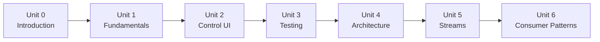
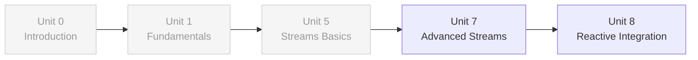
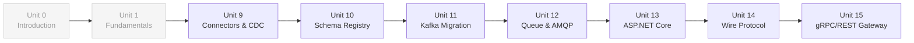
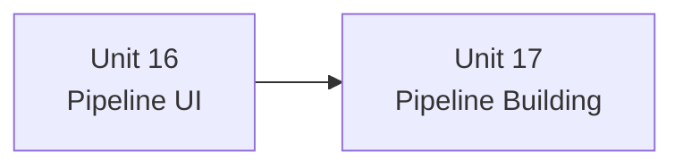
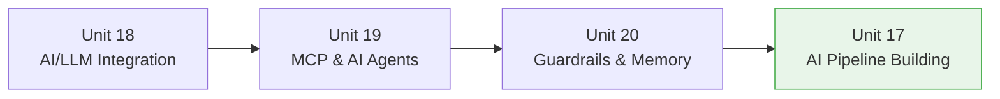
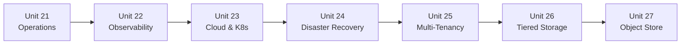
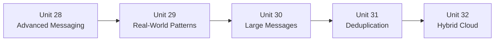
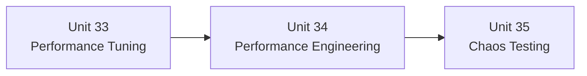

# Learning Paths

Choose a learning path based on your role and goals. Each path is designed to give you the skills you need while respecting your time. Paths can be combined freely.

## Path Overview

| Path | Target Audience | Duration | Units |
|------|-----------------|----------|-------|
| [Developer Fundamentals](#1-developer-fundamentals) | All developers (start here) | ~30 hours | 8 units |
| [Stream Processing](#2-stream-processing) | Data engineers, backend devs | ~16 hours | 3 units |
| [Data Integration](#3-data-integration) | Integration/platform engineers | ~28 hours | 7 units |
| [Pipelines & Workflows](#4-pipelines--workflows) | Low-code builders, process automation | ~10 hours | 2 units |
| [AI & Intelligent Systems](#5-ai--intelligent-systems) | AI/ML engineers, LLM developers | ~20 hours | 4 units |
| [Operations & Production](#6-operations--production) | DevOps, SREs, platform engineers | ~31 hours | 7 units |
| [Advanced Patterns](#7-advanced-patterns) | Senior developers, architects | ~28 hours | 6 units |
| [Performance & Resilience](#8-performance--resilience) | Performance engineers, SREs | ~15 hours | 3 units |

---

## 1. Developer Fundamentals

**For:** All developers — **start here** regardless of your path

**Focus:** Core concepts, produce/consume, UI basics, testing, architecture, Streams intro

### Units

| # | Unit | Topics | Key Skills |
|---|------|--------|------------|
| 1 | [Unit 0: Introduction](units/unit-0/README.md) | Setup, first connection, project structure | Environment setup |
| 2 | [Unit 1: Fundamentals](units/unit-1/README.md) | Producer, consumer, topics, partitions, batching | Core messaging |
| 3 | [Unit 2: Surgewave Control UI](units/unit-2/README.md) | Dashboard, navigation, topics, consumer groups, theme toggle, widgets | UI navigation |
| 4 | [Unit 3: Testing](units/unit-3/README.md) | Unit tests, integration tests, E2E, benchmarking | Quality assurance |
| 5 | [Unit 4: Architecture & Design](units/unit-4/README.md) | Topic design, partitioning, schema, CQRS, capacity | System design |
| 6 | [Unit 5: Stream Processing](units/unit-5/README.md) | Streams/Table, windows, joins, state stores | Real-time processing |
| 7 | [Unit 6: Advanced Consumer](units/unit-6/README.md) | Manual offset, seek, pause/resume, checkpointing | Consumer mastery |

### What You'll Learn

- Produce and consume messages with Surgewave's Native API
- Navigate the Surgewave Control UI (dashboard, topics, consumer groups)
- Write comprehensive tests for streaming applications
- Design event-driven architectures with proper partitioning
- Build real-time stream processing topologies
- Implement advanced consumer patterns

---

## 2. Stream Processing

**For:** Data engineers building real-time analytics and transformation pipelines

### Units

| # | Unit | Topics | Skip if |
|---|------|--------|---------|
| 1 | [Unit 0: Introduction](units/unit-0/README.md) | Setup, first connection | Already completed in Developer Fundamentals |
| 2 | [Unit 1: Fundamentals](units/unit-1/README.md) | Producer, consumer, topics, partitions | Already completed in Developer Fundamentals |
| 3 | [Unit 5: Stream Processing](units/unit-5/README.md) | Streams/Table, windows, joins, state stores | Already completed in Developer Fundamentals |
| 4 | [Unit 7: Advanced Streams](units/unit-7/README.md) | FK joins, lifecycle hooks, per-processor metrics, backpressure, retry | — |
| 5 | [Unit 8: Reactive Integration](units/unit-8/README.md) | IObservable, reactive operators, backpressure | — |

### What You'll Learn

- Foreign key table-table joins (`orders.Join(customers, o => o.CustomerId)`)
- Processor lifecycle hooks for resource management
- Per-processor OTEL metrics and state store instrumentation
- Backpressure with bounded buffers and flow control strategies
- Retry/backoff for transient failures in stream topologies
- Reactive stream integration with Rx.NET

---

## 3. Data Integration

**For:** Integration engineers connecting Surgewave to databases, APIs, and external systems

### Units

| # | Unit | Topics | Skip if |
|---|------|--------|---------|
| 1 | [Unit 0: Introduction](units/unit-0/README.md) | Setup, first connection | Already completed in Developer Fundamentals |
| 2 | [Unit 1: Fundamentals](units/unit-1/README.md) | Producer, consumer, topics, partitions | Already completed in Developer Fundamentals |
| 3 | [Unit 9: Data Integration](units/unit-9/README.md) | Connectors, CDC, source/sink patterns | — |
| 4 | [Unit 10: Schema Registry](units/unit-10/README.md) | JSON Schema, versioning, compatibility | — |
| 5 | [Unit 11: Kafka Migration](units/unit-11/README.md) | Compatibility, wrapper, hybrid, cutover | — |
| 6 | [Unit 12: Queue Semantics & AMQP](units/unit-12/README.md) | QueueView, AMQP adapter, visibility timeout, DLQ | — |
| 7 | [Unit 13: ASP.NET Core](units/unit-13/README.md) | Hosted services, DI, health checks, minimal APIs | — |
| 8 | [Unit 14: Wire Protocol](units/unit-14/README.md) | Kafka protocol internals, API keys, Surgewave native | — |
| 9 | [Unit 15: gRPC/REST Gateway](units/unit-15/README.md) | REST, gRPC, WebSocket, Confluent v3 compat | — |

---

## 4. Pipelines & Workflows

**For:** Low-code/visual builders, process automation engineers, pipeline designers

**Prerequisites:** Developer Fundamentals (basics), Surgewave Control UI (Unit 2)

### Units

| # | Unit | Topics | Key Skills |
|---|------|--------|------------|
| 1 | [Unit 16: Visual Pipeline UI](units/unit-16/README.md) | DAG editor, node palette, basic patterns | UI basics |
| 2 | [Unit 17: Pipeline & Workflow Building](units/unit-17/README.md) | Node types, workflow nodes (Loop, Gate, Accumulator, WaitForInput, MultiOutput, State), RAG/Agent pipeline building, Chat API, debugging, templates, versioning | Hands-on building |

### What You'll Learn

- Build visual data processing pipelines in the Surgewave Control UI
- Use all 6 workflow nodes for complex process automation
- Build RAG and Agent pipelines step-by-step
- Debug pipelines with breakpoints and live data preview
- Use Pipeline Chat API with SSE streaming
- Create and use pipeline templates

---

## 5. AI & Intelligent Systems

**For:** AI/ML engineers, LLM application developers

**Prerequisites:** Developer Fundamentals, Pipelines & Workflows recommended

### Units

| # | Unit | Topics | Key Skills |
|---|------|--------|------------|
| 1 | [Unit 18: AI/LLM Integration](units/unit-18/README.md) | OpenAI, Ollama, Qdrant, RAG, semantic search | LLM fundamentals |
| 2 | [Unit 19: MCP & AI Agents](units/unit-19/README.md) | MCP protocol, Surgewave MCP setup, Claude/VS Code, agent patterns | Agent development |
| 3 | [Unit 20: AI Guardrails & Memory](units/unit-20/README.md) | PII detection, toxicity filter, prompt injection, agent memory, tool caching | AI safety & state |
| 4 | [Unit 17: Pipeline Building](units/unit-17/README.md) | RAG pipeline (Lesson 17.4), Agent pipeline (Lesson 17.5) — AI-specific sections | AI pipeline building |

### What You'll Learn

- Integrate OpenAI, Anthropic, Ollama, and other LLM providers
- Build RAG pipelines with document parsing, embeddings, and retrieval
- Set up MCP servers and develop custom AI tools
- Secure AI applications with PII redaction, toxicity filtering, prompt injection defense
- Implement agent memory across sessions and tool result caching
- Build complete AI pipelines visually in the Pipeline Editor

---

## 6. Operations & Production

**For:** DevOps, SREs, platform engineers, system administrators

**Prerequisites:** Developer Fundamentals (Units 0-1 minimum)

### Units

| # | Unit | Topics | Key Skills |
|---|------|--------|------------|
| 1 | [Unit 21: Production Operations](units/unit-21/README.md) | Clustering, replication, security, tuning | Cluster management |
| 2 | [Unit 22: Observability](units/unit-22/README.md) | Logging, metrics, tracing, profiling | Monitoring setup |
| 3 | [Unit 23: Cloud & K8s](units/unit-23/README.md) | Docker, docker-compose, Kubernetes, Helm | Container deployment |
| 4 | [Unit 24: Disaster Recovery](units/unit-24/README.md) | Backup, MirrorMaker, failover, DR testing | Business continuity |
| 5 | [Unit 25: Multi-Tenancy](units/unit-25/README.md) | Isolation, namespacing, quotas, ACLs | Shared platforms |
| 6 | [Unit 26: Tiered Storage](units/unit-26/README.md) | Hot/warm/cold tiers, S3, Azure, lifecycle policies | Storage optimization |
| 7 | [Unit 27: Object Store & Zero-Disk](units/unit-27/README.md) | S3-Direct, Azure Blob, GCP, alternative storage engines | Cloud-native storage |

### What You'll Learn

- Deploy and manage Surgewave clusters in production
- Set up monitoring with dashboards, alerts, and performance advisor
- Deploy to Kubernetes with Helm charts
- Implement disaster recovery and multi-region failover
- Build multi-tenant streaming platforms
- Optimize storage costs with tiered and object store strategies

---

## 7. Advanced Patterns

**For:** Senior developers, architects, technical leads

**Prerequisites:** Developer Fundamentals

### Units

| # | Unit | Topics | Key Skills |
|---|------|--------|------------|
| 1 | [Unit 28: Advanced Messaging](units/unit-28/README.md) | Serialization, headers, DLQ, transactions, ephemeral topics | Reliability patterns |
| 2 | [Unit 29: Real-World Patterns](units/unit-29/README.md) | E-commerce, IoT, logs, event sourcing, microservices | Architecture patterns |
| 3 | [Unit 30: Large Message Handling](units/unit-30/README.md) | Compression, chunking, claim-check, streaming | Data optimization |
| 4 | [Unit 31: Message Deduplication](units/unit-31/README.md) | Idempotency, bloom filters, exactly-once | Data integrity |
| 5 | [Unit 32: Hybrid Cloud](units/unit-32/README.md) | Multi-region, cross-cloud, geo-routing, on-prem | Distributed systems |

---

## 8. Performance & Resilience

**For:** Performance engineers, SREs, reliability engineers

**Prerequisites:** Developer Fundamentals, Operations recommended

### Units

| # | Unit | Topics | Key Skills |
|---|------|--------|------------|
| 1 | [Unit 33: Performance & Tuning](units/unit-33/README.md) | Throughput/latency tuning, P50/P99, producer/consumer optimization | Basic tuning |
| 2 | [Unit 34: Performance Engineering](units/unit-34/README.md) | Zero-allocation, SIMD, memory pooling, regression suite, BenchmarkDotNet | Deep optimization |
| 3 | [Unit 35: Chaos Testing](units/unit-35/README.md) | ChaosEngine, fault injection, network partitions, broker crashes, disk errors | Resilience testing |

### What You'll Learn

- Tune producer and consumer for maximum throughput and minimum latency
- Apply zero-allocation patterns, SIMD, and memory pooling
- Use the Performance Regression Suite for CI benchmark checks
- Test resilience with ChaosEngine fault injection
- Simulate network partitions, broker crashes, and disk failures

---

## Combining Paths

| Goal | Recommended Combination |
|------|------------------------|
| Full-Stack Developer + DevOps | Fundamentals → Operations (Units 21, 22, 23) |
| Data Engineer | Fundamentals → Stream Processing → Data Integration |
| AI Application Developer | Fundamentals → Pipelines & Workflows → AI & Intelligent Systems |
| Platform Architect | Fundamentals → Advanced Patterns → Operations |
| Comprehensive Coverage | All 36 units in path order |

---

## Capstone Project

After completing your learning path(s), apply everything in the [Capstone Project](capstone/README.md):

**SurgewaveMart** — Build a complete real-time e-commerce platform with:
- Order processing with exactly-once semantics
- Real-time inventory management with Streams
- Analytics dashboard
- REST API gateway
- Full observability stack

[Start the Capstone Project →](capstone/README.md)
