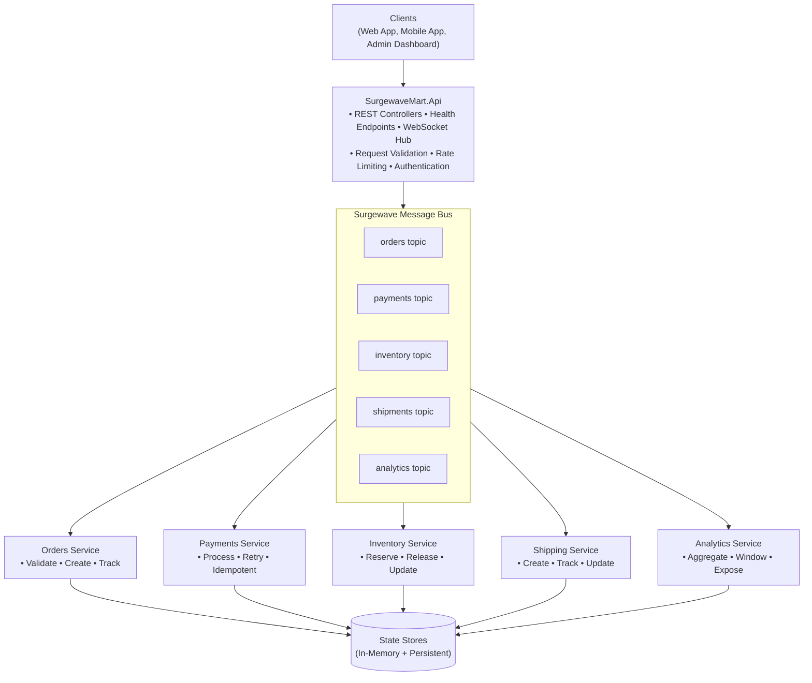
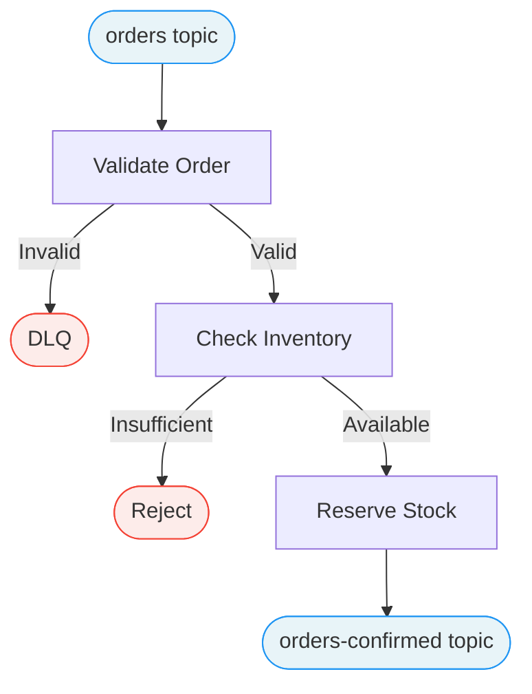
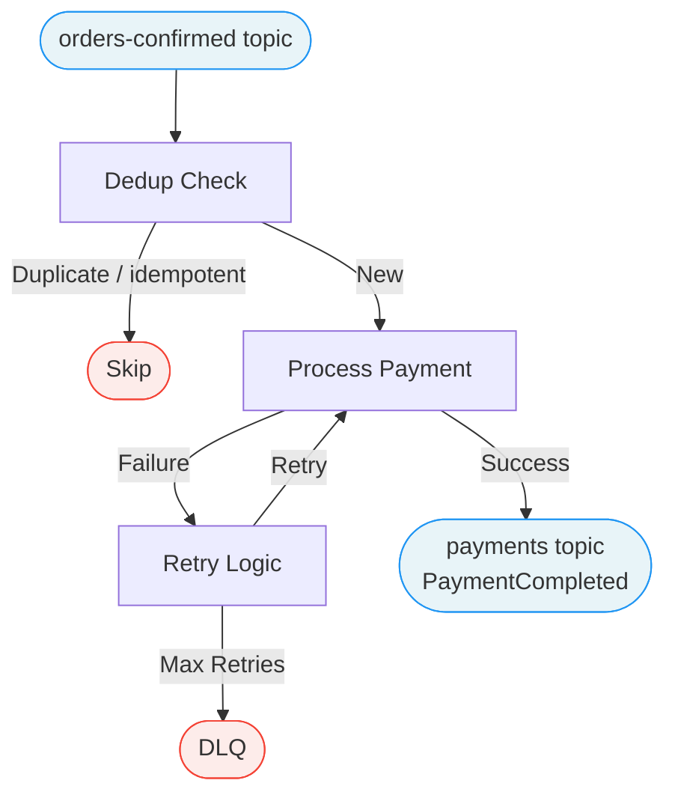
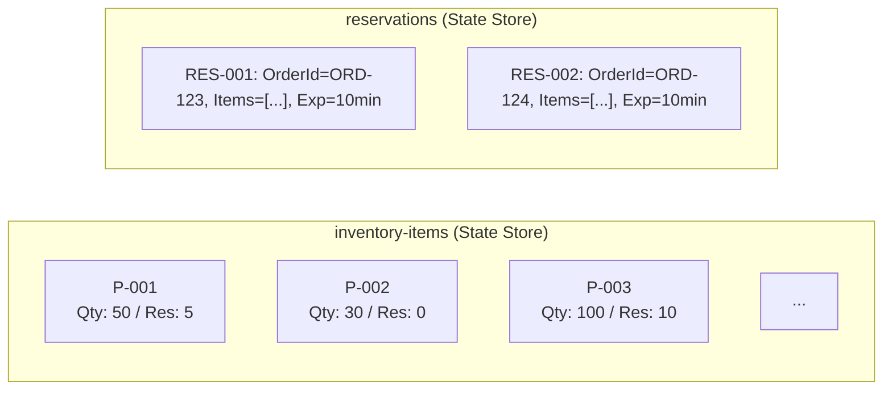
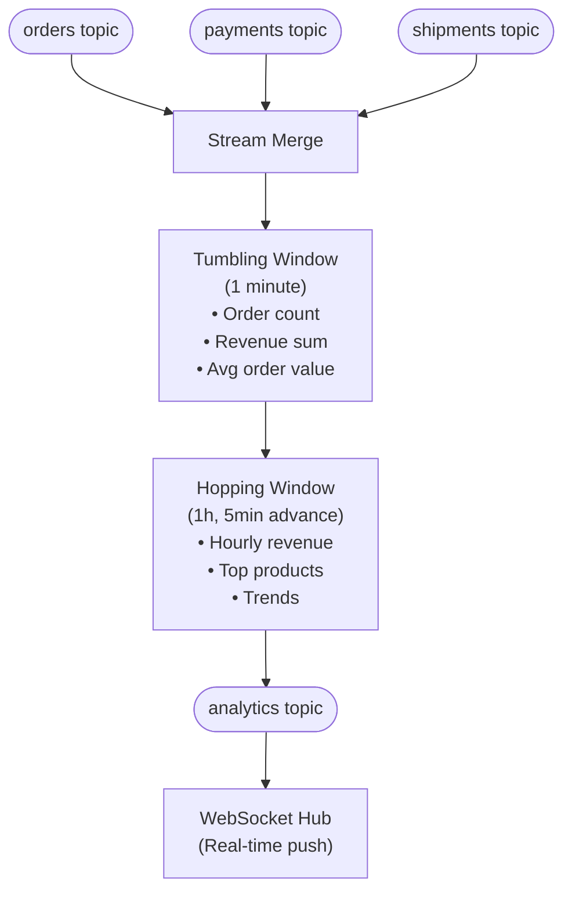
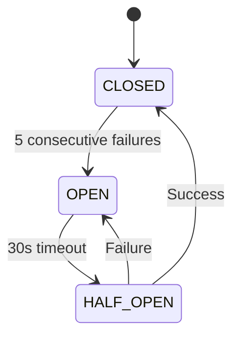
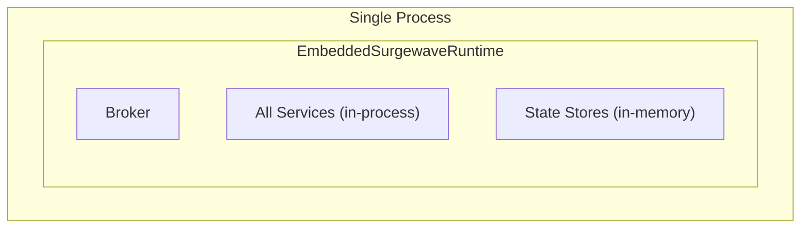
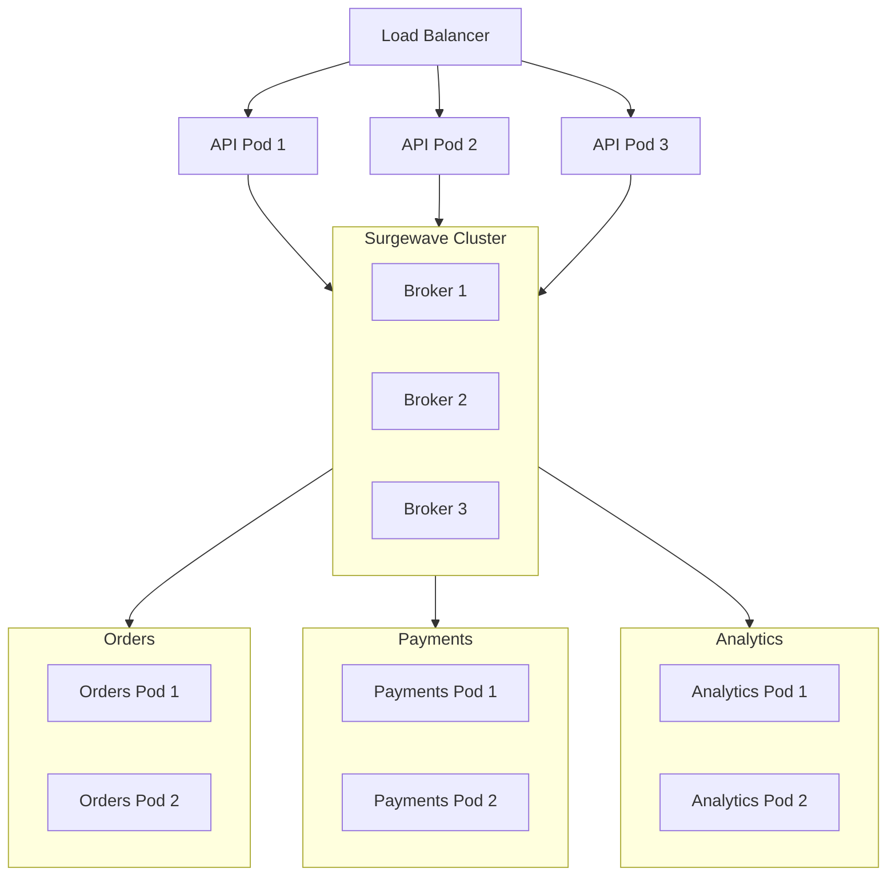

# SurgewaveMart Architecture

System architecture and design decisions for the capstone project.

## System Overview



## Component Details

### SurgewaveMart.Api

The API Gateway handles all external HTTP traffic.

```csharp
// Key responsibilities
public class ApiGateway
{
    // 1. Accept incoming requests
    // 2. Validate input
    // 3. Produce to Surgewave topics
    // 4. Query state stores for reads
    // 5. Return responses
}
```

**Controllers:**

| Controller | Endpoints | Purpose |
|------------|-----------|---------|
| `OrdersController` | POST/GET /orders | Order management |
| `InventoryController` | GET /inventory | Stock queries |
| `ShipmentsController` | GET /shipments | Tracking info |
| `AnalyticsController` | GET /analytics | Metrics & stats |
| `HealthController` | GET /health | Health checks |

### SurgewaveMart.Orders

Handles order lifecycle management.



**State Store:** `order-states`
- Key: OrderId
- Value: Order + Status + History

### SurgewaveMart.Payments

Processes payments with exactly-once semantics.



**Retry Policy:**
- Max retries: 3
- Backoff: Exponential (1s, 2s, 4s)
- DLQ on exhaustion

**State Store:** `processed-payments`
- Key: OrderId (idempotency key)
- Value: PaymentResult

### SurgewaveMart.Inventory

Manages stock levels and reservations.



**Operations:**
- `Reserve(orderId, items)` - Reserve stock for order
- `Release(orderId)` - Release reservation (cancel/timeout)
- `Commit(orderId)` - Convert reservation to sale
- `Query(productId)` - Get current availability

### SurgewaveMart.Analytics

Real-time metrics aggregation using windowed processing.



## Data Flow

### Happy Path: Order to Delivery

```
Timeline ──────────────────────────────────────────────────────────►

T0: Client POST /api/orders
    │
    ▼
T1: API produces to 'orders' topic
    │
    ▼
T2: OrderService consumes, validates
    ├── Check inventory (state store query)
    ├── Reserve stock
    └── Produce to 'orders-confirmed'
    │
    ▼
T3: PaymentService consumes 'orders-confirmed'
    ├── Dedup check
    ├── Process payment (simulated)
    └── Produce PaymentCompleted to 'payments'
    │
    ▼
T4: ShippingService consumes 'payments'
    ├── Create shipment
    ├── Generate tracking number
    └── Produce to 'shipments'
    │
    ▼
T5: InventoryService commits reservation
    │
    ▼
T6: AnalyticsService aggregates all events
    └── Push to WebSocket clients
```

### Error Path: Payment Failure

```
T0: PaymentService receives order
    │
    ▼
T1: Payment attempt fails
    │
    ▼
T2: Retry 1 (after 1s backoff)
    │
    ▼
T3: Retry 2 (after 2s backoff)
    │
    ▼
T4: Retry 3 (after 4s backoff)
    │
    ▼
T5: Max retries exceeded
    ├── Produce to DLQ with error details
    ├── Produce OrderCancelled event
    └── Trigger inventory release
```

## State Management

### State Store Strategy

| Store | Type | Persistence | Purpose |
|-------|------|-------------|---------|
| `order-states` | KeyValue | Yes | Order tracking |
| `processed-payments` | KeyValue | Yes | Idempotency |
| `inventory-items` | KeyValue | Yes | Stock levels |
| `reservations` | KeyValue | Yes (TTL) | Temp holds |
| `analytics-windows` | Windowed | No | Aggregations |

### Consistency Model

```csharp
// Exactly-once for payments
await using var transaction = await streams.BeginTransactionAsync();
try
{
    // 1. Read from input topic
    // 2. Process
    // 3. Write to state store
    // 4. Write to output topic
    await transaction.CommitAsync();
}
catch
{
    await transaction.AbortAsync();
    throw;
}
```

## Error Handling

### Dead Letter Queue

All services use the same DLQ pattern:

```csharp
public record DeadLetterMessage(
    string OriginalTopic,
    string Key,
    string Value,
    string Error,
    int RetryCount,
    DateTime FailedAt,
    Dictionary<string, string> Headers
);
```

### Circuit Breaker

For external service calls (payment provider):



## Observability

### Logging Strategy

```json
{
  "timestamp": "2024-01-15T10:30:00Z",
  "level": "INFO",
  "service": "SurgewaveMart.Orders",
  "correlationId": "abc-123",
  "orderId": "ORD-001",
  "event": "OrderValidated",
  "duration_ms": 15,
  "partition": 2
}
```

### Metrics

| Metric | Type | Labels |
|--------|------|--------|
| `orders_total` | Counter | status |
| `order_processing_duration` | Histogram | step |
| `payments_total` | Counter | status, method |
| `inventory_level` | Gauge | product_id |
| `consumer_lag` | Gauge | topic, partition |

### Health Checks

```csharp
// Composite health check
public class SurgewaveMartHealthCheck : IHealthCheck
{
    public async Task<HealthCheckResult> CheckHealthAsync(...)
    {
        var broker = await CheckBrokerConnection();
        var stateStore = await CheckStateStores();
        var consumers = await CheckConsumerLag();

        return AllHealthy(broker, stateStore, consumers)
            ? HealthCheckResult.Healthy()
            : HealthCheckResult.Degraded();
    }
}
```

## Deployment Architecture

### Single Node (Development)



### Multi-Node (Production)



## Configuration

### Environment Variables

```bash
# Surgewave Connection
Surgewave_BOOTSTRAP_SERVERS=localhost:9092
Surgewave_CLIENT_ID=surgewavemart

# Service Configuration
ORDERS_CONSUMER_GROUP=orders-service
PAYMENTS_CONSUMER_GROUP=payments-service
PAYMENTS_MAX_RETRIES=3
PAYMENTS_RETRY_BACKOFF_MS=1000

# Observability
LOG_LEVEL=Information
METRICS_ENABLED=true
TRACING_ENDPOINT=http://jaeger:14268
```

### appsettings.json Structure

```json
{
  "Surgewave": {
    "BootstrapServers": "localhost:9092",
    "ClientId": "surgewavemart"
  },
  "Services": {
    "Orders": {
      "ConsumerGroup": "orders-service",
      "Topic": "orders"
    },
    "Payments": {
      "ConsumerGroup": "payments-service",
      "MaxRetries": 3,
      "RetryBackoffMs": 1000
    }
  },
  "Observability": {
    "Logging": {
      "Format": "json",
      "Level": "Information"
    }
  }
}
```

## Testing Strategy

### Unit Tests

- Business logic isolation
- Mock Surgewave client
- State store behavior

### Integration Tests

```csharp
public class OrderProcessingTests : IAsyncLifetime
{
    private EmbeddedSurgewaveRuntime _runtime;

    public async Task InitializeAsync()
    {
        _runtime = new EmbeddedSurgewaveRuntime();
        await _runtime.StartAsync();
    }

    [Fact]
    public async Task Order_HappyPath_ProcessesSuccessfully()
    {
        // Arrange
        var client = _runtime.CreateClient();

        // Act
        await client.Messaging.Send("orders")
            .WithKey("ORD-001")
            .WithBody(orderJson)
            .ExecuteAsync();

        // Assert
        var result = await WaitForMessage("orders-confirmed");
        Assert.Equal("ORD-001", result.Key);
    }
}
```

### End-to-End Tests

- Full flow validation
- Performance benchmarks
- Chaos testing (failure injection)

## Security Considerations

### Authentication

- API: JWT Bearer tokens
- Inter-service: mTLS (production)

### Authorization

- Role-based access control
- Tenant isolation for multi-tenant mode

### Data Protection

- Encrypt sensitive fields (payment data)
- Audit logging for compliance

---

**Next Steps:** Review this architecture and proceed to implementation using the project structure in `start/`.
