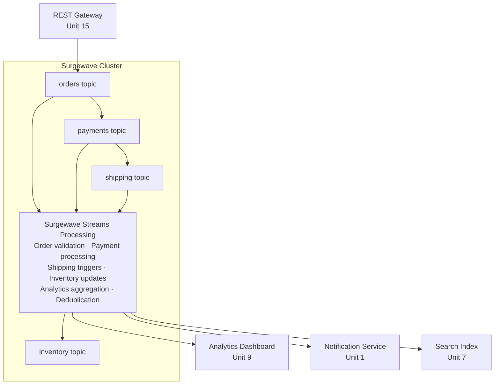

# Capstone Project: SurgewaveMart

Build a complete real-time e-commerce platform using everything you've learned in the Surgewave Bootcamp.

## Overview

SurgewaveMart is a modern e-commerce backend that processes orders in real-time, manages inventory, provides analytics, and exposes a REST API. This project combines skills from multiple units into a production-ready system.



## Features

### Core Features

| Feature | Description | Skills Used |
|---------|-------------|-------------|
| Order Processing | Accept and validate orders | Unit 1, 28 |
| Payment Processing | Handle payments with transactions | Unit 28, 31 |
| Inventory Management | Real-time stock tracking | Unit 5 |
| Shipping Orchestration | Coordinate delivery | Unit 7 |
| Analytics Dashboard | Real-time metrics | Unit 5, 9 |
| REST API | HTTP endpoints | Unit 13, 15 |
| Observability | Logging, metrics, tracing | Unit 22 |

### Technical Requirements

- [ ] **Exactly-Once Processing** - No duplicate orders
- [ ] **Real-Time Analytics** - Sub-second dashboard updates
- [ ] **Schema Evolution** - Backward-compatible event schemas
- [ ] **Graceful Degradation** - Handle component failures
- [ ] **Multi-Tenant Ready** - Tenant isolation support
- [ ] **Horizontal Scalability** - Multiple consumer instances

## Project Structure

```
capstone/
├── README.md                 # This file
├── REQUIREMENTS.md           # Detailed requirements
├── ARCHITECTURE.md           # System architecture
├── start/
│   ├── SurgewaveMart.sln
│   ├── SurgewaveMart.Api/        # REST API project
│   ├── SurgewaveMart.Orders/     # Order processing
│   ├── SurgewaveMart.Payments/   # Payment service
│   ├── SurgewaveMart.Inventory/  # Inventory management
│   ├── SurgewaveMart.Analytics/  # Analytics aggregation
│   └── SurgewaveMart.Shared/     # Shared types
└── completed/
    └── (Full implementation)
```

## Getting Started

### Prerequisites

- Completed Units 1, 5, 7, 9, 13, 15, 22 (or equivalent knowledge)
- .NET 10 SDK
- Docker (optional, for multi-broker testing)

### Quick Start

```bash
# Navigate to the capstone project
cd bootcamp/capstone/start

# Build the solution
dotnet build SurgewaveMart.sln

# Start the API (includes embedded broker)
dotnet run --project SurgewaveMart.Api

# In another terminal, run the demo
curl -X POST http://localhost:5000/api/orders \
  -H "Content-Type: application/json" \
  -d '{"customerId": "C-001", "items": [{"productId": "P-001", "quantity": 2}]}'
```

## Evaluation Rubric

| Category | Criteria | Points |
|----------|----------|--------|
| **Functionality** | All features work correctly | 30 |
| **Architecture** | Clean separation of concerns | 20 |
| **Reliability** | Error handling, retries, DLQ | 15 |
| **Performance** | Efficient processing, batching | 15 |
| **Observability** | Logging, metrics, health checks | 10 |
| **Code Quality** | Clean code, tests, documentation | 10 |
| **Total** | | **100** |

### Grading Scale

| Score | Grade | Description |
|-------|-------|-------------|
| 90-100 | A | Excellent - Production ready |
| 80-89 | B | Good - Minor improvements needed |
| 70-79 | C | Satisfactory - Core features work |
| 60-69 | D | Needs work - Major issues |
| <60 | F | Incomplete |

## Timeline Suggestion

| Week | Focus | Deliverables |
|------|-------|--------------|
| 1 | Setup & Orders | Project structure, order processing |
| 2 | Payments & Inventory | Transaction handling, stock updates |
| 3 | Analytics & API | Stream processing, REST endpoints |
| 4 | Polish & Testing | Error handling, tests, documentation |

## Resources

- [Surgewave Documentation](https://github.com/Kuestenlogik/Surgewave/blob/main/docs/)
- [Unit 1: Fundamentals](../units/unit-1/README.md)
- [Unit 5: Stream Processing](../units/unit-5/README.md)
- [Unit 9: Data Integration](../units/unit-9/README.md)
- [Unit 13: ASP.NET Core](../units/unit-13/README.md)

## Need Help?

1. Review the relevant unit lessons
2. Check [REQUIREMENTS.md](REQUIREMENTS.md) for detailed specs
3. Reference [ARCHITECTURE.md](ARCHITECTURE.md) for design guidance
4. Compare with `completed/` for hints (but try first!)

---

**Good luck! Build something amazing.**
