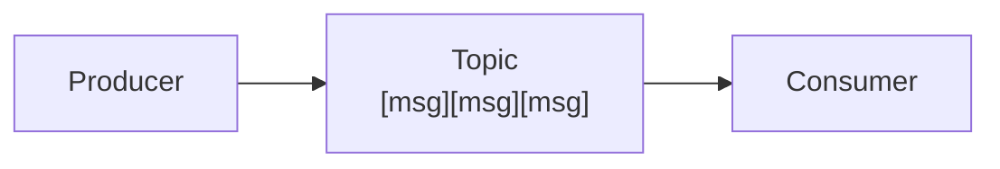

# Lesson 0.1: What is Surgewave?

> **Difficulty:** Beginner | **Duration:** 15 min | **Prerequisites:** None

## Overview

Surgewave is a high-performance message streaming platform for .NET. It's designed as a drop-in replacement for Apache Kafka, offering the same powerful capabilities with a simpler setup and native .NET performance.

## What is Message Streaming?

Message streaming is a pattern for building distributed systems where:

1. **Producers** send messages to named channels called **topics**
2. **Consumers** read messages from topics
3. Messages are **persisted** and can be replayed
4. Multiple consumers can read the same messages independently

### Why Use Message Streaming?

| Problem | How Streaming Helps |
|---------|---------------------|
| **Tight coupling** | Services communicate via messages, not direct calls |
| **Data loss** | Messages persist until explicitly deleted |
| **Scaling bottlenecks** | Consumers scale independently |
| **System recovery** | Replay messages after failures |
| **Real-time needs** | Process events as they happen |

## Why Surgewave?

### The Kafka Problem

Apache Kafka is powerful but comes with challenges:

- **Complex setup**: ZooKeeper/KRaft, JVM tuning, broker configuration
- **Operational overhead**: Managing a Java ecosystem in .NET shops
- **Resource heavy**: Significant memory and CPU requirements
- **Learning curve**: Steep for teams new to the ecosystem

### The Surgewave Solution

Surgewave provides Kafka-compatible functionality with:

| Feature | Benefit |
|---------|---------|
| **Native .NET** | Single binary, no JVM required |
| **Embedded mode** | Run the broker inside your app |
| **Zero config** | Sensible defaults, start in one line |
| **Kafka protocol** | Use existing Kafka tools and libraries |
| **High performance** | Optimized for modern .NET |

## Surgewave vs Alternatives

| Feature | Surgewave | Kafka | RabbitMQ | Redis Streams |
|---------|-------|-------|----------|---------------|
| Protocol | SRWV + Kafka | Kafka | AMQP | Redis |
| Runtime | .NET | JVM | Erlang | C |
| Embedded mode | Yes | No | No | No |
| Persistence | Optional | Mandatory | Optional | Mandatory |
| Partitioning | Yes | Yes | No | Yes |
| Consumer groups | Yes | Yes | Yes | Yes |
| Setup complexity | Low | High | Medium | Low |

## When to Use Surgewave

### Good Fit

- **Microservices** communicating asynchronously
- **Event sourcing** and CQRS patterns
- **Log aggregation** and metrics collection
- **Real-time data pipelines** and AI integrations
- **Development and testing** with an embedded broker
- **.NET shops** wanting to avoid JVM operations

### Consider Alternatives When

- You need Kafka's full ecosystem (Kafka Connect, ksqlDB)
- You're already invested in Kafka operations and need no performance boost
- You need multi-datacenter replication
- You need backtrack for data flows backed in your application

## What You'll Learn in this Bootcamp

### Unit 1: Fundamentals
Build your first Surgewave application - producers, consumers, topics, and partitions.

### Unit 2: Testing Surgewave
Master testing patterns - unit tests, mocks, integration tests, and benchmarks.

### Unit 3: Advanced Messaging
Sophisticated patterns - serialization, headers, error handling, transactions.

### Unit 4: Production Operations
Deploy and operate Surgewave - clustering, replication, monitoring, security.

### Unit 5: Kafka Migration
Migrate from Kafka to Surgewave with minimal code changes.

## Key Takeaways

1. **Surgewave is Kafka-compatible** - Use familiar concepts and tools
2. **Surgewave is .NET-native** - No JVM, simple deployment
3. **Surgewave can embed** - Run broker directly inside your app for testing and simple deployment
4. **Surgewave is fast** - Optimized for throughput and latency

## Next Steps

You're ready to start building! In the next unit, you'll:

- Set up your development environment
- Create your first Surgewave producer
- Send and receive messages
- Learn about topics and partitions

---

**Next:** → [Unit 1: Surgewave Fundamentals](../../unit-1/README.md)
