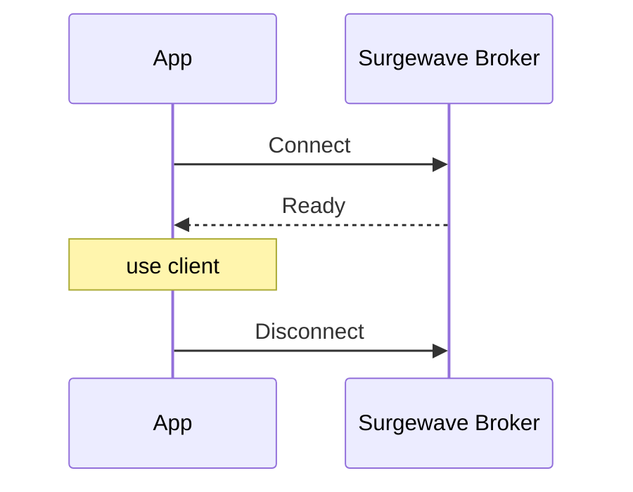

# Lesson 0.3: Hello Surgewave

> **Difficulty:** Beginner | **Duration:** 30 min | **Prerequisites:** Lesson 0.2

Welcome to your first Surgewave lesson! In this lesson, you'll set up your development environment and connect to a Surgewave broker.

## Learning Objectives

After completing this lesson, you will be able to:

- [ ] Start a Surgewave broker
- [ ] Create a Surgewave client connection
- [ ] Verify the connection is working
- [ ] Understand the client lifecycle

## Prerequisites

- .NET 10 SDK installed (`dotnet --version` should show 10.x)
- Surgewave repository cloned
- A terminal/command prompt

## Duration

~20 minutes

## What You'll Build

A simple console application that:
1. Starts an embedded Surgewave broker
2. Connects to the broker
3. Verifies the connection
4. Lists available topics
5. Shuts down gracefully

## Key Concepts

### The Surgewave Broker

The Surgewave broker is the server that:
- Stores messages in topics
- Handles producer/consumer connections
- Manages partitions and replication

You can run Surgewave in two modes:
- **Standalone**: Run `dotnet run --project src/Kuestenlogik.Surgewave.Broker`
- **Embedded**: Start the broker within your application (what we'll do)

### The Surgewave Client

The client is how your application interacts with Surgewave:

```csharp
await using var client = new SurgewaveClientBuilder()
    .WithBootstrapServers("localhost:9092")
    .Build();
```

Key points:
- Uses `await using` for proper disposal
- Connects to one or more bootstrap servers
- Provides access to messaging, topics, groups, etc.

### Connection Lifecycle



## Exercise

### Step 1: Navigate to the Start Folder

```bash
cd bootcamp/unit-1/lesson-1/start
```

### Step 2: Open the Project

Open `Program.cs` in your editor. You'll see placeholder code with `// TODO` comments.

### Step 3: Follow the Instructions

Open [INSTRUCTIONS.md](INSTRUCTIONS.md) for detailed step-by-step guidance.

### Step 4: Run Your Solution

```bash
dotnet run
```

### Expected Output

```
=== Surgewave Bootcamp: Lesson 1.1 - Hello Surgewave ===

Starting embedded Surgewave broker...
Broker started on localhost:9092

Connecting to Surgewave...
Connected successfully!

Available topics:
  (no topics yet - we'll create some in the next lesson)

Shutting down...
Goodbye!
```

## Checkpoints

Verify your solution:

- [ ] Broker starts without errors
- [ ] Client connects successfully
- [ ] Topics list is retrieved (empty is OK)
- [ ] Clean shutdown with no exceptions

## Troubleshooting

### "Port 9092 already in use"

Another process is using the port. Either:
- Stop the other process
- Use a different port in the config

### "Connection refused"

The broker isn't running. Ensure you start the embedded broker before creating the client.

### Build errors

Make sure you're in the `start/` directory and run:
```bash
dotnet restore
dotnet build
```

## Summary

In this lesson, you learned:

- How to start an embedded Surgewave broker
- How to create a Surgewave client connection
- The importance of proper resource disposal
- How to list topics from the broker

## Next Steps

Continue to [Lesson 1.2: Producing Messages](../lesson-2/README.md) to send your first messages!

---

**Stuck?** Check the [completed/](completed/README.md) solution for reference.
