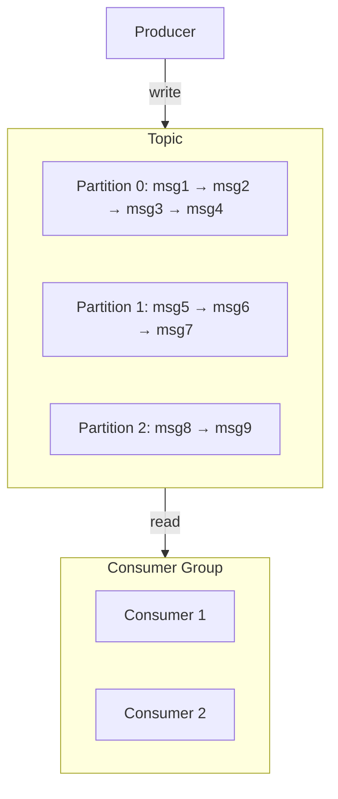

# Unit 1: Surgewave Fundamentals

Welcome to Unit 1! In this unit, you'll learn the core concepts of message streaming with Surgewave.

## Learning Objectives

By the end of this unit, you will be able to:

- Produce messages to topics
- Consume messages from topics
- Understand partitioning and its benefits
- Work with consumer groups for scalability
- Apply batching for optimal throughput
- Follow messaging best practices (events vs commands)

## Lessons

| Lesson | Topic | Duration | Description |
|--------|-------|----------|-------------|
| [1.1](lesson-1/README.md) | Producing Messages | 25 min | Send messages to topics |
| [1.2](lesson-2/README.md) | Consuming Messages | 25 min | Receive and process messages |
| [1.3](lesson-3/README.md) | Topics & Partitions | 30 min | Understand partitioning |
| [1.4](lesson-4/README.md) | Consumer Groups | 30 min | Coordinate multiple consumers |
| [1.5](lesson-5/README.md) | Batching & Message Sizing | 25 min | Optimize throughput with batching |
| [1.6](lesson-6/README.md) | Message Best Practices | 30 min | Events vs commands, immutability |

## Prerequisites

- .NET 10 SDK installed
- Basic C# knowledge
- Code editor of your choice

## Key Concepts You'll Learn

### Messages
The fundamental unit of data in Surgewave. Each message has:
- **Key**: Optional identifier for routing
- **Value**: The actual data payload
- **Headers**: Optional metadata
- **Timestamp**: When the message was created

### Topics
Named channels for organizing messages. Think of them as:
- A category or feed of messages
- An append-only log
- A way to separate different data streams

### Partitions
Subdivisions of topics for parallelism:
- Enable horizontal scaling
- Guarantee ordering within partition
- Allow multiple consumers to work in parallel

### Consumer Groups
Coordinate consumers for scalability:
- Each partition consumed by one group member
- Automatic rebalancing when members join/leave
- Enable parallel processing of messages

## Architecture Preview



## Getting Started

Start with Lesson 1.1 to learn about producing messages:

```bash
cd bootcamp/unit-1/lesson-1
cat README.md
```

---

**Ready?** → [Start Lesson 1.1: Producing Messages](lesson-1/README.md)
