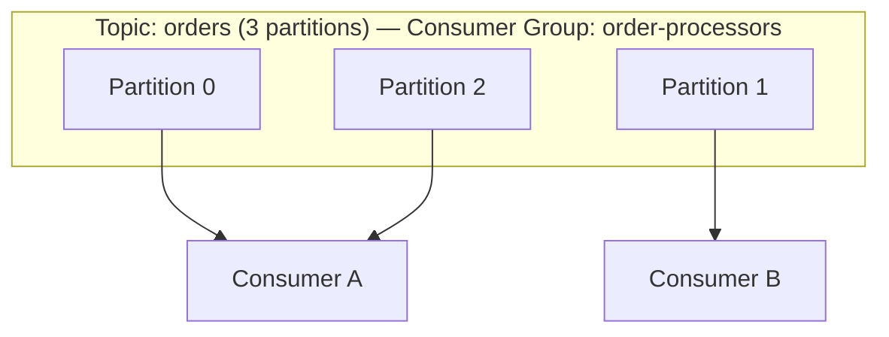

# Lesson 1.3: Consumer Groups

> **Difficulty:** Beginner | **Duration:** 30 min | **Prerequisites:** Lesson 1.2

## Overview

In this lesson, you'll learn how consumer groups enable coordinated consumption across multiple consumer instances. Consumer groups are fundamental to building scalable, fault-tolerant message processing systems.

## Learning Objectives

By the end of this lesson, you will:

1. Understand what consumer groups are and why they matter
2. Configure a consumer with a group ID
3. Understand partition assignment and rebalancing
4. Commit offsets for reliable processing

## Key Concepts

### What is a Consumer Group?

A consumer group is a set of consumers that work together to consume a topic:

- Each partition is consumed by exactly one consumer in the group
- Partitions are automatically distributed among consumers
- If a consumer fails, its partitions are reassigned to others



### Configuring a Consumer Group

```csharp
await using var consumer = new SurgewaveConsumer<string, string>(options =>
{
    options.BootstrapServers = "localhost:9092";
    options.GroupId = "my-consumer-group";  // Required for consumer groups
    options.AutoOffsetReset = AutoOffsetReset.Earliest;
});

// Use SubscribeAsync to join the group and get partition assignment
await consumer.SubscribeAsync(cancellationToken, "orders");
```

### Offset Commits

Consumer groups track their progress by committing offsets:

- **Auto-commit**: Offsets committed periodically (default)
- **Manual commit**: You control when offsets are committed

```csharp
// Enable auto-commit (default)
options.EnableAutoCommit = true;
options.AutoCommitIntervalMs = 5000;

// Or disable and commit manually
options.EnableAutoCommit = false;
// ... process message ...
await consumer.CommitAsync(result);
```

### Rebalancing Events

When consumers join or leave, partitions are redistributed:

```csharp
consumer.PartitionsAssigned += (sender, args) =>
{
    Console.WriteLine($"Assigned: {string.Join(", ", args.Partitions)}");
};

consumer.PartitionsRevoked += (sender, args) =>
{
    Console.WriteLine($"Revoked: {string.Join(", ", args.Partitions)}");
};
```

## Prerequisites

- Completed Lesson 1.3 (Consuming Messages)

## Getting Started

1. Navigate to the `start` folder
2. Open `Program.cs` and follow the TODO comments
3. Reference `INSTRUCTIONS.md` for detailed guidance

## Verification

Run the completed lesson:

```bash
cd completed
dotnet run
```

Expected output:
```
=== Surgewave Bootcamp: Lesson 1.4 - Consumer Groups ===

Starting embedded Surgewave broker...
Broker started on localhost:9092

Producing messages to 'orders' topic...
  Produced 10 orders

Creating consumer with group 'order-processors'...
Joining consumer group...
Partitions assigned: [(orders, 0)]
Consumer ready!

Processing orders...
  Order 0: Processing order ORD-0 for $10.00
  Order 1: Processing order ORD-1 for $20.00
  ...
  Order 9: Processing order ORD-9 for $100.00

Committing offsets...
Offsets committed successfully!

Processed 10 orders

Shutting down...
Goodbye!
```

## Next Steps

Continue to [Lesson 1.5: Partitioning](../lesson-5/README.md) to learn how partitions enable parallel processing!
