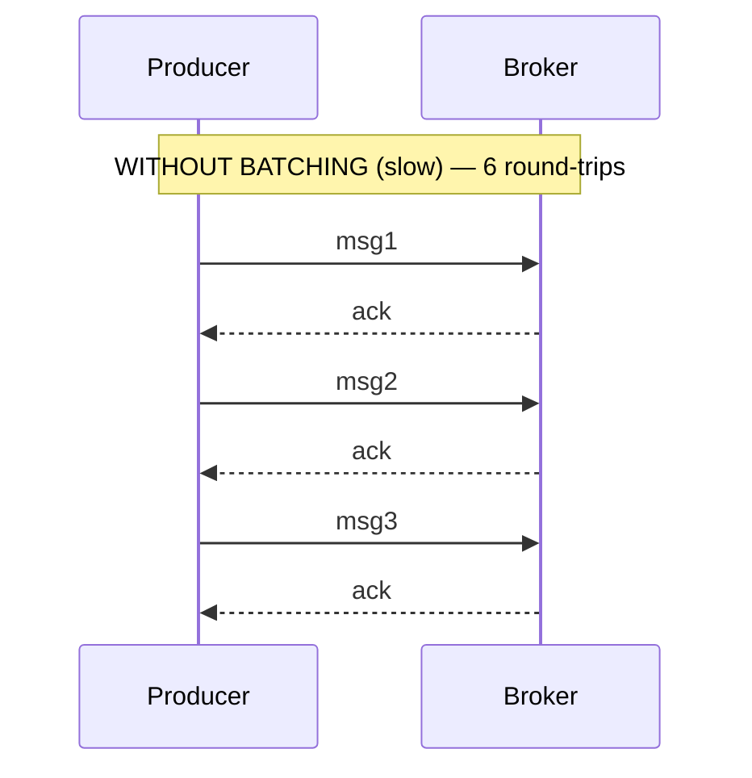
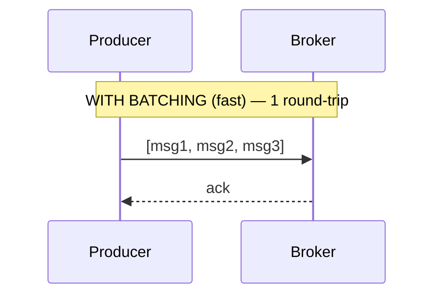

# Lesson 1.5: Batching & Message Sizing

> **Difficulty:** Beginner | **Duration:** 30 min | **Prerequisites:** Lesson 1.4

## Overview

In this lesson, you'll learn how batching and message sizing dramatically impact throughput performance. Proper batching configuration can multiply your throughput by 10x or more while reducing network overhead.

## Learning Objectives

By the end of this lesson, you will:

1. Understand why batching matters for performance
2. Configure producer batching settings
3. Choose optimal message sizes
4. Decide when to flush vs let batches fill
5. Measure throughput impact
6. Configure consumer batch fetching

## Key Concepts

### Why Batching Matters

Without batching, each message requires a separate network round-trip:





### Batching Configuration

Surgewave producers support batching settings:

```csharp
await using var producer = new SurgewaveProducer<string, string>(options =>
{
    options.BootstrapServers = "localhost:9092";

    // Batch size in messages (default: 100)
    // Larger = better throughput, higher latency
    options.BatchSize = 100;  // Batch up to 100 messages

    // Time to wait for batch to fill (default: 5ms)
    // Higher = better batching, higher latency
    options.LingerMs = 5;  // Wait up to 5ms
});
```

### Message Sizing Guidelines

| Zone | Size | Characteristics |
|------|------|-----------------|
| Too Small | < 100 bytes | High overhead per message |
| Optimal | 1 KB – 100 KB | Good balance of throughput and latency |
| Too Large | > 1 MB | Memory pressure, network timeouts, slow consumers |

### Flush vs Let Batch Fill

| Scenario | Strategy |
|----------|----------|
| High-volume stream | Let batches fill naturally |
| Low-latency required | Smaller batches, lower linger |
| End of batch/request | Explicit flush |
| Time-critical messages | ProduceAsync with flush |

### Consumer Batch Fetching

Consumers can also fetch in batches for efficiency:

```csharp
await using var consumer = new SurgewaveConsumer<string, string>(options =>
{
    options.BootstrapServers = "localhost:9092";
    options.GroupId = "batch-group";

    // Maximum bytes to fetch per request (default: 1MB)
    options.FetchMaxBytes = 1024 * 1024;  // 1MB
});
```

## Prerequisites

- Completed Lesson 1.4 (Consumer Groups)

## Getting Started

1. Navigate to the `start` folder
2. Open `Program.cs` and follow the TODO comments
3. Reference `INSTRUCTIONS.md` for detailed guidance

## Verification

Run the completed lesson:

```bash
cd completed
dotnet run
```

Expected output:
```
=== Surgewave Bootcamp: Lesson 1.5 - Batching & Message Sizing ===

Starting embedded Surgewave broker...
Broker started on localhost:9092

--- Test 1: No Batching (Baseline) ---
Producing 1000 messages without batching...
  Time: 850ms
  Throughput: 1,176 msg/sec

--- Test 2: With Batching ---
Producing 1000 messages with batching...
  Time: 95ms
  Throughput: 10,526 msg/sec
  Improvement: 8.9x faster!

--- Test 3: Message Size Impact ---
Producing 100 small messages (100 bytes)...
  Throughput: 12,500 msg/sec
Producing 100 medium messages (10KB)...
  Throughput: 8,333 msg/sec
Producing 100 large messages (100KB)...
  Throughput: 2,000 msg/sec

--- Test 4: Flush Strategies ---
Batch with explicit flush: 45ms
Batch with auto-flush: 52ms

--- Test 5: Consumer Batch Fetching ---
Consuming 1000 messages...
  Total time: 120ms
  Throughput: 8,333 msg/sec

Summary:
  - Batching improved throughput by ~9x
  - Optimal message size: 1KB-100KB
  - Use explicit flush for time-critical batches

Shutting down...
Goodbye!
```

## Next Steps

Continue to [Lesson 1.6: Partitioning](../lesson-6/README.md) to learn how partitions enable parallel processing!
