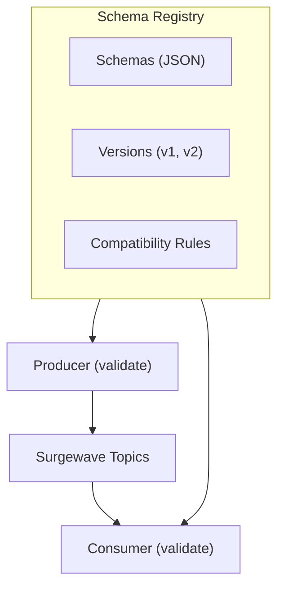

# Unit 10: Schema Registry

Manage message schemas, versioning, and compatibility with Surgewave.

## Overview

Schema Registry provides centralized schema management for Surgewave:
- Define and validate message schemas (JSON Schema, Avro-like)
- Version schemas with semantic versioning
- Enforce compatibility rules for schema evolution
- Integrate schemas with producers and consumers

## Architecture

## Lessons

| Lesson | Topic | What You'll Build |
|--------|-------|-------------------|
| [10.1](lesson-1/README.md) | Schema Basics | Understand schema registry concepts |
| [10.2](lesson-2/README.md) | JSON Schema | JSON schema definition and validation |
| [10.3](lesson-3/README.md) | Schema Versioning | Version management and evolution |
| [10.4](lesson-4/README.md) | Compatibility Modes | Forward, backward, full compatibility |
| [10.5](lesson-5/README.md) | Schema in Practice | Integrate schemas with Surgewave |
| [10.6](lesson-6/README.md) | Schema Inference & AI Evolution | Auto-derive schemas and classify breaking changes |

## Prerequisites

- Completed Unit 1 (Fundamentals)
- Basic understanding of JSON
- Familiarity with data serialization concepts

## Key Concepts

### What is a Schema?

A schema defines the structure of your data:
- Field names and types
- Required vs optional fields
- Constraints and validation rules

### Schema Registry Benefits

| Benefit | Description |
|---------|-------------|
| Data Quality | Validate messages before production |
| Contract | Shared understanding between producers/consumers |
| Evolution | Safely evolve schemas over time |
| Documentation | Self-documenting data structures |

### Compatibility Modes

| Mode | Description | Use Case |
|------|-------------|----------|
| None | No compatibility checking | Development |
| Backward | New schema can read old data | Adding fields |
| Forward | Old schema can read new data | Removing fields |
| Full | Both backward and forward | Strict evolution |

## Learning Objectives

By the end of this unit, you will be able to:

1. Understand schema registry architecture and benefits
2. Define JSON schemas for message validation
3. Manage schema versions and evolution
4. Configure and enforce compatibility modes
5. Integrate schemas with Surgewave producers and consumers
6. Use schema inference to auto-derive schemas from live message traffic
7. Detect and classify breaking schema changes with AI-assisted evolution
