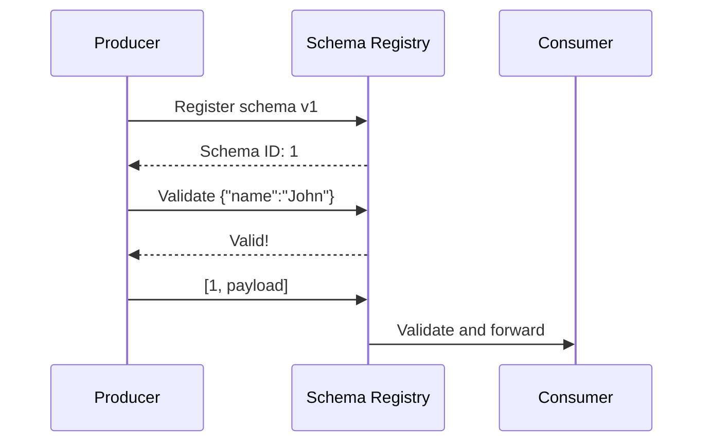

# Lesson 10.1: Schema Basics

> **Difficulty:** Intermediate | **Duration:** 30 min | **Prerequisites:** Unit 9 completion

Understand what a schema registry is and why it matters.

## Objectives

- Understand the purpose of schema registry
- Learn schema registry architecture
- Explore the problems schemas solve

## Concepts

### What is a Schema Registry?

A Schema Registry is a centralized service that:
- Stores and manages schemas for topics
- Assigns unique IDs to schema versions
- Validates messages against registered schemas
- Enforces compatibility rules

### Why Use a Schema Registry?

Without schemas, producers and consumers have implicit contracts — a producer sending `{"name":"Jane","age":"X"}` causes a runtime error on the consumer expecting `age` to be a number.

With schemas, contracts are explicit and enforced:

### Schema Registry Components

| Component | Description |
|-----------|-------------|
| Schemas | Subject → Schema mappings |
| Versions | Schema version history |
| Compatibility | Evolution rules |
| Subjects | Topic-schema bindings |

## Exercise

In this lesson, you'll:
1. Create an in-memory schema registry
2. Register and retrieve schemas
3. Understand schema subjects and IDs

## Key Takeaways

- Schema registry centralizes schema management
- Schemas are identified by subject (typically topic name)
- Each schema version gets a unique ID
- Validation happens before messages are sent
