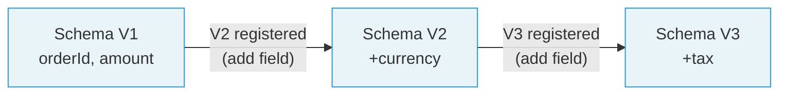

# Lesson 10.3: Schema Versioning and Protobuf Serialization

> **Difficulty:** Intermediate | **Duration:** 45 min | **Prerequisites:** Lesson 10.2

Manage schema versions and evolution over time, and serialize with Protocol Buffers.

## Objectives

- Understand schema versioning strategies
- Implement version management in schema registry
- Handle schema evolution gracefully
- Track schema history and changes
- Use Protobuf serialization with schema registry integration

## Concepts

### Why Version Schemas?

As applications evolve, data structures change:
- New fields are added
- Old fields become obsolete
- Field types may change
- Business requirements shift

Versioning allows:
- Tracking changes over time
- Rolling back to previous versions
- Supporting multiple schema versions simultaneously

### Version Numbering

```
Subject: orders-value

Version 1: { orderId, amount }
Version 2: { orderId, amount, currency }      <-- Added field
Version 3: { orderId, amount, currency, tax } <-- Added field
```

### Schema Evolution Timeline



Messages in the topic: `[v1] [v1] [v2] [v2] [v2] [v3] [v3]`

### Version Metadata

Each version can include metadata:
- Timestamp of registration
- Author/source information
- Description of changes
- Deprecation status

## Protocol Buffers (Protobuf) Serialization

### What is Protobuf?

Protocol Buffers is Google's language-neutral, platform-neutral serialization format:
- Extremely compact binary format
- Strong typing with code generation
- Excellent backward and forward compatibility
- High performance serialization/deserialization

### Protobuf Schema Example (.proto file)

```protobuf
syntax = "proto3";

package com.example.orders;

message Order {
    string order_id = 1;
    int32 customer_id = 2;
    double amount = 3;
    string currency = 4;
    int64 timestamp = 5;
    repeated LineItem items = 6;
}

message LineItem {
    string product_id = 1;
    int32 quantity = 2;
    double price = 3;
}
```

### Using Protobuf with Surgewave

Surgewave provides built-in Protobuf serialization with schema registry integration:

```csharp
using Kuestenlogik.Surgewave.Client;
using Kuestenlogik.Surgewave.Client.SchemaRegistry.Protobuf;
using Google.Protobuf;

// Create Protobuf serializer config
var protobufConfig = new ProtobufSerializerConfig(schemaRegistryClient)
{
    AutoRegisterSchemas = true,
    SubjectNameStrategy = TopicNameStrategy.Instance
};

// Create producer with Protobuf serialization
await using var producer = new SurgewaveProducer<string, Order>(options =>
{
    options.BootstrapServers = "localhost:9092";
    options.AsyncValueSerializer = new SchemaRegistryProtobufSerializer<Order>(protobufConfig);
});

// Produce Protobuf-encoded messages
var order = new Order
{
    OrderId = "ORD-001",
    CustomerId = 1001,
    Amount = 99.99,
    Currency = "USD",
    Timestamp = DateTimeOffset.UtcNow.ToUnixTimeMilliseconds()
};

await producer.ProduceAsync("orders", order.OrderId, order);
```

### Consuming Protobuf Messages

```csharp
using Kuestenlogik.Surgewave.Client;
using Kuestenlogik.Surgewave.Client.SchemaRegistry.Protobuf;

// Create Protobuf deserializer
var protobufDeserializerConfig = new ProtobufSerializerConfig(schemaRegistryClient);

await using var consumer = new SurgewaveConsumer<string, Order>(options =>
{
    options.BootstrapServers = "localhost:9092";
    options.GroupId = "order-processors";
    options.AsyncValueDeserializer = new SchemaRegistryProtobufDeserializer<Order>(protobufDeserializerConfig);
});

consumer.Subscribe("orders");

var result = await consumer.ConsumeAsync();
Console.WriteLine($"Order: {result?.Value.OrderId}, Amount: {result?.Value.Amount}");
```

### Wire Format

Surgewave uses the Confluent-compatible wire format for Protobuf messages:

| Byte(s) | Field | Value |
|---------|-------|-------|
| 1 byte | Magic byte | `0x00` |
| 4 bytes | Schema ID | Big-endian integer |
| varint | Message Index | `0` for single message type |
| variable | Protobuf Payload | Binary Protobuf |

### Protobuf vs Avro Comparison

| Feature | Protobuf | Avro |
|---------|----------|------|
| Schema format | .proto files | JSON |
| Code generation | Required | Optional |
| Schema in payload | No (registry) | Optional |
| Field identification | Numbers | Names |
| Compression | Very compact | Compact |
| Performance | Excellent | Very good |

## Exercise

In this lesson, you'll:
1. Implement versioned schema registry
2. Track version history
3. Retrieve schemas by version number
4. Handle deprecation and migration
5. Use Protobuf serialization with schema registry

## Key Takeaways

- Schemas should be immutable once registered
- Version numbers are auto-incremented per subject
- Support retrieving any historical version
- Track metadata for auditing and debugging
- Protobuf provides extremely compact binary serialization
- Use `SchemaRegistryProtobufSerializer` for automatic schema registration
- Protobuf requires code generation from .proto files
- The wire format is compatible with Confluent Schema Registry
