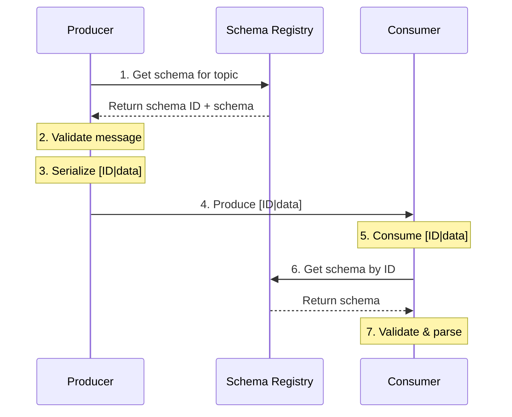

# Lesson 10.5: Schema in Practice

> **Difficulty:** Intermediate | **Duration:** 45 min | **Prerequisites:** Lesson 10.4

Integrate schema registry with Surgewave producers and consumers.

## Objectives

- Build a complete schema-aware messaging system
- Implement schema-validating producers
- Implement schema-aware consumers
- Handle schema evolution in production

## Concepts

### End-to-End Schema Flow



### Producer Integration

```csharp
public class SchemaAwareProducer<T>
{
    private readonly SurgewaveProducer<byte[], byte[]> _producer;
    private readonly ISchemaRegistry _registry;
    private readonly string _subject;
    private int? _cachedSchemaId;

    public async Task ProduceAsync(string topic, string key, T value)
    {
        // Get or cache schema ID
        var schemaId = await GetSchemaIdAsync();

        // Serialize value
        var json = JsonSerializer.Serialize(value);

        // Validate against schema
        ValidateOrThrow(json);

        // Prepend schema ID and produce
        var payload = Encoding.UTF8.GetBytes(json);
        var message = PrependSchemaId(schemaId, payload);

        await _producer.ProduceAsync(topic,
            Encoding.UTF8.GetBytes(key), message);
    }
}
```

### Consumer Integration

```csharp
public class SchemaAwareConsumer<T>
{
    private readonly SurgewaveConsumer<byte[], byte[]> _consumer;
    private readonly ISchemaRegistry _registry;
    private readonly Dictionary<int, JsonSchemaValidator> _validators = new();

    public async Task<T?> ConsumeAsync()
    {
        var result = await _consumer.ConsumeAsync();
        if (result?.Value == null) return default;

        // Extract schema ID
        var (schemaId, payload) = ExtractSchemaId(result.Value);

        // Get validator for schema
        var validator = GetOrCreateValidator(schemaId);

        // Validate
        var json = Encoding.UTF8.GetString(payload);
        validator.Validate(json).ThrowIfInvalid();

        // Deserialize
        return JsonSerializer.Deserialize<T>(json);
    }
}
```

## Exercise

In this lesson, you'll:
1. Build a complete schema-aware producer
2. Build a complete schema-aware consumer
3. Handle multiple schema versions
4. Implement graceful schema evolution

## Key Takeaways

- Cache schema IDs for performance
- Validate at both produce and consume time
- Handle schema version mismatches gracefully
- Use dead-letter queues for invalid messages
