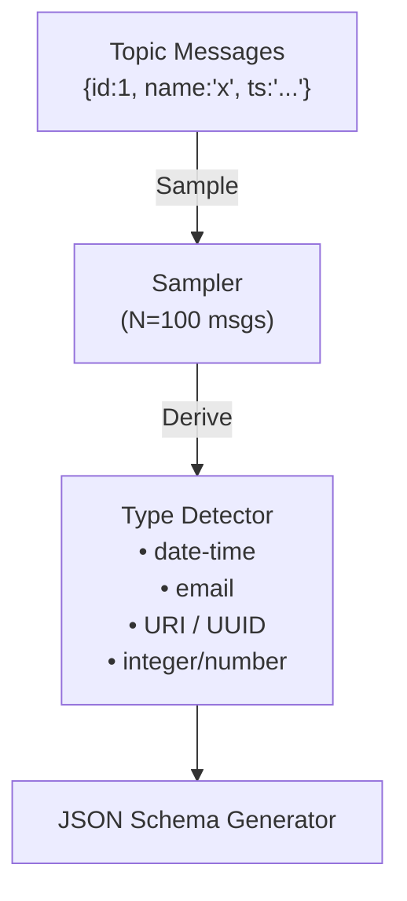

# Lesson 10.6: Live Schema Inference & AI-Assisted Evolution

> **Difficulty:** Advanced | **Duration:** 60 min | **Prerequisites:** Lesson 10.5

## Overview

Stop writing schemas by hand. Surgewave's Schema Inference engine observes live message traffic and
automatically derives JSON schemas from actual data. The AI-Assisted Evolution layer then detects
breaking changes, classifies their severity, generates C# migration code, and optionally enriches
suggestions with an LLM — falling back gracefully when no AI provider is configured.

## Learning Objectives

- Understand how Surgewave derives JSON schemas from sampled message data
- Configure inference sampling rate, sample size, and refresh interval
- Use the REST API to trigger inference and register derived schemas
- Detect schema changes automatically and classify their breaking level
- Generate C# migration code for schema evolution
- Optionally enhance suggestions with an LLM (graceful degradation when absent)

## How Schema Inference Works



## JSON Schema Auto-Derivation

Surgewave samples messages from a topic and derives a schema by inspecting field types and values:

```csharp
public class SchemaInferenceEngine
{
    private readonly InferenceOptions _options;

    public SchemaInferenceEngine(InferenceOptions options) => _options = options;

    /// <summary>Derive a JSON Schema from a set of sampled JSON objects.</summary>
    public JsonSchema Infer(IReadOnlyList<JsonElement> samples)
    {
        var fieldStats = new Dictionary<string, FieldStats>();

        foreach (var sample in samples)
        {
            foreach (var property in sample.EnumerateObject())
                CollectStats(fieldStats, property.Name, property.Value);
        }

        return BuildSchema(fieldStats, totalSamples: samples.Count);
    }

    private void CollectStats(Dictionary<string, FieldStats> stats, string name, JsonElement value)
    {
        if (!stats.TryGetValue(name, out var fs))
            stats[name] = fs = new FieldStats();

        fs.Count++;
        fs.ObservedTypes.Add(value.ValueKind);

        if (value.ValueKind == JsonValueKind.String)
            fs.StringSamples.Add(value.GetString()!);
    }

    private JsonSchema BuildSchema(Dictionary<string, FieldStats> stats, int totalSamples)
    {
        var properties = new Dictionary<string, JsonSchemaProperty>();
        var required   = new List<string>();

        foreach (var (name, fs) in stats)
        {
            // A field is required if it appeared in >95% of samples
            if (fs.Count >= totalSamples * 0.95)
                required.Add(name);

            properties[name] = new JsonSchemaProperty
            {
                Type   = InferJsonType(fs),
                Format = InferFormat(fs)
            };
        }

        return new JsonSchema
        {
            Type       = "object",
            Properties = properties,
            Required   = required
        };
    }
}
```

## Format Detection Heuristics

Surgewave goes beyond basic types — it detects semantic formats from string content:

```csharp
public static class FormatDetector
{
    // Date-time: ISO 8601 patterns
    private static readonly Regex DateTimePattern =
        new(@"^\d{4}-\d{2}-\d{2}T\d{2}:\d{2}:\d{2}", RegexOptions.Compiled);

    // Email: RFC 5322 simplified
    private static readonly Regex EmailPattern =
        new(@"^[^@\s]+@[^@\s]+\.[^@\s]+$", RegexOptions.Compiled);

    // URI: http/https/ftp
    private static readonly Regex UriPattern =
        new(@"^(https?|ftp)://", RegexOptions.Compiled);

    // UUID: 8-4-4-4-12 hex groups
    private static readonly Regex UuidPattern =
        new(@"^[0-9a-f]{8}-[0-9a-f]{4}-[0-9a-f]{4}-[0-9a-f]{4}-[0-9a-f]{12}$",
            RegexOptions.Compiled | RegexOptions.IgnoreCase);

    public static string? DetectFormat(IReadOnlyList<string> samples)
    {
        if (samples.Count == 0) return null;

        // Only assert a format when the heuristic matches ≥ 90% of samples
        double threshold = 0.90;

        if (MatchRate(samples, DateTimePattern) >= threshold) return "date-time";
        if (MatchRate(samples, EmailPattern)    >= threshold) return "email";
        if (MatchRate(samples, UriPattern)      >= threshold) return "uri";
        if (MatchRate(samples, UuidPattern)     >= threshold) return "uuid";

        return null;
    }

    private static double MatchRate(IReadOnlyList<string> samples, Regex regex)
        => samples.Count(s => regex.IsMatch(s)) / (double)samples.Count;
}
```

## Configuring Schema Inference

```json
{
  "Surgewave": {
    "SchemaRegistry": {
      "Inference": {
        "Enabled": true,
        "SampleSize": 100,
        "RefreshIntervalSeconds": 300,
        "FormatDetectionThreshold": 0.9,
        "RequiredFieldThreshold": 0.95,
        "MaxArrayItemSamples": 20
      }
    }
  }
}
```

```csharp
// Or configure in code
builder.Services.AddSurgewaveSchemaRegistry(opt =>
{
    opt.Inference.Enabled = true;
    opt.Inference.SampleSize = 100;
    opt.Inference.RefreshInterval = TimeSpan.FromMinutes(5);
    opt.Inference.FormatDetectionThreshold = 0.90;
    opt.Inference.RequiredFieldThreshold = 0.95;
});
```

## REST API: Schema Inference Endpoints

### Derive a Schema (without registering)

```http
GET /schemas/infer/{topic}?sampleSize=100
```

Response:

```json
{
  "topic": "orders",
  "sampleSize": 100,
  "schema": {
    "type": "object",
    "properties": {
      "id":        { "type": "integer" },
      "email":     { "type": "string", "format": "email" },
      "createdAt": { "type": "string", "format": "date-time" },
      "total":     { "type": "number" }
    },
    "required": ["id", "email", "createdAt"]
  },
  "confidence": 0.97,
  "inferredAt": "2026-03-22T09:15:00Z"
}
```

### Derive and Register a Schema

```http
POST /schemas/infer/{topic}/register
Content-Type: application/json

{
  "sampleSize": 100,
  "subject": "orders-value",
  "compatibilityMode": "Backward"
}
```

Response:

```json
{
  "schemaId": 42,
  "subject": "orders-value",
  "version": 1,
  "registered": true
}
```

### Trigger Inference Refresh

```http
POST /schemas/infer/{topic}/refresh
```

## AI-Assisted Schema Evolution

When schemas change, Surgewave automatically classifies the breaking impact and generates migration code:

```csharp
public class SchemaEvolutionAdvisor
{
    private readonly ILlmProvider? _llm; // Optional — graceful degradation

    public SchemaEvolutionAdvisor(ILlmProvider? llm = null) => _llm = llm;

    public async Task<EvolutionAdvice> AnalyzeEvolutionAsync(
        JsonSchema oldSchema, JsonSchema newSchema, string subject)
    {
        var changes = DetectChanges(oldSchema, newSchema);
        var level   = ClassifyBreakingLevel(changes);
        var code    = GenerateMigrationCode(oldSchema, newSchema, changes);

        string? aiSuggestion = null;
        if (_llm != null)
        {
            // Enhance with LLM — best-effort, failures are swallowed
            aiSuggestion = await EnhanceWithLlmAsync(changes, level, subject);
        }

        return new EvolutionAdvice(
            Subject:      subject,
            Changes:      changes,
            BreakingLevel: level,
            MigrationCode: code,
            AiSuggestion:  aiSuggestion
        );
    }
}
```

## Breaking Level Classification

| Level | Description | Examples | Action |
|-------|-------------|---------|--------|
| None | No structural change | Description update only | Safe to register |
| Minor | Backward compatible | Adding optional field | Safe, consumers adapt |
| Major | Breaking change | Removing required field, type change | Coordinate consumers first |

```csharp
public static BreakingLevel ClassifyBreakingLevel(IReadOnlyList<SchemaChange> changes)
{
    if (changes.Count == 0) return BreakingLevel.None;

    if (changes.Any(c => c.ChangeType is
        ChangeType.FieldRemoved or
        ChangeType.TypeChanged or
        ChangeType.RequiredFieldAdded))
    {
        return BreakingLevel.Major;
    }

    if (changes.Any(c => c.ChangeType is
        ChangeType.OptionalFieldAdded or
        ChangeType.FormatChanged or
        ChangeType.DefaultValueAdded))
    {
        return BreakingLevel.Minor;
    }

    return BreakingLevel.None;
}
```

## C# Migration Code Generation

Surgewave generates ready-to-use C# code for schema migrations:

```csharp
public string GenerateMigrationCode(
    JsonSchema oldSchema, JsonSchema newSchema,
    IReadOnlyList<SchemaChange> changes)
{
    var sb = new StringBuilder();
    sb.AppendLine("// Auto-generated migration — review before use");
    sb.AppendLine($"// Generated: {DateTime.UtcNow:O}");
    sb.AppendLine();

    // Detect added fields and emit defaults
    foreach (var change in changes.Where(c => c.ChangeType == ChangeType.OptionalFieldAdded))
    {
        sb.AppendLine($"// New optional field: '{change.FieldName}'");
        sb.AppendLine($"// Add to your model and set a default value:");
        sb.AppendLine($"public {MapJsonTypeToCSharp(change.NewType)} {ToPascalCase(change.FieldName)} " +
                      $"{{ get; set; }} = {DefaultValue(change.NewType)};");
        sb.AppendLine();
    }

    // Detect removed required fields and emit warnings
    foreach (var change in changes.Where(c => c.ChangeType == ChangeType.FieldRemoved && c.WasRequired))
    {
        sb.AppendLine($"// BREAKING: Required field '{change.FieldName}' was removed.");
        sb.AppendLine($"// Ensure all consumers handle missing '{change.FieldName}' before registering.");
        sb.AppendLine();
    }

    return sb.ToString();
}
```

Example generated output for adding an optional `phone` field:

```csharp
// Auto-generated migration — review before use
// Generated: 2026-03-22T09:15:00Z

// New optional field: 'phone'
// Add to your model and set a default value:
public string? Phone { get; set; } = null;
```

## LLM Enhancement (Optional, Graceful Degradation)

When an LLM provider is configured, Surgewave enriches evolution advice with natural-language explanations:

```csharp
private async Task<string?> EnhanceWithLlmAsync(
    IReadOnlyList<SchemaChange> changes,
    BreakingLevel level,
    string subject)
{
    if (_llm == null) return null;

    var prompt = $"""
        Schema evolution for '{subject}':
        Breaking level: {level}
        Changes:
        {string.Join("\n", changes.Select(c => $"  - {c.ChangeType}: {c.FieldName}"))}

        Provide a concise explanation (3-5 sentences) covering:
        1. What changed and why it matters
        2. What consumer teams need to do
        3. Whether a coordination window is needed
        """;

    try
    {
        return await _llm.CompleteAsync(prompt, maxTokens: 200);
    }
    catch (Exception ex)
    {
        // LLM unavailable — return null, caller handles gracefully
        _logger.LogDebug("LLM enhancement unavailable: {Message}", ex.Message);
        return null;
    }
}
```

Configure the LLM provider:

```json
{
  "Surgewave": {
    "SchemaRegistry": {
      "AiEvolution": {
        "Enabled": true,
        "Provider": "AzureOpenAI",
        "Endpoint": "https://my-instance.openai.azure.com/",
        "Model": "gpt-4o",
        "ApiKeyEnvironmentVariable": "AZURE_OPENAI_KEY",
        "FallbackToRulesBased": true
      }
    }
  }
}
```

## End-to-End Example

```csharp
// 1. Produce messages to a topic
await using var producer = new SurgewaveProducer<string, string>(opt =>
    opt.BootstrapServers = "localhost:9092");

await producer.ProduceAsync("orders", "k1",
    """{"id":1,"email":"alice@example.com","createdAt":"2026-03-22T09:00:00Z","total":49.99}""");

// 2. Infer schema from live traffic
var registry = new SchemaRegistryClient("http://localhost:9092");
var inferred  = await registry.InferSchemaAsync("orders", sampleSize: 100);

Console.WriteLine($"Inferred schema with {inferred.Schema.Properties.Count} properties");
Console.WriteLine($"Confidence: {inferred.Confidence:P0}");

// 3. Register the inferred schema
var registered = await registry.RegisterInferredSchemaAsync("orders-value", inferred.Schema);
Console.WriteLine($"Registered schema ID: {registered.SchemaId}");

// 4. Simulate schema evolution (add optional field)
var newSchema = inferred.Schema with
{
    Properties = inferred.Schema.Properties
        .Concat([KeyValuePair.Create("phone", new JsonSchemaProperty { Type = "string" })])
        .ToDictionary()
};

// 5. Analyse the evolution
var advisor = new SchemaEvolutionAdvisor(llm: null); // No LLM configured
var advice  = await advisor.AnalyzeEvolutionAsync(inferred.Schema, newSchema, "orders-value");

Console.WriteLine($"Breaking level: {advice.BreakingLevel}");
Console.WriteLine($"Changes detected: {advice.Changes.Count}");
Console.WriteLine();
Console.WriteLine("Generated migration code:");
Console.WriteLine(advice.MigrationCode);
```

## Exercise

In this lesson, you'll:

1. Produce messages with realistic data (emails, dates, UUIDs) to a topic
2. Run schema inference and inspect the detected formats
3. Register the inferred schema via the REST API
4. Evolve the schema (add optional field, then remove required field)
5. Observe breaking level classification for each change
6. Inspect the generated C# migration code

---

**Instructions:** → [INSTRUCTIONS.md](INSTRUCTIONS.md)
