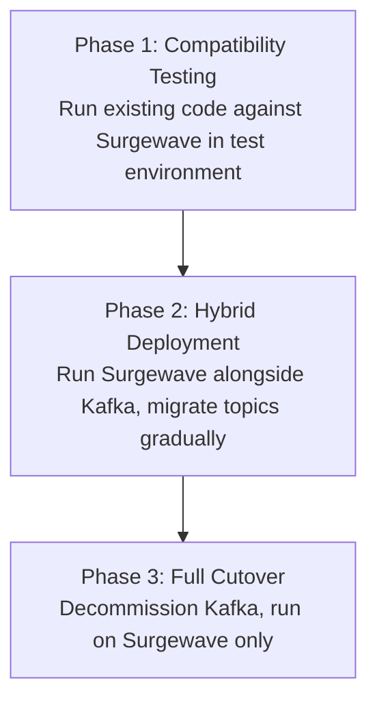

# Unit 11: Kafka Migration

Migrate from Apache Kafka to Surgewave with minimal code changes.

## Learning Objectives

By the end of this unit, you will be able to:

- Run existing Kafka applications on Surgewave
- Use Surgewave's Kafka compatibility layer
- Plan and execute a migration strategy
- Handle hybrid deployments during transition

## Lessons

| Lesson | Topic | Description |
|--------|-------|-------------|
| [5.1](lesson-1/README.md) | Kafka Compatibility | Run Kafka clients against Surgewave |
| [5.2](lesson-2/README.md) | API Wrapper Migration | Use Surgewave's Confluent.Kafka wrapper |
| [5.3](lesson-3/README.md) | Hybrid Deployments | Run Surgewave alongside Kafka |
| [5.4](lesson-4/README.md) | Production Cutover | Complete migration checklist |
| [5.5](lesson-5/README.md) | Hybrid Deployment Patterns | Cluster Linking, dual-read, and rollback |
| [5.6](lesson-6/README.md) | Performance Comparison & Validation | Benchmark Surgewave vs Kafka, pitfalls, cutover checklist |

## Prerequisites

- Completed Unit 1: Surgewave Fundamentals
- Familiarity with Apache Kafka (helpful)
- Existing Kafka application to migrate (optional)
- Unit 4 completion recommended for lessons 5.5–5.6

## Why Migrate to Surgewave?

| Challenge with Kafka | Surgewave Solution |
|---------------------|----------------|
| JVM dependency | Native .NET |
| Complex setup | Single binary |
| ZooKeeper/KRaft | Built-in coordination |
| Operational overhead | Simplified ops |
| .NET integration | First-class support |

## Migration Approaches

### Option 1: Protocol Compatibility

Surgewave speaks the Kafka protocol. Point existing Kafka clients at Surgewave:

```csharp
// Existing Confluent.Kafka code
var config = new ProducerConfig
{
    BootstrapServers = "surgewave-broker:9092"  // Just change the address!
};
```

### Option 2: API Wrapper

Use Surgewave's Confluent.Kafka compatible API:

```csharp
// Replace NuGet reference:
// - Confluent.Kafka → Kuestenlogik.Surgewave.Kafka.Compat

// Code stays the same!
using Confluent.Kafka; // Provided by Surgewave.Kafka.Compat
```

### Option 3: Native Surgewave Client

Rewrite to use native Surgewave client for best performance:

```csharp
// Native Surgewave API
var producer = new SurgewaveProducer<string, string>(opt =>
    opt.BootstrapServers = "localhost:9092");

await producer.ProduceAsync("topic", "key", "value");
```

## Migration Path



---

**Ready?** → [Start Lesson 5.1: Kafka Compatibility](lesson-1/README.md)

> **Advanced track:** For production-grade migration with Cluster Linking and performance validation,
> proceed directly to [Lesson 5.5](lesson-5/README.md) after completing 5.1–5.4.
