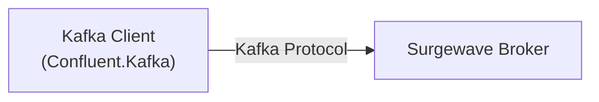

# Lesson 5.1: Kafka Compatibility

> **Difficulty:** Intermediate | **Duration:** 30 min | **Prerequisites:** Unit 4 completion

## Overview

Learn how Surgewave's Kafka protocol compatibility allows you to run existing Kafka applications unchanged.

## Learning Objectives

- Understand Surgewave's Kafka protocol support
- Point existing Kafka clients at Surgewave
- Verify compatibility with your workload
- Identify unsupported features

## Prerequisites

- Existing knowledge of Kafka client libraries
- (Optional) Existing Kafka application to test

## Kafka Protocol Support

Surgewave implements the Kafka protocol, allowing existing Kafka clients to connect:

| Feature | Support Level |
|---------|---------------|
| Produce | Full |
| Consume | Full |
| Consumer Groups | Full |
| Transactions | Full |
| Admin API | Full |
| Kafka Streams | Partial |
| Schema Registry | Planned |

## Key Concepts

### Protocol-Level Compatibility

Surgewave speaks the same wire protocol as Kafka:



### Connection Change

Migration can be as simple as changing the bootstrap servers:

```csharp
// Before (Kafka)
BootstrapServers = "kafka-broker:9092"

// After (Surgewave)
BootstrapServers = "surgewave-broker:9092"
```

## Exercise

In this exercise, you'll:

1. Start a Surgewave broker
2. Connect using standard Kafka client configuration
3. Verify produce/consume compatibility

---

**Instructions:** → [INSTRUCTIONS.md](INSTRUCTIONS.md)
