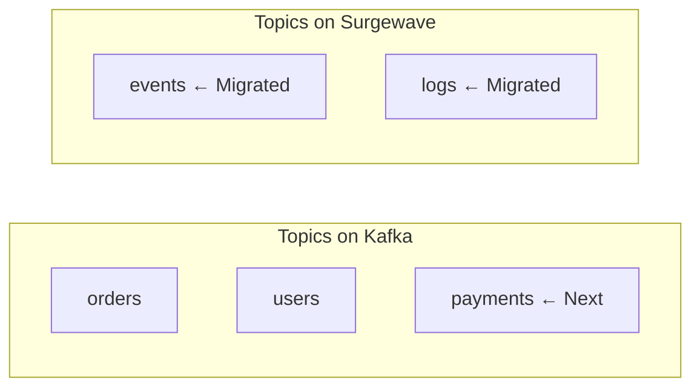
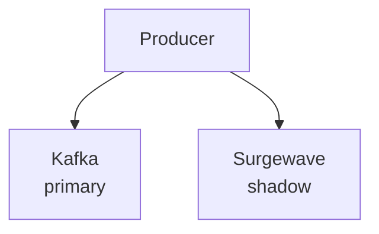

# Lesson 5.3: Hybrid Deployments

> **Difficulty:** Intermediate | **Duration:** 45 min | **Prerequisites:** Lesson 5.2

## Overview

Learn how to run Surgewave alongside Kafka during migration for a gradual transition.

## Learning Objectives

- Design hybrid architectures
- Mirror data between systems
- Manage dual-write scenarios
- Plan topic migration

## Why Hybrid?

A hybrid deployment reduces migration risk:

| Approach | Risk | Rollback |
|----------|------|----------|
| Big bang | High | Difficult |
| Hybrid/Gradual | Low | Easy |

## Hybrid Patterns

### Pattern 1: Topic-by-Topic Migration

### Pattern 2: Dual-Write

---

**Instructions:** → [INSTRUCTIONS.md](INSTRUCTIONS.md)
