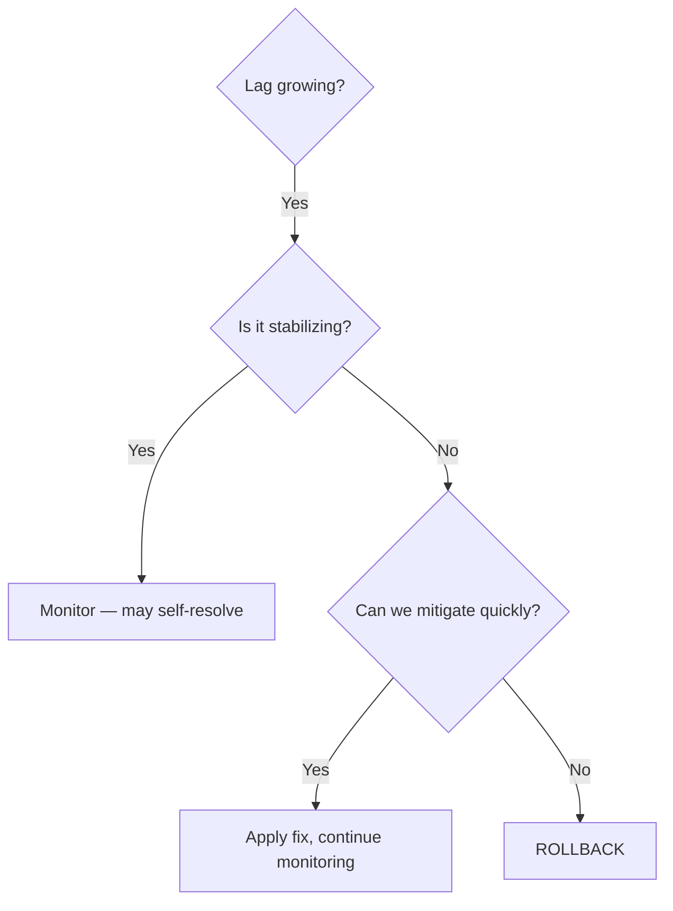

# Knowledge Assessment: Lesson 5.4 - Production Cutover

## Multiple Choice

### 1. What should be documented before a production cutover?
- [ ] A) Only the success criteria
- [ ] B) The rollback plan
- [ ] C) Only the migration steps
- [ ] D) The budget report

<details>
<summary>Answer</summary>
**B)** A rollback plan must be documented before cutover. The pre-cutover checklist specifically includes "Rollback plan documented" as a critical item for safe migration.
</details>

### 2. What is the first action during the cutover phase?
- [ ] A) Delete Kafka data
- [ ] B) Switch bootstrap servers
- [ ] C) Pause non-critical producers
- [ ] D) Notify stakeholders

<details>
<summary>Answer</summary>
**C)** Pausing non-critical producers is the first action during cutover. This reduces the complexity of the migration by limiting active traffic while the switch occurs.
</details>

### 3. When should you decommission Kafka after cutover?
- [ ] A) Immediately after switching
- [ ] B) After a burn-in period
- [ ] C) Never
- [ ] D) Before the cutover

<details>
<summary>Answer</summary>
**B)** Kafka should only be decommissioned after a burn-in period. The post-cutover checklist notes "Decommission Kafka (after burn-in)" - this ensures you have time to detect any issues and can still roll back if needed.
</details>

## True/False

### 4. Monitoring should be configured after the production cutover is complete.
- [ ] True
- [ ] False

<details>
<summary>Answer</summary>
**False** - Monitoring should be configured BEFORE cutover. The pre-cutover checklist includes "Monitoring configured" as a prerequisite. You need visibility into the system during and after migration.
</details>

### 5. Consumer lag should be checked as part of post-cutover validation.
- [ ] True
- [ ] False

<details>
<summary>Answer</summary>
**True** - "Check consumer lag" is explicitly listed in the post-cutover checklist. High consumer lag after cutover could indicate performance issues with the new Surgewave deployment.
</details>

## Code Challenge

### 6. Create a checklist for validating a successful cutover. What metrics and checks would you include?

<details>
<summary>Answer</summary>
**Post-Cutover Validation Checklist:**

**Message Flow Validation:**
- [ ] Messages being produced to Surgewave (check `surgewave_broker_messages_in_total`)
- [ ] Messages being consumed (check `surgewave_consumer_messages_consumed_total`)
- [ ] No producer errors (check `surgewave_producer_errors_total`)
- [ ] Message counts match expected rates

**Consumer Health:**
- [ ] Consumer lag within acceptable threshold
- [ ] All consumer groups active
- [ ] No rebalancing loops
- [ ] Commit latency normal

**Application Health:**
- [ ] All dependent services healthy
- [ ] No increase in application errors
- [ ] Response times within SLA
- [ ] No data inconsistencies reported

**Infrastructure:**
- [ ] Broker CPU/memory normal
- [ ] Disk I/O within limits
- [ ] Network throughput as expected
- [ ] No broker errors in logs

**Business Validation:**
- [ ] End-to-end flow working (produce -> consume -> process)
- [ ] Sample message content verified
- [ ] Critical business workflows tested

**Rollback Readiness:**
- [ ] Kafka still running (during burn-in)
- [ ] Rollback procedure tested
- [ ] Team on standby for rollback decision
</details>

### 7. During cutover, you notice consumer lag increasing rapidly on Surgewave. Walk through your troubleshooting and decision process.

<details>
<summary>Answer</summary>
**Troubleshooting increasing consumer lag during cutover:**

**1. Assess Severity (First 5 minutes)**
```
- How fast is lag growing?
- What is the current lag vs. acceptable threshold?
- Is it affecting all consumers or specific groups?
```

**2. Check Root Cause**
```
- Consumer throughput: Are consumers processing slower?
- Producer rate: Did message rate spike unexpectedly?
- Infrastructure: CPU/memory/network on Surgewave brokers?
- Configuration: Consumer settings (fetch size, etc.)?
```

**3. Quick Mitigations**
```
- Scale consumers if possible
- Reduce producer rate (pause non-critical producers)
- Check for consumer errors/exceptions
```

**4. Rollback Decision**
```
If within 15 minutes:
- Lag continues growing uncontrollably
- Consumer errors increasing
- Business impact reported

Then ROLLBACK:
1. Switch bootstrap servers back to Kafka
2. Verify message flow on Kafka
3. Notify stakeholders of rollback
4. Analyze root cause before next attempt
```

**5. Document**
```
- Timeline of events
- Metrics captured
- Root cause (if identified)
- Actions taken
- Lessons learned
```

**Decision tree:**


</details>

## Score
- 7/7: Excellent! You understand production cutover
- 5-6/7: Good understanding
- 4/7: Review the lesson
- <4/7: Re-do the lesson
