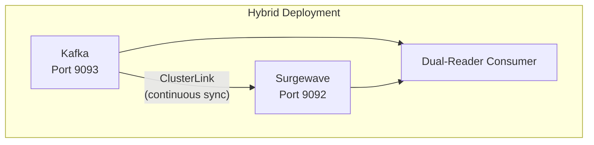

# Lesson 5.5: Hybrid Deployment Patterns

> **Difficulty:** Intermediate | **Duration:** 50 min | **Prerequisites:** Lesson 5.4

## Overview

Learn advanced hybrid deployment patterns for running Surgewave alongside Kafka during migration,
including Cluster Linking, the dual-read consumer pattern, and rollback strategies.

## Learning Objectives

- Configure side-by-side Kafka + Surgewave deployments
- Implement MirrorMaker-style topic mirroring with Surgewave Cluster Linking
- Apply the dual-read consumer pattern for zero-downtime migration
- Design and execute a rollback strategy
- Use Docker Compose to orchestrate a hybrid environment

## Why Advanced Hybrid Patterns?

Lesson 5.3 introduced the concept of hybrid deployments. This lesson goes deeper into
production-grade patterns that handle real-world complexity:

| Challenge | Pattern |
|-----------|---------|
| Historical data replay | Cluster Linking (continuous mirroring) |
| Consumer cutover without downtime | Dual-read (read Surgewave, fall back to Kafka) |
| Unexpected issues after cutover | Rollback to Kafka within seconds |
| Team confidence in Surgewave | Side-by-side validation period |

## Architecture Overview



## Surgewave Cluster Linking

Surgewave Cluster Linking provides continuous, low-latency replication from Kafka (or another
Surgewave cluster) into Surgewave:

```csharp
// Configure Surgewave with a Cluster Link source
var surgewaveConfig = new SurgewaveConfig
{
    ClusterLinks =
    [
        new ClusterLinkConfig
        {
            Name = "kafka-source",
            BootstrapServers = "kafka-broker:9093",
            // Topics to mirror (supports globs)
            TopicPatterns = ["orders.*", "users", "payments"],
            // Offset alignment: start from earliest to capture history
            OffsetSync = OffsetSyncMode.Earliest,
            // Sync consumer group offsets so consumers can cut over
            ConsumerGroupSync = true
        }
    ]
};
```

Configure via `appsettings.json`:

```json
{
  "Surgewave": {
    "ClusterLinks": [
      {
        "Name": "kafka-source",
        "BootstrapServers": "kafka-broker:9093",
        "TopicPatterns": ["orders.*", "users", "payments"],
        "OffsetSync": "Earliest",
        "ConsumerGroupSync": true
      }
    ]
  }
}
```

## Dual-Read Consumer Pattern

The dual-read pattern allows consumers to migrate without downtime. The consumer tries
Surgewave first; if the offset is not yet available (topic not yet fully mirrored), it falls
back to Kafka transparently:

```csharp
public class DualReadConsumer<TKey, TValue> : IAsyncDisposable
{
    private readonly SurgewaveConsumer<TKey, TValue> _surgewaveConsumer;
    private readonly SurgewaveConsumer<TKey, TValue> _kafkaConsumer;
    private bool _surgewavePrimary;

    public DualReadConsumer(
        string surgewaveBootstrap,
        string kafkaBootstrap,
        string groupId,
        bool surgewavePrimary = false)
    {
        _surgewaveConsumer = new SurgewaveConsumer<TKey, TValue>(opt =>
        {
            opt.BootstrapServers = surgewaveBootstrap;
            opt.GroupId = groupId;
            opt.AutoOffsetReset = AutoOffsetReset.Earliest;
        });

        _kafkaConsumer = new SurgewaveConsumer<TKey, TValue>(opt =>
        {
            opt.BootstrapServers = kafkaBootstrap;
            opt.GroupId = groupId;
            opt.AutoOffsetReset = AutoOffsetReset.Earliest;
        });

        _surgewavePrimary = surgewavePrimary;
    }

    public async Task<ConsumeResult<TKey, TValue>?> ConsumeAsync(TimeSpan timeout)
    {
        if (_surgewavePrimary)
        {
            // Try Surgewave first; fall back to Kafka if nothing available
            var result = await _surgewaveConsumer.ConsumeAsync(TimeSpan.FromMilliseconds(200));
            return result ?? await _kafkaConsumer.ConsumeAsync(timeout - TimeSpan.FromMilliseconds(200));
        }

        // Default: Kafka is primary, Surgewave is shadow
        return await _kafkaConsumer.ConsumeAsync(timeout);
    }

    /// <summary>Promote Surgewave to primary reader. Call after lag reaches zero.</summary>
    public void PromoteSurgewave() => _surgewavePrimary = true;

    public async ValueTask DisposeAsync()
    {
        await _surgewaveConsumer.DisposeAsync();
        await _kafkaConsumer.DisposeAsync();
    }
}
```

## Gradual Consumer Migration

Migrate consumer groups topic-by-topic using a migration coordinator:

```csharp
public class MigrationCoordinator
{
    private readonly ISchemaRegistry _registry;
    private readonly Dictionary<string, MigrationState> _states = new();

    public async Task<MigrationState> CheckReadinessAsync(
        string topic,
        string kafkaBootstrap,
        string surgewaveBootstrap)
    {
        var kafkaLag = await GetConsumerLagAsync(kafkaBootstrap, topic);
        var surgewaveLag = await GetConsumerLagAsync(surgewaveBootstrap, topic);
        var linkLag  = await GetClusterLinkLagAsync(surgewaveBootstrap, topic);

        return new MigrationState(
            Topic: topic,
            KafkaConsumerLag: kafkaLag,
            SurgewaveConsumerLag: surgewaveLag,
            ClusterLinkLag: linkLag,
            ReadyToCutover: linkLag < 100 && surgewaveLag < 1000
        );
    }
}

public record MigrationState(
    string Topic,
    long KafkaConsumerLag,
    long SurgewaveConsumerLag,
    long ClusterLinkLag,
    bool ReadyToCutover);
```

## Rollback Strategy

Design rollback into the migration from day one:

```csharp
public class RollbackController
{
    private readonly ILogger<RollbackController> _logger;
    private readonly DualReadConsumer<string, string> _consumer;

    /// <summary>Demote Surgewave to shadow reader, restore Kafka as primary.</summary>
    public async Task RollbackAsync(string reason)
    {
        _logger.LogWarning("Rolling back to Kafka: {Reason}", reason);

        // Demote Surgewave (set Kafka back as primary)
        _consumer.DemoteSurgewave();

        // Alert monitoring
        await NotifyOpsAsync($"Surgewave rollback triggered: {reason}");
    }

    /// <summary>Monitors error rates and auto-rolls back if threshold exceeded.</summary>
    public async Task MonitorAndRollbackAsync(CancellationToken ct)
    {
        int surgewaveErrors = 0;

        while (!ct.IsCancellationRequested)
        {
            var msg = await _consumer.ConsumeAsync(TimeSpan.FromSeconds(1));
            if (msg == null) continue;

            try
            {
                await ProcessAsync(msg);
                surgewaveErrors = 0; // reset on success
            }
            catch (Exception ex)
            {
                surgewaveErrors++;
                _logger.LogError(ex, "Processing error #{Count}", surgewaveErrors);

                if (surgewaveErrors >= 5)
                {
                    await RollbackAsync($"Exceeded error threshold ({surgewaveErrors} errors)");
                    return;
                }
            }
        }
    }

    private Task ProcessAsync(ConsumeResult<string, string> msg) => Task.CompletedTask;
    private Task NotifyOpsAsync(string message) => Task.CompletedTask;
}
```

## Docker Compose: Kafka + Surgewave Side by Side

Save as `docker-compose.hybrid.yml`:

```yaml
version: "3.9"

services:
  # Apache Kafka (existing production system)
  kafka:
    image: apache/kafka:3.8.0
    container_name: kafka
    ports:
      - "9093:9093"
    environment:
      KAFKA_NODE_ID: 1
      KAFKA_PROCESS_ROLES: broker,controller
      KAFKA_LISTENERS: PLAINTEXT://:9093,CONTROLLER://:9094
      KAFKA_ADVERTISED_LISTENERS: PLAINTEXT://kafka:9093
      KAFKA_CONTROLLER_LISTENER_NAMES: CONTROLLER
      KAFKA_CONTROLLER_QUORUM_VOTERS: 1@kafka:9094
      KAFKA_OFFSETS_TOPIC_REPLICATION_FACTOR: 1
      KAFKA_AUTO_CREATE_TOPICS_ENABLE: "true"

  # Surgewave (migration target)
  surgewave:
    image: klsurgewave/surgewave:latest
    container_name: surgewave
    ports:
      - "9092:9092"   # Kafka-compatible API
      - "5050:5050"   # Control UI
    environment:
      Surgewave__Port: 9092
      Surgewave__Storage__Mode: Disk
      Surgewave__ClusterLinks__0__Name: kafka-source
      Surgewave__ClusterLinks__0__BootstrapServers: kafka:9093
      Surgewave__ClusterLinks__0__TopicPatterns__0: "orders.*"
      Surgewave__ClusterLinks__0__TopicPatterns__1: users
      Surgewave__ClusterLinks__0__ConsumerGroupSync: "true"
    depends_on:
      - kafka

  # Migration validator (optional sidecar)
  validator:
    image: klsurgewave/surgewave-tools:latest
    container_name: migration-validator
    command: >
      surgewave-migrate validate
        --source kafka:9093
        --target surgewave:9092
        --topics orders,users,payments
        --interval 30s
    depends_on:
      - kafka
      - surgewave
```

Start the hybrid stack:

```bash
docker compose -f docker-compose.hybrid.yml up -d

# Watch Cluster Link lag
docker exec surgewave surgewave-cli link status kafka-source --watch

# Tail the migration validator
docker logs -f migration-validator
```

## Migration Timeline Template

```
Week 1 — Setup
  [x] Deploy Surgewave alongside Kafka
  [x] Configure Cluster Link for low-risk topics (logs, metrics)
  [x] Verify link lag < 500ms

Week 2 — Shadow Validation
  [x] Enable dual-read for logs consumer (Kafka primary)
  [x] Compare message counts between systems
  [x] Run load tests against Surgewave

Week 3 — Promote Surgewave
  [x] Promote Surgewave to primary reader for logs
  [x] Monitor error rates for 48h
  [ ] Begin dual-read for orders

Week 4+ — Critical Topics
  [ ] Repeat shadow → promote cycle for orders, users
  [ ] Payments last (highest business criticality)

Cutover Complete
  [ ] All consumers reading from Surgewave
  [ ] Decommission Cluster Links
  [ ] Decommission Kafka after 30-day burn-in
```

## Exercise

In this lesson, you'll:

1. Start a simulated hybrid environment (two Surgewave brokers representing Kafka and Surgewave)
2. Configure Cluster Linking to mirror topics continuously
3. Implement the dual-read consumer and observe fallback behavior
4. Trigger a rollback and verify it restores Kafka as primary

---

**Instructions:** → [INSTRUCTIONS.md](INSTRUCTIONS.md)
