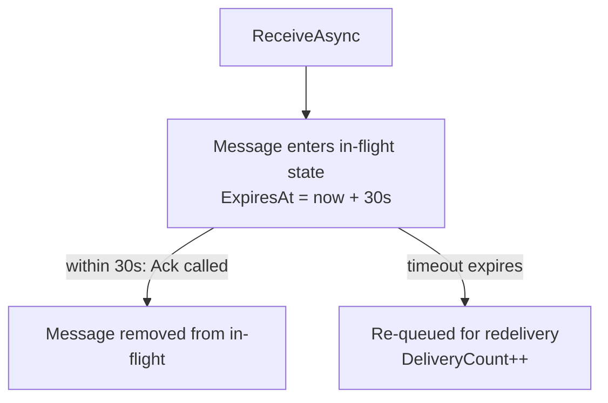
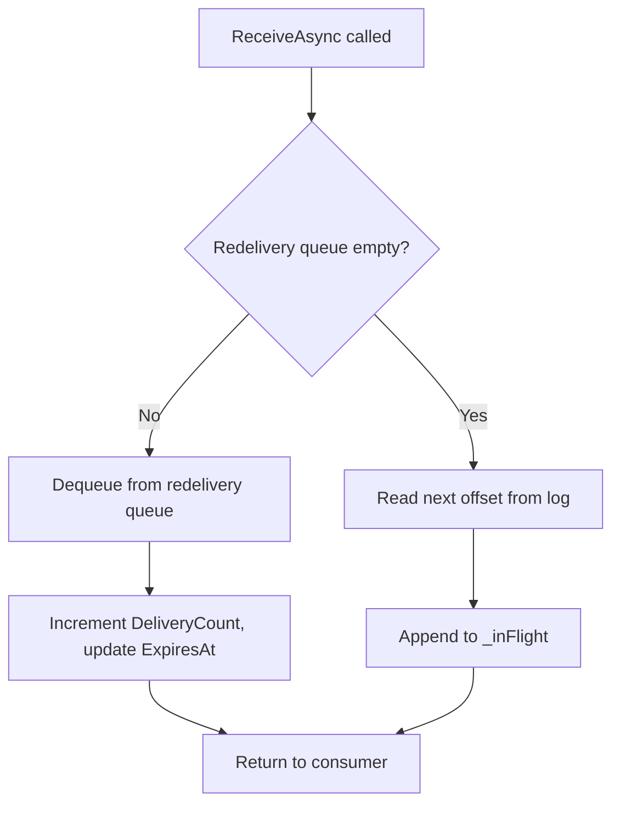

# Lesson 12.4: Visibility Timeout & Delivery Guarantees

QueueView's delivery guarantee model is the heart of the feature. Understanding how messages move
through the in-flight lifecycle — and what happens when things go wrong — is essential for building
reliable consumers.

## How Visibility Timeout Works

When a consumer calls `ReceiveAsync` (or `Basic.Consume` via AMQP), QueueView hands the consumer
a message and records a delivery timestamp:

```
ExpiresAt = UtcNow + VisibilityTimeout
```

The message is now **in-flight**: it is hidden from all other consumers for the duration of the
visibility timeout. Other calls to `ReceiveAsync` will skip this message and return the next one.



Default visibility timeout: **30 seconds**.

## In-Flight Message Lifecycle

An `InFlightMessage` tracks the full delivery state:

| Field | Description |
|-------|-------------|
| `MessageId` | Composite key: `{topic}-{partition}-{offset}` |
| `Offset` | Log offset of the message |
| `Partition` | Partition number |
| `Payload` | The raw message bytes |
| `DeliveryCount` | How many times this message has been delivered (starts at 1) |
| `ExpiresAt` | UTC timestamp when visibility timeout expires |

Messages that have been nacked with `requeue=true` are placed immediately into a **redelivery
queue** (`ConcurrentQueue<InFlightMessage>`). The next `ReceiveAsync` call drains this queue
before reading new messages from the log.

## Delivery Count and DLQ Routing

Each re-delivery increments `DeliveryCount`. When the cleanup timer fires and finds a message
whose visibility timeout has expired:

1. `DeliveryCount < MaxDeliveryCount` → message is enqueued back into the redelivery queue
2. `DeliveryCount >= MaxDeliveryCount` → message is routed to the dead-letter topic

```
First delivery:    DeliveryCount = 1,  timeout → re-queued (count 2)
Second delivery:   DeliveryCount = 2,  timeout → re-queued (count 3)
Third delivery:    DeliveryCount = 3,  timeout → re-queued (count 4)
Fourth delivery:   DeliveryCount = 4,  timeout → re-queued (count 5)
Fifth delivery:    DeliveryCount = 5,  timeout → routed to DLQ
```

Default `MaxDeliveryCount`: **5 attempts**.

## Ack / Nack / Reject Behavior

### Ack

```csharp
await channel.BasicAckAsync(ea.DeliveryTag, multiple: false);
```

- Message is removed from the `_inFlight` dictionary
- Committed offset advances for the partition
- Message will not be re-delivered

### Nack with requeue=true

```csharp
await channel.BasicNackAsync(ea.DeliveryTag, multiple: false, requeue: true);
```

- Message is removed from `_inFlight`
- Message is immediately placed into the redelivery queue
- `DeliveryCount` is preserved (incremented on next delivery)
- Message will be re-delivered to the next `ReceiveAsync` call

### Nack with requeue=false

```csharp
await channel.BasicNackAsync(ea.DeliveryTag, multiple: false, requeue: false);
```

- Message is removed from `_inFlight`
- Message is silently dropped — offset is not advanced
- Use this to discard poison messages without DLQ routing

### Reject with requeue=false (explicit DLQ)

```csharp
await channel.BasicRejectAsync(ea.DeliveryTag, requeue: false);
```

- Message is removed from `_inFlight`
- Message is immediately routed to the dead-letter topic (bypasses `MaxDeliveryCount`)
- Use this when you detect a poison message and want to explicitly move it to the DLQ

### Batch Ack

```csharp
// Ack all messages up to and including deliveryTag
await channel.BasicAckAsync(ea.DeliveryTag, multiple: true);
```

QueueView calls `Ack` for each delivery tag in the channel's outstanding set where tag ≤ deliveryTag.

## Re-Delivery Queue Mechanics

The re-delivery queue (`ConcurrentQueue<InFlightMessage>`) is drained before reading new messages:



This ensures that failed messages are retried before new messages are processed, providing a
FIFO retry ordering within each topic.

## The Cleanup Timer

A background timer fires every `CleanupInterval` (default: 10 seconds):

1. Snapshot all keys from `_inFlight` where `ExpiresAt <= UtcNow`
2. For each expired key, remove from `_inFlight` atomically
3. If `DeliveryCount >= MaxDeliveryCount`, add to DLQ candidate list
4. Otherwise, enqueue back into `_redeliveryQueue`
5. Route DLQ candidates to the dead-letter topic via `Task.Run`

The snapshot-then-remove pattern prevents modifying the dictionary during enumeration.

## Redelivered Flag

When QueueView delivers a message with `DeliveryCount > 1`, the AMQP adapter sets the `redelivered`
flag to `true` in the `Basic.Deliver` frame. Consumers can inspect this flag to detect retries:

```csharp
consumer.ReceivedAsync += async (_, ea) =>
{
    if (ea.Redelivered)
    {
        // This is a retry — check for idempotency issues
        Console.WriteLine($"Redelivered message: {ea.BasicProperties.MessageId}");
    }

    // Process and ack
    await channel.BasicAckAsync(ea.DeliveryTag, multiple: false);
};
```

## Inspecting the DLQ

The DLQ is a standard Surgewave topic. Read it with any Kafka-compatible client:

```bash
# Using kcat (kafkacat)
kcat -b localhost:9092 -t orders.dlq -C -o beginning

# Using Surgewave REST API
curl http://localhost:5050/api/topics/orders.dlq/messages
```

Or check in-flight counts via the QueueView REST API:

```bash
# How many messages are currently in-flight for 'orders'?
curl http://localhost:5050/api/queue/orders/status
```

## Summary

| Action | Effect on in-flight state | Effect on log |
|--------|--------------------------|--------------|
| `Ack` | Removed from in-flight | Committed offset advances |
| `Nack(requeue=true)` | Removed from in-flight, placed in redelivery queue | Unchanged |
| `Nack(requeue=false)` | Removed from in-flight, dropped | Unchanged |
| `Reject(requeue=false)` | Removed from in-flight, routed to DLQ | DLQ topic appended |
| Visibility timeout | Removed from in-flight, placed in redelivery queue | Unchanged |
| Timeout at MaxDeliveryCount | Removed from in-flight, routed to DLQ | DLQ topic appended |

---

[Back to Unit 12](../README.md)
