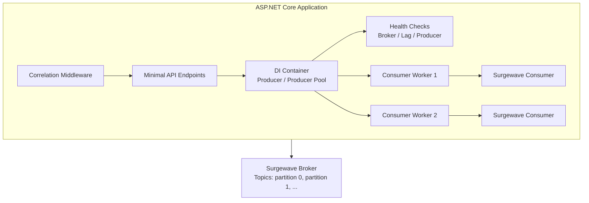
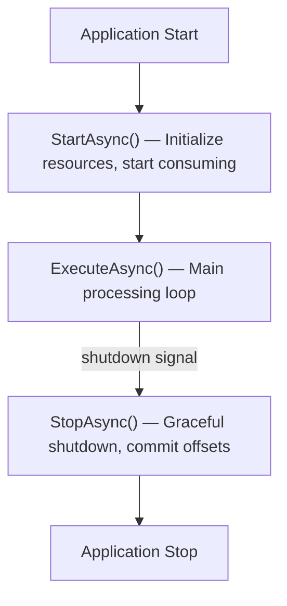

# Unit 13: ASP.NET Core Integration

Integrate Surgewave seamlessly into your ASP.NET Core applications for production-ready event-driven systems.

## Learning Objectives

By the end of this unit, you will be able to:

- Run Surgewave consumers as background services using IHostedService
- Register Surgewave clients with dependency injection
- Implement health checks for broker connectivity and consumer lag
- Create Minimal API endpoints for producing messages
- Build robust background processing with graceful shutdown

## Lessons

| Lesson | Topic | Description |
|--------|-------|-------------|
| [13.1](lesson-1/README.md) | Hosted Services | BackgroundService, IHostedService, consuming in background |
| [13.2](lesson-2/README.md) | Dependency Injection | IServiceCollection extensions, scoped vs singleton |
| [13.3](lesson-3/README.md) | Health Checks | IHealthCheck for broker, consumer lag, producer health |
| [13.4](lesson-4/README.md) | Middleware & Endpoints | Minimal API endpoints, correlation middleware |
| [13.5](lesson-5/README.md) | Background Processing | Producer pools, consumer workers, graceful shutdown |

## Prerequisites

- Completed Unit 1: Surgewave Fundamentals
- Basic ASP.NET Core knowledge
- Understanding of dependency injection concepts

## Architecture Overview



## Key Concepts

### Hosted Services Lifecycle



### Dependency Injection Lifetimes

| Lifetime | Use Case | Surgewave Example |
|----------|----------|---------------|
| Singleton | Shared across requests | Producer, Consumer (long-lived) |
| Scoped | Per-request | Message handlers with DbContext |
| Transient | Fresh each time | Rarely used for Surgewave clients |

### Health Check States

| State | Conditions |
|-------|-----------|
| Healthy | Broker up, low lag, all consumers running |
| Degraded | High lag, slow responses, some consumers lagging |
| Unhealthy | Broker down, connection lost, no consumers running |

## Common Patterns

### Producer per Request vs Shared Producer

```csharp
// Shared (Singleton) - Recommended for most cases
services.AddSingleton<SurgewaveProducer<string, string>>(sp =>
    new SurgewaveProducer<string, string>(opt =>
        opt.BootstrapServers = "localhost:9092"));

// Scoped - Use when you need request-specific configuration
services.AddScoped<IMessageProducer>(sp =>
{
    var context = sp.GetRequiredService<IHttpContextAccessor>();
    // Configure based on request context
});
```

### Consumer Worker Pattern

```csharp
public class OrderConsumerWorker : BackgroundService
{
    protected override async Task ExecuteAsync(CancellationToken stoppingToken)
    {
        await using var consumer = new SurgewaveConsumer<string, Order>(...);
        consumer.Subscribe("orders");

        while (!stoppingToken.IsCancellationRequested)
        {
            var result = await consumer.ConsumeAsync(TimeSpan.FromSeconds(1));
            if (result != null)
            {
                await ProcessOrderAsync(result.Value);
            }
        }
    }
}
```

## Getting Started

Start with Lesson 13.1 to learn how to run Surgewave consumers as background services:

```bash
cd bootcamp/unit-13/lesson-1
cat README.md
```

---

**Ready?** -> [Start Lesson 13.1: Hosted Services](lesson-1/README.md)
