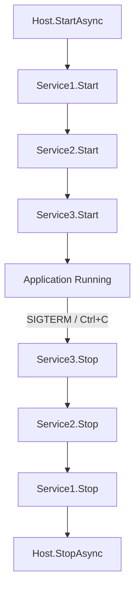

# Lesson 13.1: Hosted Services

> **Difficulty:** Advanced | **Duration:** 30 min | **Prerequisites:** Unit 12 completion

Learn to run Surgewave consumers as background services in ASP.NET Core applications.

## Learning Objectives

After completing this lesson, you will be able to:

- [ ] Create a BackgroundService that consumes Surgewave messages
- [ ] Implement IHostedService for custom lifecycle control
- [ ] Handle graceful shutdown with CancellationToken
- [ ] Understand the hosted service lifecycle

## Prerequisites

- .NET 10 SDK installed
- Understanding of Surgewave producers and consumers
- Basic ASP.NET Core knowledge

## Duration

~30 minutes

## What You'll Build

An ASP.NET Core application with a background service that:
1. Starts a Surgewave consumer when the application starts
2. Processes messages continuously in the background
3. Handles graceful shutdown when the application stops

## Key Concepts

### BackgroundService vs IHostedService

| | IHostedService (Interface) | BackgroundService (Abstract Class) |
|---|---|---|
| `StartAsync()` | Called when app starts | Calls `ExecuteAsync` |
| `StopAsync()` | Called when app stops | Signals cancellation |
| `ExecuteAsync()` | — (not in interface) | Your long-running work |

`BackgroundService` inherits from `IHostedService`.

Use `BackgroundService` when you have a single long-running task (most common).
Use `IHostedService` when you need more control over start/stop logic.

### Hosted Service Lifecycle



### Consumer Worker Pattern

```csharp
public class MessageConsumerService : BackgroundService
{
    protected override async Task ExecuteAsync(CancellationToken stoppingToken)
    {
        // Create consumer
        await using var consumer = new SurgewaveConsumer<string, string>(...);
        consumer.Subscribe("my-topic");

        // Process until shutdown
        while (!stoppingToken.IsCancellationRequested)
        {
            try
            {
                var result = await consumer.ConsumeAsync(TimeSpan.FromSeconds(1));
                if (result != null)
                {
                    await ProcessMessageAsync(result);
                }
            }
            catch (OperationCanceledException) when (stoppingToken.IsCancellationRequested)
            {
                // Normal shutdown
                break;
            }
        }
    }
}
```

### Graceful Shutdown

1. SIGTERM / Ctrl+C → `stoppingToken.IsCancellationRequested = true`
2. Current `ConsumeAsync()` completes or times out
3. While loop exits, consumer disposed (commits offsets for processed messages)
4. `ExecuteAsync()` returns, `StopAsync()` completes

## Exercise

### Step 1: Navigate to the Start Folder

```bash
cd bootcamp/unit-13/lesson-1/start
```

### Step 2: Open the Project

Open `Program.cs` in your editor. You'll see placeholder code with `// TODO` comments.

### Step 3: Follow the Instructions

Open [INSTRUCTIONS.md](INSTRUCTIONS.md) for detailed step-by-step guidance.

### Step 4: Run Your Solution

```bash
dotnet run
```

### Expected Output

```
info: Microsoft.Hosting.Lifetime[14]
      Now listening on: http://localhost:5000
info: MessageConsumerService[0]
      Starting message consumer...
info: MessageConsumerService[0]
      Subscribed to topic: demo-messages
info: Microsoft.Hosting.Lifetime[0]
      Application started.

info: MessageConsumerService[0]
      Received: Message 1 at 2024-01-15 10:30:00
info: MessageConsumerService[0]
      Received: Message 2 at 2024-01-15 10:30:01

(Press Ctrl+C to stop)

info: MessageConsumerService[0]
      Stopping message consumer...
info: MessageConsumerService[0]
      Message consumer stopped gracefully
info: Microsoft.Hosting.Lifetime[0]
      Application is shutting down...
```

## Checkpoints

Verify your solution:

- [ ] Application starts without errors
- [ ] Background service logs startup message
- [ ] Messages are consumed and logged
- [ ] Ctrl+C triggers graceful shutdown
- [ ] No unhandled exceptions on shutdown

## Troubleshooting

### "Consumer not receiving messages"

Make sure the producer is sending messages before the consumer starts. In the demo, we use a second hosted service to produce test messages.

### "Shutdown hangs"

Ensure your consume timeout is reasonable (1-5 seconds). Long timeouts delay shutdown.

### "OperationCanceledException"

This is expected during shutdown. Handle it with:
```csharp
catch (OperationCanceledException) when (stoppingToken.IsCancellationRequested)
{
    // Normal shutdown - exit gracefully
}
```

## Summary

In this lesson, you learned:

- How to implement BackgroundService for message consumption
- The difference between IHostedService and BackgroundService
- How hosted services fit into the ASP.NET Core lifecycle
- How to handle graceful shutdown with cancellation tokens

## Next Steps

Continue to [Lesson 13.2: Dependency Injection](../lesson-2/README.md) to learn how to register Surgewave clients with the DI container.

---

**Stuck?** Check the [completed/](completed/README.md) solution for reference.
