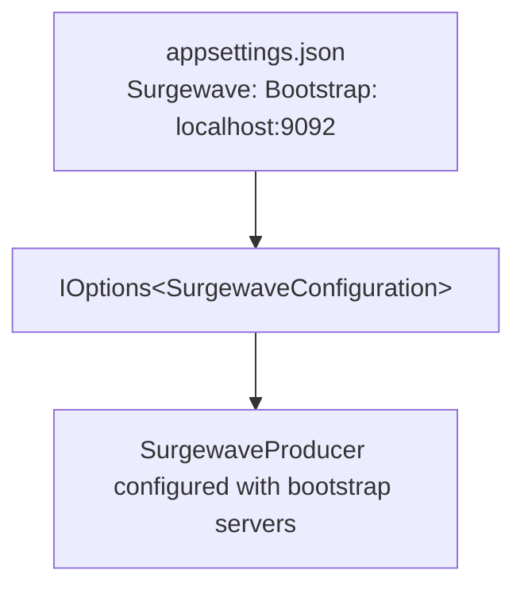

# Lesson 13.2: Dependency Injection

> **Difficulty:** Advanced | **Duration:** 25 min | **Prerequisites:** Lesson 13.1

Learn to register Surgewave clients with ASP.NET Core's dependency injection container.

## Learning Objectives

After completing this lesson, you will be able to:

- [ ] Register Surgewave producers and consumers with IServiceCollection
- [ ] Choose appropriate service lifetimes (singleton vs scoped)
- [ ] Create extension methods for clean registration
- [ ] Inject Surgewave clients into controllers and services

## Prerequisites

- .NET 10 SDK installed
- Completed Lesson 13.1
- Understanding of dependency injection concepts

## Duration

~25 minutes

## What You'll Build

An ASP.NET Core application with:
1. Extension methods for registering Surgewave clients
2. A singleton producer for high-throughput scenarios
3. Scoped consumers for request-based processing
4. Proper configuration using IOptions pattern

## Key Concepts

### Service Lifetimes

| Lifetime | Instances | Best For |
|----------|----------|---------|
| **Singleton** | One instance, shared across all requests | Producers, connection pools |
| **Scoped** | One per request | DbContext, request handlers |
| **Transient** | New instance on each injection | Lightweight, stateless services |

### Surgewave Client Recommendations

| Client | Recommended Lifetime | Reason |
|--------|---------------------|--------|
| Producer | Singleton | Thread-safe, expensive to create |
| Consumer | Singleton/Scoped | Depends on usage pattern |
| Connection | Singleton | Maintains connection pool |

### Extension Method Pattern

```csharp
public static class SurgewaveServiceCollectionExtensions
{
    public static IServiceCollection AddSurgewaveProducer<TKey, TValue>(
        this IServiceCollection services,
        Action<SurgewaveProducerOptions> configure)
    {
        services.AddSingleton(sp =>
        {
            return new SurgewaveProducer<TKey, TValue>(configure);
        });
        return services;
    }
}
```

### Options Pattern Integration



## Exercise

### Step 1: Navigate to the Start Folder

```bash
cd bootcamp/unit-13/lesson-2/start
```

### Step 2: Open the Project

Open `Program.cs` in your editor. You'll see placeholder code with `// TODO` comments.

### Step 3: Follow the Instructions

Open [INSTRUCTIONS.md](INSTRUCTIONS.md) for detailed step-by-step guidance.

### Step 4: Run Your Solution

```bash
dotnet run
```

### Expected Output

```
info: Microsoft.Hosting.Lifetime[14]
      Now listening on: http://localhost:5000

# In another terminal:
curl -X POST http://localhost:5000/messages -H "Content-Type: application/json" -d '{"key":"test","value":"Hello DI!"}'

# Response:
{"success":true,"message":"Message sent successfully"}

# Server logs:
info: MessageController[0]
      Producing message with key: test
info: MessageController[0]
      Message produced successfully
```

## Checkpoints

Verify your solution:

- [ ] Application starts without errors
- [ ] Producer is registered as singleton
- [ ] POST /messages endpoint works
- [ ] Multiple requests reuse the same producer instance
- [ ] Configuration is read from appsettings.json

## Troubleshooting

### "Unable to resolve service"

Make sure the service is registered before building the app:
```csharp
builder.Services.AddSurgewaveProducer<string, string>(...);
var app = builder.Build();  // Must be after registration
```

### "Producer disposed prematurely"

Don't use `using` when the DI container manages lifetime:
```csharp
// Wrong - DI manages lifetime
public MyController(SurgewaveProducer<string, string> producer)
{
    using var p = producer;  // NO!
}

// Correct
public MyController(SurgewaveProducer<string, string> producer)
{
    _producer = producer;  // Let DI manage it
}
```

## Summary

In this lesson, you learned:

- How to register Surgewave clients with different lifetimes
- Why producers should typically be singletons
- How to create clean extension methods for registration
- How to integrate with the IOptions configuration pattern

## Next Steps

Continue to [Lesson 13.3: Health Checks](../lesson-3/README.md) to add health monitoring for your Surgewave integration.

---

**Stuck?** Check the [completed/](completed/README.md) solution for reference.
