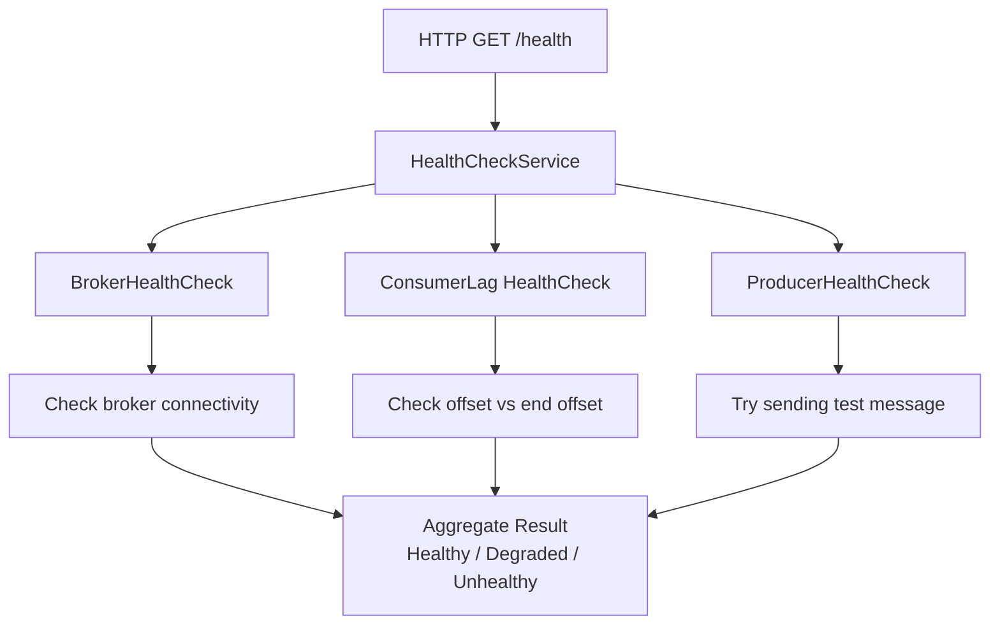

# Lesson 13.3: Health Checks

> **Difficulty:** Advanced | **Duration:** 30 min | **Prerequisites:** Lesson 13.2

Learn to implement health checks for monitoring Surgewave broker connectivity, consumer lag, and producer health.

## Learning Objectives

After completing this lesson, you will be able to:

- [ ] Implement IHealthCheck for Surgewave broker connectivity
- [ ] Create consumer lag health checks
- [ ] Build producer health checks
- [ ] Configure health check endpoints and UI

## Prerequisites

- .NET 10 SDK installed
- Completed Lesson 13.1 and 13.2
- Understanding of health check concepts

## Duration

~30 minutes

## What You'll Build

An ASP.NET Core application with health checks for:
1. Surgewave broker connectivity
2. Consumer lag monitoring
3. Producer send capability
4. Combined health status endpoint

## Key Concepts

### Health Check States

| Status | Conditions |
|--------|-----------|
| **Healthy** | Broker reachable, consumer lag within limits, producer can send |
| **Degraded** | Broker responds slowly, consumer lag high but not critical, some operations slow |
| **Unhealthy** | Broker unreachable, consumer lag exceeds critical threshold, producer cannot send |

### Health Check Architecture



### Consumer Lag Calculation

Lag = End Offset − Consumer Position. Example: end offset 8, consumer position 4 → lag = 4 messages.

| Threshold | Condition |
|-----------|-----------|
| Healthy | lag < 100 |
| Degraded | 100 ≤ lag < 1,000 |
| Unhealthy | lag ≥ 1,000 |

### IHealthCheck Interface

```csharp
public interface IHealthCheck
{
    Task<HealthCheckResult> CheckHealthAsync(
        HealthCheckContext context,
        CancellationToken cancellationToken = default);
}
```

Return values:
- `HealthCheckResult.Healthy("Description")`
- `HealthCheckResult.Degraded("Description")`
- `HealthCheckResult.Unhealthy("Description")`

## Exercise

### Step 1: Navigate to the Start Folder

```bash
cd bootcamp/unit-13/lesson-3/start
```

### Step 2: Open the Project

Open `Program.cs` in your editor. You'll see placeholder code with `// TODO` comments.

### Step 3: Follow the Instructions

Open [INSTRUCTIONS.md](INSTRUCTIONS.md) for detailed step-by-step guidance.

### Step 4: Run Your Solution

```bash
dotnet run
```

### Expected Output

Access health endpoints:

```bash
# Basic health check
curl http://localhost:5000/health
# Response: Healthy

# Detailed health check
curl http://localhost:5000/health/detail
# Response:
{
  "status": "Healthy",
  "checks": [
    {
      "name": "surgewave-broker",
      "status": "Healthy",
      "description": "Surgewave broker is reachable on port 54321"
    },
    {
      "name": "surgewave-producer",
      "status": "Healthy",
      "description": "Producer can send messages"
    }
  ]
}
```

## Checkpoints

Verify your solution:

- [ ] /health endpoint returns overall status
- [ ] /health/detail shows individual check results
- [ ] Broker health check passes when broker is running
- [ ] Producer health check can send test messages
- [ ] Stopping broker causes health check to fail

## Troubleshooting

### "Health check always unhealthy"

Make sure the broker is started before health checks run:
```csharp
// Broker must start first
builder.Services.AddSingleton<SurgewaveBrokerService>();
builder.Services.AddHostedService(sp => sp.GetRequiredService<SurgewaveBrokerService>());

// Then add health checks
builder.Services.AddHealthChecks()
    .AddCheck<SurgewaveBrokerHealthCheck>("surgewave-broker");
```

### "Cannot resolve IHealthCheck"

Health checks are registered differently:
```csharp
// Wrong
services.AddSingleton<IHealthCheck, SurgewaveBrokerHealthCheck>();

// Correct
services.AddHealthChecks()
    .AddCheck<SurgewaveBrokerHealthCheck>("surgewave-broker");
```

## Summary

In this lesson, you learned:

- How to implement IHealthCheck for custom health monitoring
- How to check broker connectivity
- How to monitor consumer lag
- How to configure health check endpoints

## Next Steps

Continue to [Lesson 13.4: Middleware & Endpoints](../lesson-4/README.md) to create Minimal API endpoints for producing messages.

---

**Stuck?** Check the [completed/](completed/README.md) solution for reference.
