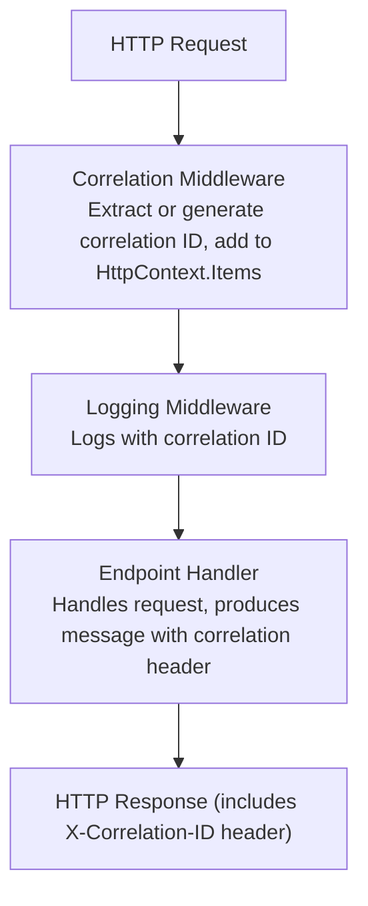
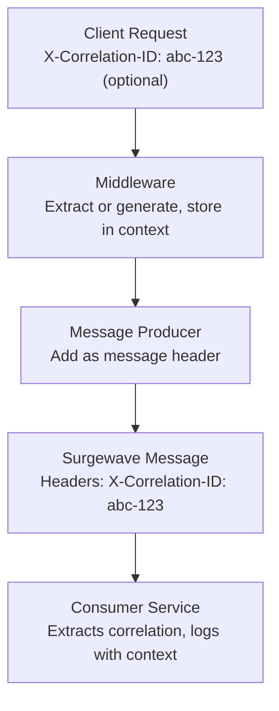

# Lesson 13.4: Middleware & Endpoints

> **Difficulty:** Advanced | **Duration:** 30 min | **Prerequisites:** Lesson 13.3

Learn to create Minimal API endpoints for producing messages and middleware for correlation tracking.

## Learning Objectives

After completing this lesson, you will be able to:

- [ ] Create Minimal API endpoints for producing messages
- [ ] Implement correlation ID middleware
- [ ] Pass correlation context through message headers
- [ ] Build RESTful message APIs

## Prerequisites

- .NET 10 SDK installed
- Completed Lessons 13.1-13.3
- Understanding of ASP.NET Core middleware

## Duration

~30 minutes

## What You'll Build

An ASP.NET Core application with:
1. Minimal API endpoints for producing messages
2. Correlation ID middleware for request tracking
3. Message headers that carry correlation context
4. RESTful API for message operations

## Key Concepts

### Minimal API Endpoints

Minimal API endpoints map HTTP verbs directly to handlers using `app.MapPost`, `app.MapGet`, etc. The handler receives injected services and returns `Results.Created`, `Results.Ok`, etc.

### Middleware Pipeline



### Correlation Flow



### RESTful Message API Design

| Endpoint | Method | Description |
|----------|--------|-------------|
| /api/topics/{topic}/messages | POST | Produce a message |
| /api/topics/{topic}/messages | GET | List recent messages (optional) |
| /api/topics | GET | List available topics |

## Exercise

### Step 1: Navigate to the Start Folder

```bash
cd bootcamp/unit-13/lesson-4/start
```

### Step 2: Open the Project

Open `Program.cs` in your editor. You'll see placeholder code with `// TODO` comments.

### Step 3: Follow the Instructions

Open [INSTRUCTIONS.md](INSTRUCTIONS.md) for detailed step-by-step guidance.

### Step 4: Run Your Solution

```bash
dotnet run
```

### Expected Output

```bash
# Send a message with auto-generated correlation ID
curl -X POST http://localhost:5000/api/topics/orders/messages \
  -H "Content-Type: application/json" \
  -d '{"key":"order-1","value":"New order created"}'

# Response headers include:
# X-Correlation-ID: 550e8400-e29b-41d4-a716-446655440000

# Response body:
{
  "success": true,
  "correlationId": "550e8400-e29b-41d4-a716-446655440000",
  "topic": "orders",
  "key": "order-1"
}

# Send with custom correlation ID
curl -X POST http://localhost:5000/api/topics/orders/messages \
  -H "Content-Type: application/json" \
  -H "X-Correlation-ID: my-custom-id-123" \
  -d '{"key":"order-2","value":"Another order"}'
```

## Checkpoints

Verify your solution:

- [ ] POST /api/topics/{topic}/messages produces messages
- [ ] Correlation ID is generated if not provided
- [ ] Correlation ID is passed through to messages
- [ ] Response includes correlation ID header
- [ ] Logs show correlation ID for tracing

## Troubleshooting

### "Correlation ID not in response"

Make sure middleware adds the header to the response:
```csharp
context.Response.OnStarting(() =>
{
    context.Response.Headers["X-Correlation-ID"] = correlationId;
    return Task.CompletedTask;
});
```

### "Message headers not set"

Verify you're using the correct header API when producing:
```csharp
// If Surgewave client supports headers
await producer.ProduceAsync(topic, key, value, headers);
```

## Summary

In this lesson, you learned:

- How to create Minimal API endpoints for message production
- How to implement correlation ID middleware
- How to pass correlation context through message headers
- Best practices for RESTful message APIs

## Next Steps

Continue to [Lesson 13.5: Background Processing](../lesson-5/README.md) to learn about producer pools and graceful shutdown.

---

**Stuck?** Check the [completed/](completed/README.md) solution for reference.
