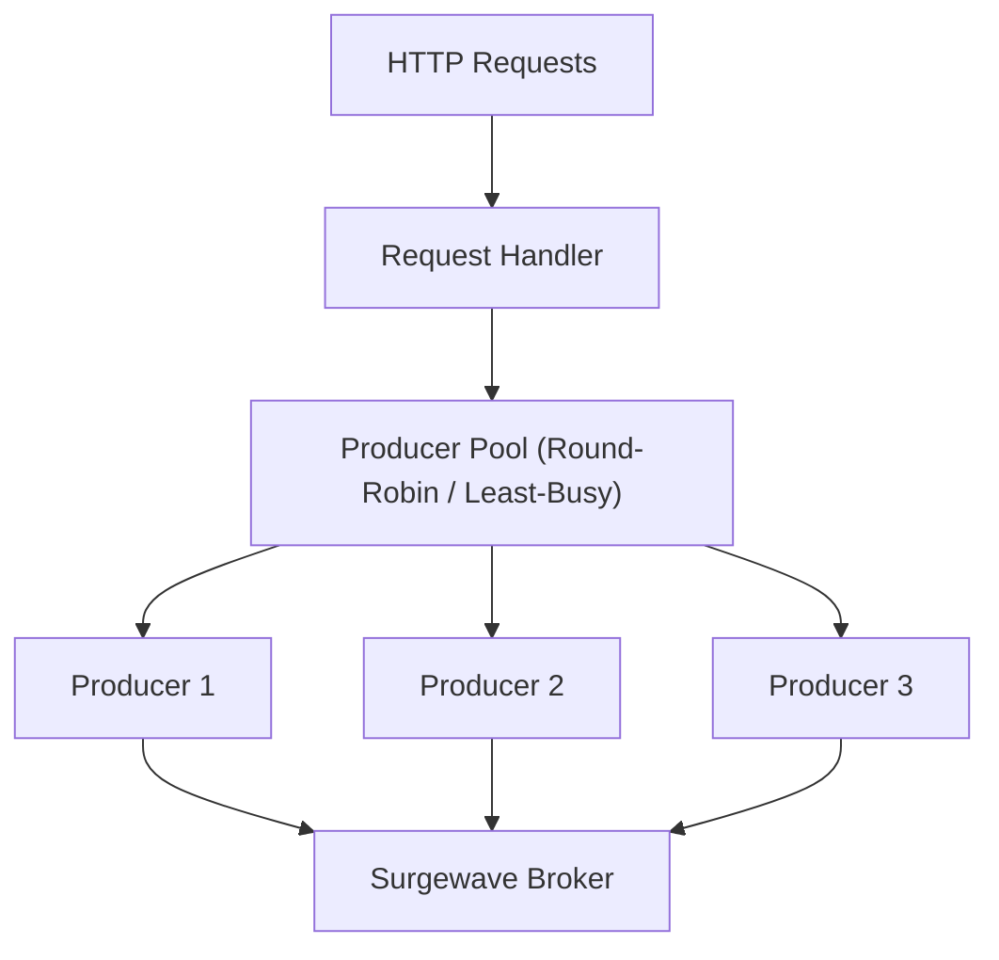
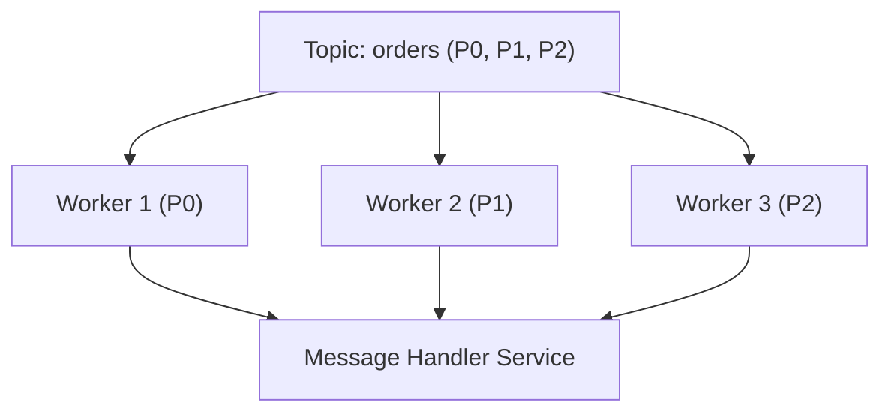

# Lesson 13.5: Background Processing

> **Difficulty:** Advanced | **Duration:** 35 min | **Prerequisites:** Lesson 13.4

Learn to build robust background processing with producer pools, consumer workers, and graceful shutdown.

## Learning Objectives

After completing this lesson, you will be able to:

- [ ] Implement producer pools for high-throughput scenarios
- [ ] Create multiple consumer workers for parallel processing
- [ ] Handle graceful shutdown properly
- [ ] Coordinate multiple background services

## Prerequisites

- .NET 10 SDK installed
- Completed Lessons 13.1-13.4
- Understanding of async programming and threading

## Duration

~35 minutes

## What You'll Build

An ASP.NET Core application with:
1. A producer pool for high-throughput message production
2. Multiple consumer workers processing in parallel
3. Proper graceful shutdown handling
4. Coordination between services

## Key Concepts

### Producer Pool Pattern



### Consumer Worker Pattern



### Graceful Shutdown Flow

1. SIGTERM / Ctrl+C received
2. `IHostApplicationLifetime.StopApplication()` called
3. `StopAsync()` called on all hosted services in reverse order (Workers 3, 2, 1 — each cancels consume, commits offsets, disposes)
4. Producer pool drained and disposed
5. Broker service stopped
6. Application terminated cleanly

### Shutdown Timeout Configuration

```csharp
// Configure shutdown timeout in Program.cs
builder.Host.ConfigureHostOptions(options =>
{
    options.ShutdownTimeout = TimeSpan.FromSeconds(30);
});
```

## Exercise

### Step 1: Navigate to the Start Folder

```bash
cd bootcamp/unit-13/lesson-5/start
```

### Step 2: Open the Project

Open `Program.cs` in your editor. You'll see placeholder code with `// TODO` comments.

### Step 3: Follow the Instructions

Open [INSTRUCTIONS.md](INSTRUCTIONS.md) for detailed step-by-step guidance.

### Step 4: Run Your Solution

```bash
dotnet run
```

### Expected Output

```
info: SurgewaveBrokerService[0]
      Starting embedded Surgewave broker...
info: SurgewaveBrokerService[0]
      Surgewave broker started on port 54321
info: ProducerPoolService[0]
      Producer pool initialized with 3 producers
info: ConsumerWorkerService[0]
      Starting consumer worker 1...
info: ConsumerWorkerService[0]
      Starting consumer worker 2...
info: ConsumerWorkerService[0]
      Starting consumer worker 3...
info: MessageGeneratorService[0]
      Generating test messages...
info: ConsumerWorkerService[0]
      Worker 1: Processed message key-1
info: ConsumerWorkerService[0]
      Worker 2: Processed message key-2

(Press Ctrl+C)

info: Microsoft.Hosting.Lifetime[0]
      Application is shutting down...
info: ConsumerWorkerService[0]
      Worker 3: Stopping...
info: ConsumerWorkerService[0]
      Worker 2: Stopping...
info: ConsumerWorkerService[0]
      Worker 1: Stopping...
info: ProducerPoolService[0]
      Draining producer pool...
info: SurgewaveBrokerService[0]
      Stopping Surgewave broker...
info: Microsoft.Hosting.Lifetime[0]
      Application stopped.
```

## Checkpoints

Verify your solution:

- [ ] Multiple consumer workers start successfully
- [ ] Producer pool distributes work across producers
- [ ] Messages are processed in parallel
- [ ] Graceful shutdown completes without errors
- [ ] All workers commit their offsets before stopping

## Troubleshooting

### "Workers not processing in parallel"

Make sure each worker has its own consumer instance:
```csharp
// Each worker creates its own consumer
await using var consumer = new SurgewaveConsumer<string, string>(...);
```

### "Shutdown hangs"

Check your cancellation token handling:
```csharp
while (!stoppingToken.IsCancellationRequested)
{
    // Use short timeouts so cancellation is responsive
    var result = await consumer.ConsumeAsync(TimeSpan.FromSeconds(1));
}
```

### "Messages processed multiple times"

Ensure consumers are in the same group:
```csharp
options.GroupId = "my-consumer-group";  // Same for all workers
```

## Summary

In this lesson, you learned:

- How to implement producer pools for high throughput
- How to create multiple consumer workers for parallel processing
- How to handle graceful shutdown properly
- How to coordinate multiple background services

## Unit Complete

Congratulations! You've completed Unit 13: ASP.NET Core Integration. You now know how to:

- Run Surgewave consumers as background services
- Register Surgewave clients with dependency injection
- Implement health checks for monitoring
- Create API endpoints for message production
- Build robust background processing systems

---

**Stuck?** Check the [completed/](completed/README.md) solution for reference.
