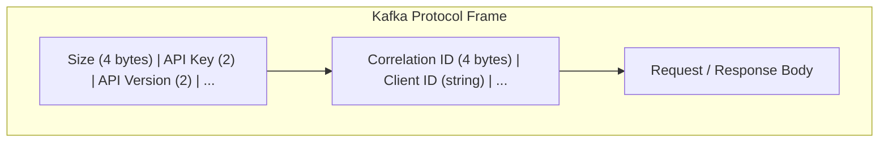

# Unit 14: Wire Protocol

This unit explores the Kafka wire protocol internals, teaching you how to build custom clients and debug protocol-level issues.

## Learning Objectives

By the end of this unit, you will be able to:

- Understand the Kafka binary protocol structure
- Parse and construct protocol messages manually
- Build a minimal custom client from scratch
- Debug protocol issues using hex dumps and analysis tools
- Compare Surgewave native protocol with Kafka protocol

## Prerequisites

- Completion of Units 0-4 (fundamentals)
- Basic understanding of binary serialization
- Familiarity with TCP/IP networking

## Lessons

| Lesson | Topic | Description |
|--------|-------|-------------|
| 19.1 | Protocol Basics | Request/response format, API keys, versioning |
| 19.2 | Message Format | Record batches, headers, compression, CRC |
| 19.3 | Building a Custom Client | Socket connection, request serialization, response parsing |
| 19.4 | Protocol Debugging | Wireshark analysis, hex dumps, troubleshooting |
| 19.5 | Protocol Extensions | Surgewave native vs Kafka protocol, performance differences |

## Protocol Architecture



## API Keys Overview

| API Key | Name | Description |
|---------|------|-------------|
| 0 | Produce | Send messages to topics |
| 1 | Fetch | Retrieve messages from topics |
| 2 | ListOffsets | Get available offsets |
| 3 | Metadata | Get cluster/topic metadata |
| ... | ... | 75+ total APIs |

## Key Concepts

### Request Structure

```
Request => Size ApiKey ApiVersion CorrelationId ClientId RequestBody
  Size => INT32 (total message size excluding this field)
  ApiKey => INT16 (identifies the API being called)
  ApiVersion => INT16 (version of the API)
  CorrelationId => INT32 (client-provided ID for matching responses)
  ClientId => NULLABLE_STRING (client identifier)
  RequestBody => varies by API
```

### Response Structure

```
Response => Size CorrelationId ResponseBody
  Size => INT32
  CorrelationId => INT32 (matches the request)
  ResponseBody => varies by API
```

### VarInt Encoding

Kafka uses variable-length integer encoding for efficiency:

```
Value Range          | Bytes Used
---------------------|------------
0 to 127             | 1 byte
128 to 16383         | 2 bytes
16384 to 2097151     | 3 bytes
...                  | ...
```

## Surgewave Native Protocol

Surgewave also supports a high-performance native protocol:

| Feature | Kafka Protocol | Surgewave Native |
|---------|---------------|--------------|
| Latency | ~15ms P50 | ~45µs P50 |
| Format | Binary | Binary (optimized) |
| Compatibility | Kafka clients | Surgewave clients only |
| Features | Standard Kafka | Extended capabilities |

## Resources

- [Kafka Protocol Guide](https://kafka.apache.org/protocol)
- [KIP-482: Kafka APIs documentation](https://cwiki.apache.org/confluence/display/KAFKA/KIP-482)
- Surgewave Protocol Documentation (see docs/protocol/)

## Estimated Time

4-5 hours for all lessons
