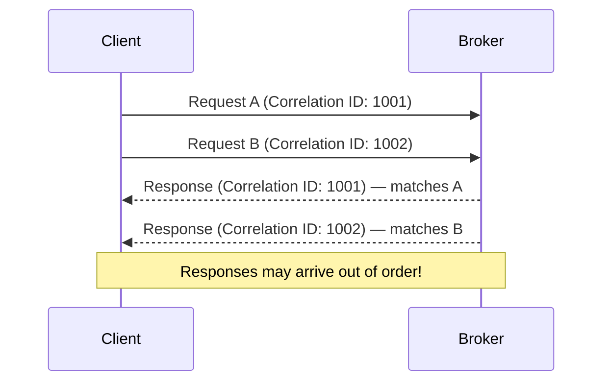

# Lesson 19.1: Protocol Basics

> **Difficulty:** Advanced | **Duration:** 45 min | **Prerequisites:** Unit 6 completion

## Overview

Learn the fundamental structure of the Kafka wire protocol, including request/response format, API keys, versioning, and correlation IDs. This knowledge is essential for debugging protocol issues and building custom clients.

## Learning Objectives

- Understand the Kafka wire protocol structure
- Learn about API keys and their purposes
- Master request/response correlation
- Explore protocol versioning mechanisms

## Why Learn Protocol Basics?

Understanding the wire protocol enables:

| Benefit | Description |
|---------|-------------|
| Debugging | Diagnose low-level communication issues |
| Custom clients | Build clients in any language |
| Protocol analysis | Use Wireshark and other tools effectively |
| Optimization | Understand performance characteristics |
| Extension | Add custom functionality when needed |

## Key Concepts

### Protocol Layer Stack

| Layer | Contents |
|-------|---------|
| Application Layer | Producer/Consumer API, Admin API, Group Coordination |
| Protocol Layer | Request Header, Request Body, Response Header, Response Body |
| Framing Layer | Length Prefix (4 bytes, big-endian), Message Data |
| Transport Layer | TCP/TLS |

### Request Structure

**Kafka Request Format:**

| Field | Size | Description |
|-------|------|-------------|
| Length | 4B | Total message size (excluding this field) |
| API Key | 2B | Identifies the request type (e.g., 0=Produce) |
| API Version | 2B | Protocol version for this API |
| Correlation ID | 4B | Unique ID to match response |
| Client ID | variable | Nullable string identifying the client |
| Request Body | variable | API-specific payload (varies by API key) |

### Response Structure

**Kafka Response Format:**

| Field | Size | Description |
|-------|------|-------------|
| Length | 4B | Total message size (excluding this field) |
| Correlation ID | 4B | Matches the request's correlation ID |
| Response Body | variable | API-specific response data |

### Common API Keys

| API Key | Name | Description |
|---------|------|-------------|
| 0 | Produce | Send messages to a topic |
| 1 | Fetch | Retrieve messages from a topic |
| 2 | ListOffsets | Get offset information for partitions |
| 3 | Metadata | Get cluster and topic metadata |
| 8 | OffsetCommit | Commit consumer offsets |
| 9 | OffsetFetch | Retrieve committed offsets |
| 10 | FindCoordinator | Locate group/transaction coordinator |
| 11 | JoinGroup | Join a consumer group |
| 14 | SyncGroup | Synchronize group assignments |
| 18 | ApiVersions | Query supported API versions |

### Correlation ID Flow

### API Versioning

1. Client connects to broker
2. Client sends `ApiVersions` request (API Key 18, Version 0 — always supported for bootstrapping)
3. Broker responds with supported version ranges:

| API Key | Min | Max |
|---------|-----|-----|
| 0 (Produce) | 0 | 9 |
| 1 (Fetch) | 0 | 13 |
| 3 (Metadata) | 0 | 12 |
| ... | | |

4. Client selects highest mutually supported version for each API
5. Client uses negotiated versions for all subsequent requests

### Nullable String Encoding

| String Type | Encoding | Example |
|-------------|----------|---------|
| Regular (non-null) | `Length (2 bytes)` + UTF-8 bytes | `"test"` = `[0x00, 0x04, 't', 'e', 's', 't']` |
| Null | `-1` as int16 | `null` = `[0xFF, 0xFF]` |
| Empty | `0` as int16 | `""` = `[0x00, 0x00]` |

## Protocol Versions and Compatibility

| Version Feature | Old Protocol | New Protocol (Flexible) |
|-----------------|--------------|-------------------------|
| String length | 2 bytes (int16) | VarInt (unsigned) |
| Array length | 4 bytes (int32) | VarInt (unsigned) |
| Tagged fields | Not supported | Supported |
| Introduced | Kafka 0.8 | Kafka 2.4+ |

## Exercise

In this exercise, you'll:

1. Build a request header manually in bytes
2. Parse a response header from bytes
3. Implement correlation ID tracking
4. Query API versions and display supported ranges

---

**Instructions:** [INSTRUCTIONS.md](INSTRUCTIONS.md)
