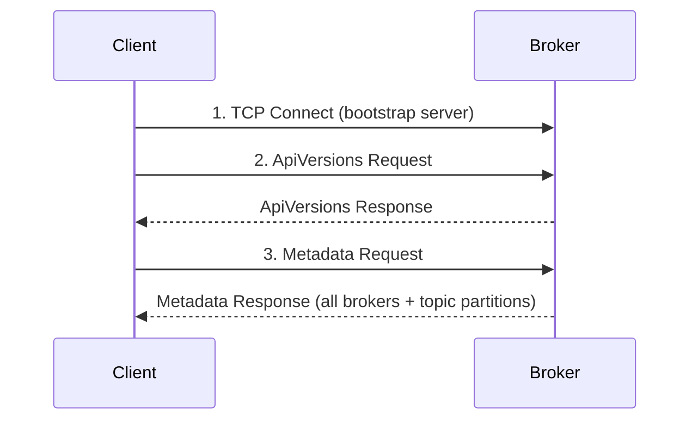

# Lesson 19.3: Building a Minimal Client

> **Difficulty:** Advanced | **Duration:** 60 min | **Prerequisites:** Lesson 19.2

## Overview

Learn how to build a minimal Kafka client from scratch using raw socket connections. This lesson covers the essential operations: connecting, fetching metadata, producing messages, and consuming messages.

## Learning Objectives

- Establish a raw TCP connection to a broker
- Implement the Metadata API for cluster discovery
- Build Produce requests to send messages
- Build Fetch requests to consume messages
- Handle response parsing for each API

## Why Build a Minimal Client?

Building a client from scratch teaches:

| Benefit | Description |
|---------|-------------|
| Deep understanding | Know exactly what happens on the wire |
| Debugging skills | Recognize and fix protocol issues |
| Language portability | Write clients in any language |
| Custom optimizations | Tailor client behavior to your needs |
| Protocol mastery | Understand every byte exchanged |

## Key Concepts

### Client Connection Flow

### Metadata Request Structure

**Metadata Request v0** — Header: `API Key: 3 (2B)`, `Version: 0 (2B)`, `Correlation ID (4B)`, `Client ID (string)`. Body: Topics Array (4-byte length + topic name strings; -1 = all topics, 0 = no topics).

### Produce Request Structure

**Produce Request v0** — Body:

| Field | Size | Description |
|-------|------|-------------|
| Required Acks | 2B | Acknowledgment level |
| Timeout | 4B | Timeout in milliseconds |
| Topic Array | variable | Topic name → Partition Array |
| Partition ID | 4B | Partition identifier |
| Record Batch | variable | MessageSet |

### Fetch Request Structure

**Fetch Request v0** — Body:

| Field | Size | Description |
|-------|------|-------------|
| Replica ID | 4B | -1 for consumers |
| Max Wait | 4B | Max wait time in milliseconds |
| Min Bytes | 4B | Minimum bytes to return |
| Topic Array → Partition Array | variable | Topic name, Partition ID (4B), Fetch Offset (8B), Max Bytes (4B) |

### MessageSet Format (v0/v1)

**Legacy MessageSet Message Entry:**

| Field | Size | Description |
|-------|------|-------------|
| Offset | 8B | Message offset |
| Message Size | 4B | Size of this message |
| CRC32 | 4B | Checksum |
| Magic | 1B | 0 = v0 (no timestamp), 1 = v1 (with timestamp) |
| Attributes | 1B | bits 0-2: compression (0=none, 1=gzip, 2=snappy, 3=lz4); bit 3: timestamp type |
| Key | variable | Message key bytes |
| Value | variable | Message value bytes |

### Response Error Codes

| Code | Name | Description |
|------|------|-------------|
| 0 | NONE | Success |
| 1 | OFFSET_OUT_OF_RANGE | Requested offset invalid |
| 3 | UNKNOWN_TOPIC_OR_PARTITION | Topic/partition doesn't exist |
| 5 | LEADER_NOT_AVAILABLE | Partition has no leader |
| 6 | NOT_LEADER_OR_FOLLOWER | Broker is not the leader |
| 7 | REQUEST_TIMED_OUT | Request timed out |

## Exercise

In this exercise, you'll:

1. Connect to a Surgewave broker with a raw TCP socket
2. Send a Metadata request and parse the response
3. Send a Produce request to create messages
4. Send a Fetch request to retrieve messages

---

**Instructions:** [INSTRUCTIONS.md](INSTRUCTIONS.md)
