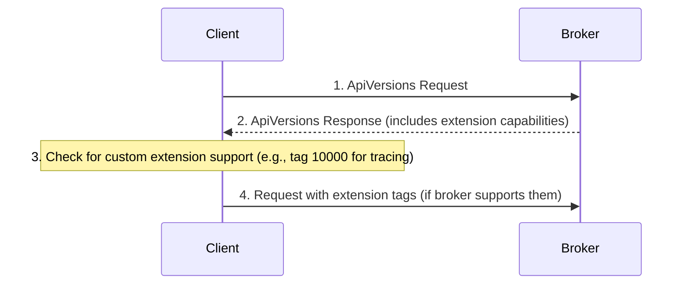

# Lesson 19.5: Protocol Extensions

> **Difficulty:** Advanced | **Duration:** 45 min | **Prerequisites:** Lesson 19.4

## Overview

Learn how to extend the Kafka protocol with custom headers, proprietary features, and maintain backward compatibility. This lesson covers the flexible protocol format and best practices for protocol evolution.

## Learning Objectives

- Understand the flexible protocol format with tagged fields
- Implement custom headers for request tracing
- Design proprietary protocol extensions
- Maintain backward compatibility across versions

## Why Learn Protocol Extensions?

Protocol extension skills enable:

| Benefit | Description |
|---------|-------------|
| Custom features | Add organization-specific capabilities |
| Observability | Inject tracing and debugging information |
| Interoperability | Bridge with other systems |
| Future-proofing | Design for evolution |
| Vendor extensions | Support proprietary features |

## Key Concepts

### Flexible Protocol Format

| Version | Structure | Notes |
|---------|-----------|-------|
| v0-v1 (Old) | `Field A | Field B | Field C` | Fixed structure |
| v2+ (Flexible) | `Field A | Field B | Field C | Tagged Fields` | Tagged Fields allow adding new optional fields without breaking existing clients |

### Tagged Field Format

Tagged Fields Block: `Num Tags (VarInt)` + one or more tagged fields.

Single Tagged Field: `Tag ID (VarInt)` + `Size (VarInt)` + `Data (bytes)`.

Example — adding a trace ID (tag 1000): `0x01` (1 tag), `0xE8 0x07` (tag ID 1000 as varint), `0x10` (16 bytes), `[16 bytes UUID]`.

### Custom Header Extensions

Standard Header v2+ fields: `API Key` | `API Version` | `Correlation ID` | `Client ID` | `Tagged Fields`

**Tag 10000: Trace Context** — `trace_id` (16B W3C trace ID), `span_id` (8B), `trace_flags` (1B)

**Tag 10001: Request Metadata** — `priority` (1B), `source_app` (string), `timestamp` (8B Unix)

### Version Negotiation with Extensions

### Backward Compatibility Rules

| Type | Changes |
|------|---------|
| **Safe** (backward compatible) | Adding new optional tagged fields, new API versions, new error codes, increasing max limits |
| **Unsafe** (breaking) | Removing required fields, changing field types/semantics, removing API versions |

**Best Practices:** Use tagged fields for all new optional data; never reuse tag IDs; document tag ranges; check API version before using new features; gracefully degrade when extensions unavailable.

### Proprietary Extension Namespace

| Tag Range | Owner |
|-----------|-------|
| 0–9,999 | Reserved for Kafka protocol |
| 10,000–19,999 | Surgewave proprietary extensions |
| 20,000–29,999 | Organization-specific |
| 30,000+ | Application-specific |

| Tag | Surgewave Extension |
|-----|----------------|
| 10000 | Request tracing (trace_id, span_id) |
| 10001 | Request priority and routing hints |
| 10002 | Compression preferences |
| 10003 | Client capabilities bitmap |
| 10004 | Response compression hint |

## Exercise

In this exercise, you'll:

1. Implement tagged field encoding and decoding
2. Add custom trace headers to requests
3. Design a proprietary extension
4. Handle unknown tags gracefully

---

**Instructions:** [INSTRUCTIONS.md](INSTRUCTIONS.md)
