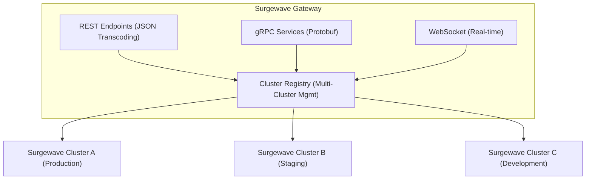
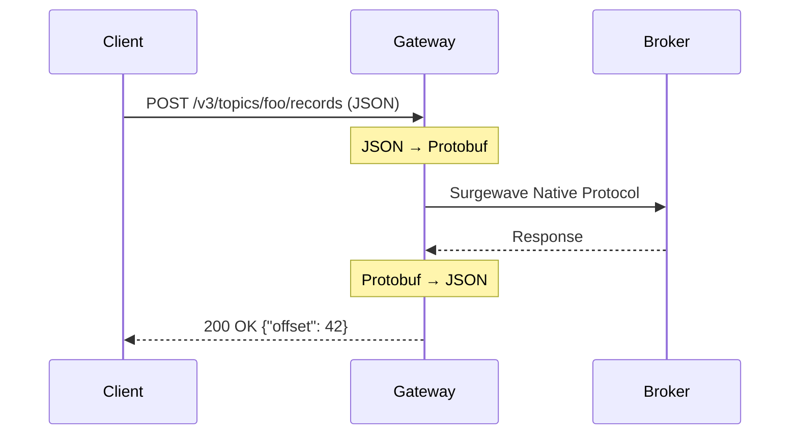
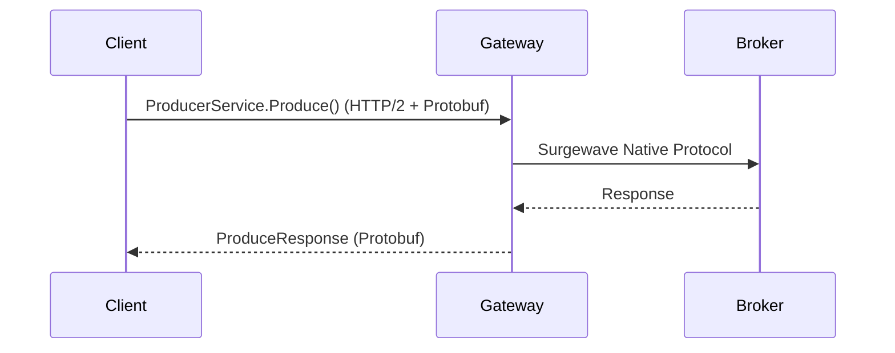

# Lesson 20.1: Gateway Architecture

> **Difficulty:** Advanced | **Duration:** 30 min | **Prerequisites:** Unit 14 completion

## Overview

Learn the architecture of Surgewave's HTTP/gRPC Gateway, understand the differences between REST and gRPC APIs, and explore Confluent REST Proxy v3 compatibility.

## Learning Objectives

- Understand Gateway architecture and multi-cluster support
- Compare REST vs gRPC APIs and their trade-offs
- Learn about Confluent v3 API compatibility
- Understand routing patterns and endpoint structure

## Why Use the Gateway?

The Gateway enables HTTP and gRPC access to Surgewave for clients that cannot use the native protocol:

| Use Case | Native Client | Gateway REST | Gateway gRPC |
|----------|---------------|--------------|--------------|
| .NET applications | Preferred | Supported | Supported |
| Web browsers | Not possible | Preferred | Via gRPC-Web |
| Mobile apps | Limited | Preferred | Supported |
| Legacy systems | May not exist | Preferred | Limited |
| Microservices | Depends | Supported | Preferred |
| CLI/Scripts | Via SDK | Preferred | Possible |

## Gateway Architecture



## REST vs gRPC

### REST API (via JSON Transcoding)



Pros: Universal compatibility, easy debugging, human-readable. Cons: Higher latency, larger payload size, no streaming.

### gRPC API



Pros: Lower latency, smaller payloads, streaming support, type safety. Cons: Requires gRPC client, harder to debug, binary format.

## Confluent v3 API Compatibility

Surgewave Gateway implements Confluent REST Proxy v3-compatible endpoints:

| Endpoint | Description |
|----------|-------------|
| `POST /v3/topics/{topic}/records` | Produce a record |
| `POST /v3/consumers/fetch` | Fetch records |
| `GET /v3/topics` | List topics |
| `GET /v3/topics/{topic}` | Describe topic |
| `POST /v3/consumer-groups/{group}/offsets` | Commit offsets |
| `GET /v3/consumer-groups/{group}/offsets` | Fetch committed offsets |
| `GET /v3/clusters` | List clusters |
| `GET /v3/clusters/{cluster_id}` | Get cluster info |

### Multi-Cluster Routing

| Pattern | URL | Target |
|---------|-----|--------|
| Single Cluster (default) | `POST /v3/topics/my-topic/records` | Configured default cluster |
| Multi-Cluster (explicit) | `POST /v3/clusters/prod-cluster/topics/my-topic/records` | Specific cluster |
| WebSocket (default) | `ws://gateway:8080/ws` | Default cluster |
| WebSocket (explicit) | `ws://gateway:8080/ws/clusters/staging` | Specific cluster |

## Gateway Services

Surgewave Gateway exposes 6 gRPC services:

| Service | Purpose | Key Operations |
|---------|---------|----------------|
| ProducerService | Produce messages | Produce, ProduceBatch, ProduceStream |
| ConsumerService | Consume messages | Fetch, Consume (stream), ListOffsets |
| TopicService | Topic management | Create, List, Describe, Delete |
| ClusterService | Cluster info | GetCluster, ListClusters |
| ConsumerGroupService | Group management | Describe, List, Delete |
| TransactionService | Transactions | InitProducer, EndTransaction |

## Configuration

```json
{
  "Gateway": {
    "DefaultCluster": "production",
    "Clusters": {
      "production": {
        "BootstrapServers": "surgewave-prod:9092"
      },
      "staging": {
        "BootstrapServers": "surgewave-staging:9092"
      }
    },
    "ConnectionTimeoutMs": 30000,
    "RequestTimeoutMs": 30000,
    "WebSocket": {
      "Enabled": true,
      "HeartbeatIntervalMs": 30000
    }
  }
}
```

## Exercise

In this exercise, you'll:

1. Start an embedded Surgewave broker and Gateway
2. Explore the Gateway's OpenAPI documentation
3. List available endpoints and services
4. Understand the routing structure

---

**Instructions:** [INSTRUCTIONS.md](INSTRUCTIONS.md)
