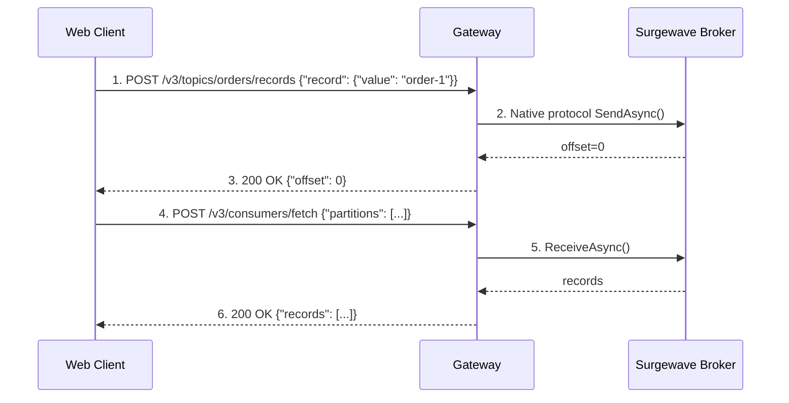

# Lesson 20.2: REST Produce/Consume

> **Difficulty:** Advanced | **Duration:** 30 min | **Prerequisites:** Lesson 20.1

## Overview

Learn how to produce and consume messages using Surgewave Gateway's REST API. This lesson covers HTTP endpoints, request/response formats, and practical examples.

## Learning Objectives

- Produce messages via REST API
- Consume messages via REST API (fetch-based)
- Commit offsets via REST API
- Handle errors and responses

## REST API Flow



## Produce Request Format

### Single Record

```json
POST /v3/topics/orders/records
Content-Type: application/json

{
  "record": {
    "key": "b3JkZXItMQ==",     // Base64 encoded
    "value": "eyJpZCI6MX0="    // Base64 encoded JSON
  },
  "partition": 0,
  "acks_required": true
}
```

### Response

```json
HTTP/1.1 200 OK
Content-Type: application/json

{
  "topic": "orders",
  "partition": 0,
  "offset": 42,
  "timestamp": 1706025600000,
  "status": {
    "error_code": "NONE"
  }
}
```

## Fetch Request Format

```json
POST /v3/consumers/fetch
Content-Type: application/json

{
  "partitions": [
    {
      "topic": "orders",
      "partition": 0,
      "offset": 0,
      "max_bytes": 1048576
    }
  ],
  "max_wait_ms": 5000
}
```

### Response

```json
HTTP/1.1 200 OK
Content-Type: application/json

{
  "results": [
    {
      "topic": "orders",
      "partition": 0,
      "high_watermark": 43,
      "records": [
        {
          "offset": 0,
          "timestamp": 1706025600000,
          "key": "b3JkZXItMQ==",
          "value": "eyJpZCI6MX0="
        }
      ],
      "status": { "error_code": "NONE" }
    }
  ]
}
```

## Offset Management

### Commit Offsets

```json
POST /v3/consumer-groups/my-group/offsets
Content-Type: application/json

{
  "offsets": [
    {
      "topic": "orders",
      "partition": 0,
      "offset": 43,
      "metadata": "processed"
    }
  ]
}
```

### Fetch Committed Offsets

```json
GET /v3/consumer-groups/my-group/offsets?topic=orders&partition=0
```

## Error Handling

| Error Code | Description |
|------------|-------------|
| `NONE` | Success |
| `UNKNOWN` | General error |
| `TOPIC_NOT_FOUND` | Topic does not exist |
| `PARTITION_NOT_FOUND` | Invalid partition |
| `OFFSET_OUT_OF_RANGE` | Offset not available |
| `LEADER_NOT_AVAILABLE` | Partition has no leader |
| `REQUEST_TIMED_OUT` | Operation timed out |

Example error response: `{ "status": { "error_code": "TOPIC_NOT_FOUND", "error_message": "Topic 'orders' does not exist" } }`

## Exercise

In this exercise, you'll:

1. Create a topic via REST API
2. Produce messages using HTTP POST
3. Fetch messages using HTTP POST
4. Commit offsets
5. Handle API responses

---

**Instructions:** [INSTRUCTIONS.md](INSTRUCTIONS.md)
