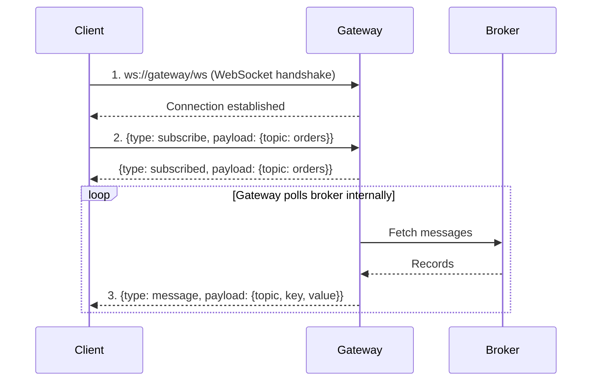

# Lesson 20.3: WebSocket Streaming

> **Difficulty:** Advanced | **Duration:** 35 min | **Prerequisites:** Lesson 20.2

## Overview

Learn how to use Surgewave Gateway's WebSocket support for real-time bidirectional communication. This lesson covers subscriptions, message streaming, and session management.

## Learning Objectives

- Connect to Surgewave via WebSocket
- Subscribe to topics for real-time streaming
- Produce messages via WebSocket
- Manage subscriptions and sessions

## Why WebSocket?

| | REST (Polling) | WebSocket (Push) |
|---|---|---|
| Pattern | Client polls server every N seconds | Persistent bidirectional connection |
| Latency | Higher — even when no new messages | Low — server pushes immediately |
| Efficiency | Wasted requests | Efficient |
| Best for | Simple request/response | Real-time updates, live dashboards, high-frequency messages |

## WebSocket Protocol

Surgewave Gateway uses JSON messages over WebSocket with a common structure: `{"type": "...", "payload": {...}, "correlation_id": "..."}`.

| Direction | Message Types |
|-----------|--------------|
| Client → Server | `subscribe`, `unsubscribe`, `produce`, `list_topics`, `heartbeat` |
| Server → Client | `message`, `subscribed`, `unsubscribed`, `produced`, `error`, `topics` |

## Subscription Flow



## Message Types

### Subscribe Request

```json
{
  "type": "subscribe",
  "payload": {
    "topic": "orders",
    "partition": 0,
    "offset": -1
  },
  "correlation_id": "sub-1"
}
```

### Subscribed Response

```json
{
  "type": "subscribed",
  "payload": {
    "topic": "orders",
    "partition": 0,
    "subscription_id": "abc123"
  },
  "correlation_id": "sub-1"
}
```

### Message (Server Push)

```json
{
  "type": "message",
  "payload": {
    "topic": "orders",
    "partition": 0,
    "offset": 42,
    "key": "order-1",
    "value": "{\"id\":1,\"item\":\"widget\"}",
    "timestamp": 1706025600000
  }
}
```

### Produce Request

```json
{
  "type": "produce",
  "payload": {
    "topic": "orders",
    "partition": 0,
    "key": "order-1",
    "value": "{\"id\":1}"
  },
  "correlation_id": "prod-1"
}
```

### Admin Operations

```json
// List Topics
{ "type": "list_topics", "correlation_id": "admin-1" }

// Describe Topic
{ "type": "describe_topic", "payload": { "topic": "orders" }, "correlation_id": "admin-2" }

// Get Cluster Info
{ "type": "get_cluster_info", "correlation_id": "admin-3" }
```

## Session Management

1. **Connection Establishment:** client connects to `ws://gateway/ws`; server creates a session with unique ID; session timeout starts (configurable)
2. **Heartbeat:** client sends heartbeat periodically; server responds with `heartbeat_ack`; missing heartbeats lead to session cleanup
3. **Subscriptions:** multiple subscriptions per session; each subscription has max buffer size; slow consumers may have messages dropped
4. **Disconnection:** client closes WebSocket; server cleans up subscriptions and releases resources

## Configuration

```json
{
  "Gateway": {
    "WebSocket": {
      "Enabled": true,
      "HeartbeatIntervalMs": 30000,
      "MaxSubscriptionsPerSession": 10,
      "MessageBufferSize": 1000,
      "SessionTimeoutMs": 60000
    }
  }
}
```

## Exercise

In this exercise, you'll:

1. Simulate WebSocket connection and message flow
2. Create subscription requests
3. Handle message streaming
4. Produce messages via WebSocket protocol

---

**Instructions:** [INSTRUCTIONS.md](INSTRUCTIONS.md)
