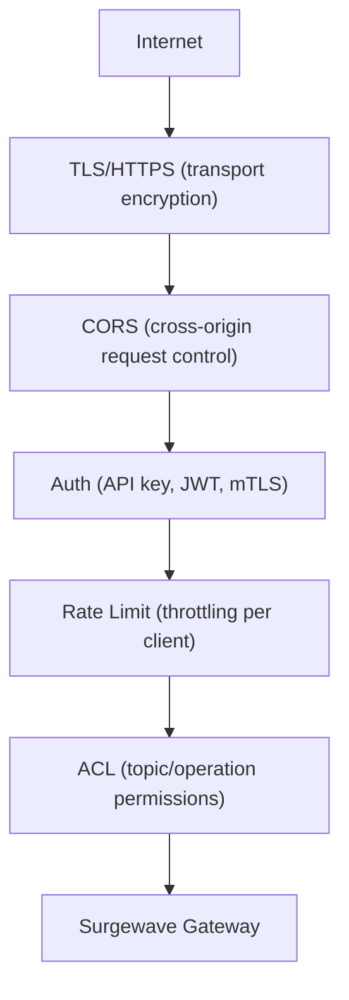

# Lesson 20.5: Gateway Security

> **Difficulty:** Advanced | **Duration:** 45 min | **Prerequisites:** Lesson 20.4

## Overview

Learn how to secure Surgewave Gateway with authentication, rate limiting, and CORS configuration. This lesson covers security best practices for production deployments.

## Learning Objectives

- Configure authentication (API keys, JWT/OAuth2)
- Implement rate limiting per client
- Configure CORS for web applications
- Secure WebSocket connections

## Security Layers



## Authentication Methods

### API Key Authentication

Send `X-API-Key: sk_live_abc123xyz789` header. Gateway validates: key exists, not expired, has permission for the operation.

### JWT/OAuth2 Authentication

Send `Authorization: Bearer <token>`. The gateway extracts JWT claims (`sub`, `client_id`, `roles`, `topics`, `exp`) and validates issuer, audience, and expiry.

## Rate Limiting

Uses a token bucket algorithm: bucket has a capacity and refill rate. If a token is available the request is processed; otherwise `429 Too Many Requests` is returned.

Response headers: `X-RateLimit-Limit`, `X-RateLimit-Remaining`, `X-RateLimit-Reset`.

## CORS Configuration

Cross-Origin Resource Sharing allows web browsers to make requests to Surgewave Gateway from different domains. The browser sends a preflight `OPTIONS` request; the gateway responds with `Access-Control-Allow-Origin`, `Access-Control-Allow-Methods`, and `Access-Control-Allow-Headers` headers.

## WebSocket Security

| Option | Method |
|--------|--------|
| Query string | `ws://gateway:8080/ws?token=eyJhbGci...` |
| First message | `{"type": "authenticate", "payload": {"token": "..."}}` |
| Subprotocol | `Sec-WebSocket-Protocol: surgewave.v1, bearer.eyJhbGci...` |

## TLS/HTTPS Configuration

```json
{
  "Kestrel": {
    "Endpoints": {
      "Https": {
        "Url": "https://*:8443",
        "Certificate": {
          "Path": "/certs/gateway.pfx",
          "Password": "cert-password"
        }
      }
    }
  }
}
```

## Exercise

In this exercise, you'll:

1. Understand authentication patterns
2. Configure rate limiting policies
3. Set up CORS for web clients
4. Secure WebSocket connections

---

**Instructions:** [INSTRUCTIONS.md](INSTRUCTIONS.md)
