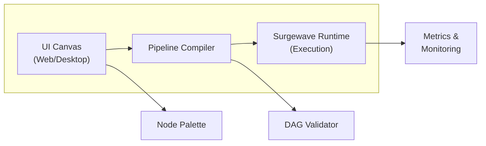
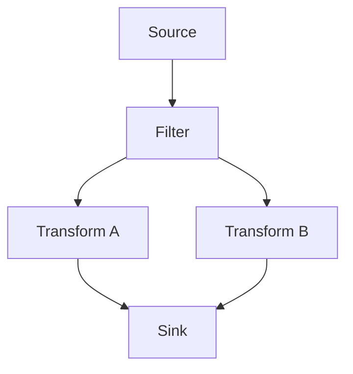

# Unit 16: Visual Pipeline UI

Master Surgewave's Visual Pipeline Orchestration UI to design, configure, monitor, and debug data processing pipelines using an intuitive graphical interface with drag-and-drop functionality.

## Learning Objectives

By the end of this unit, you will be able to:

- Understand the Visual Pipeline UI architecture and capabilities
- Create data processing pipelines using the visual DAG editor
- Configure source, transform, and sink connector nodes
- Design advanced DAG patterns including fan-out, fan-in, and parallel processing
- Monitor running pipelines and debug data flow issues in real-time
- Extend Surgewave with sandboxed WebAssembly plugins in any language

## Lessons

| Lesson | Topic | Description |
|--------|-------|-------------|
| [25.1](lesson-1/README.md) | Pipeline UI Overview | Visual DAG editor, UI architecture, when to use visual vs code pipelines |
| [25.2](lesson-2/README.md) | Creating Visual Pipelines | Drag-drop nodes, connecting components, pipeline validation |
| [25.3](lesson-3/README.md) | Connector Nodes and Configuration | Source, sink, and transform patterns, node configuration |
| [25.4](lesson-4/README.md) | DAG Patterns | Fan-out, fan-in, parallel processing, complex topologies |
| [25.5](lesson-5/README.md) | Pipeline Monitoring and Debugging | Real-time monitoring, debugging data flow, troubleshooting |
| [25.6](lesson-6/README.md) | WebAssembly Plugins | WASM plugin types, WasmRuntime, hot-deploy, host functions, writing a transform |

## Prerequisites

- Completed Unit 1: Surgewave Fundamentals
- Completed Unit 2: Producer & Consumer Basics
- Completed Unit 7: Stream Processing (recommended)
- Basic understanding of data pipelines and DAGs

## Why Visual Pipelines?

| | Visual Pipeline UI | Code-Based Pipelines |
|---|---|---|
| Approach | Drag-and-drop, immediate visual feedback | Full programmatic control and flexibility |
| Audience | Non-developer friendly (analysts, data engineers) | Developers with version control and CI/CD |
| Changes | Easy topology changes without code deployment | Complex business logic and custom transformations |
| Tooling | Built-in monitoring and debugging tools | Unit testing and CI/CD integration |
| Best for | ETL pipelines, data integration, quick iterations | Production systems, complex logic, microservices |

## Visual Pipeline Architecture



## Pipeline Components

| Component | Icon | Description |
|-----------|------|-------------|
| Source Node | [S] | Reads data from topics, files, databases |
| Transform Node | [T] | Filters, maps, aggregates, joins data |
| Sink Node | [K] | Writes data to topics, files, databases |
| Branch Node | [B] | Splits flow into multiple paths |
| Merge Node | [M] | Combines multiple flows into one |

## Aggregated Node Palette & Remote Workers

The Node Palette on the left side of the Pipeline Editor aggregates connectors from two sources: **local connectors** (built-in and plugin connectors loaded by the broker) and **remote connectors** (advertised by connected worker nodes). Each connector entry displays its `DisplayName`, `Icon`, and `Category` from the `ConnectorMetadata` attribute, so you can quickly identify the right node.

When remote workers are connected to the cluster, a **worker availability badge** appears next to connectors that can run remotely. The badge shows the number of available workers and their health status (green = healthy, yellow = degraded, red = offline).

When you drag a remote-capable connector onto the canvas, the node configuration panel includes a **Worker Selector** dropdown. This lets you choose which worker node should execute the connector, enabling resource isolation and horizontal scaling without changing the pipeline topology.

## Key Concepts

### DAG (Directed Acyclic Graph)



> **Acyclic** = No loops (data flows in one direction). **Directed** = Each edge has a direction (source → destination).

### Node Configuration

```csharp
// Visual node configurations are represented programmatically as:
var sourceConfig = new SourceNodeConfig
{
    NodeId = "source-1",
    Topic = "input-events",
    Deserializer = "json",
    Position = new Point(100, 100)
};

var transformConfig = new TransformNodeConfig
{
    NodeId = "filter-1",
    Expression = "event.Type == 'order'",
    Inputs = ["source-1"],
    Position = new Point(300, 100)
};

var sinkConfig = new SinkNodeConfig
{
    NodeId = "sink-1",
    Topic = "filtered-orders",
    Serializer = "json",
    Inputs = ["filter-1"],
    Position = new Point(500, 100)
};
```

## Best Practices

| Practice | Description |
|----------|-------------|
| Name nodes descriptively | Use clear names like "filter-orders" not "node-1" |
| Keep pipelines focused | One pipeline per business use case |
| Use comments/annotations | Document complex transformations |
| Test with sample data | Validate pipeline before production |
| Monitor metrics | Watch throughput, latency, error rates |
| Version your pipelines | Export and track pipeline definitions |

---

**Ready?** [Start Lesson 25.1: Pipeline UI Overview](lesson-1/README.md)
