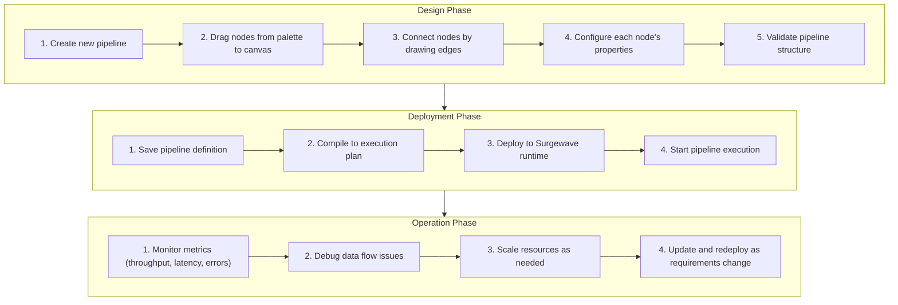

# Lesson 25.1: Pipeline UI Overview

> **Difficulty:** Intermediate | **Duration:** 35 min | **Prerequisites:** Unit 7 completion

## Overview

Learn the fundamentals of Surgewave's Visual Pipeline UI, understand its architecture, and discover when to use visual pipelines versus code-based approaches. This lesson introduces the core concepts that power Surgewave's intuitive graphical pipeline designer.

## Learning Objectives

- Understand the Visual Pipeline UI architecture and components
- Learn when to choose visual pipelines over code-based pipelines
- Explore the node palette and canvas interactions
- Understand pipeline definitions and their serialization
- Create your first simple visual pipeline programmatically

## Visual Pipeline UI Architecture

The UI is divided into three panels and a toolbar:

| Panel | Location | Contents |
|-------|----------|----------|
| **Node Palette** | Left | Sources, Transforms, Sinks, Logic categories — drag to canvas |
| **Pipeline Canvas** | Center | Visual graph with nodes (S → T → K) connected by edges |
| **Properties Panel** | Right | Selected node config: Topic, Format, Validation status, Run/Debug buttons |
| **Toolbar** | Bottom | New, Open, Save, Validate, Deploy, Monitor actions |

## When to Use Visual Pipelines

| Use Visual Pipelines When | Use Code Pipelines When |
|---------------------------|-------------------------|
| Rapid prototyping and experimentation | Complex business logic requiring custom code |
| Team includes non-developers (analysts, data engineers) | Need full version control and code review |
| Pipeline topology changes frequently | Extensive unit testing requirements |
| Need immediate visual feedback | CI/CD integration with automated deployments |
| Simple transformations (filter, map, aggregate) | Performance-critical hot paths |
| Data integration / ETL scenarios | Reusable pipeline components as libraries |
| Debugging data flow visually | |

## Core Components

### Node Types

| Category | Node Type | Description |
|----------|-----------|-------------|
| **Sources** | Topic Source | Reads from Surgewave topics |
| | File Source | Reads from file systems |
| | HTTP Source | Receives HTTP webhooks |
| | Timer Source | Generates periodic events |
| **Transforms** | Filter | Conditionally passes records |
| | Map | Transforms record values |
| | FlatMap | One-to-many transformations |
| | Aggregate | Groups and aggregates |
| | Join | Combines multiple streams |
| **Sinks** | Topic Sink | Writes to Surgewave topics |
| | File Sink | Writes to file systems |
| | HTTP Sink | Sends HTTP requests |
| | Console Sink | Debug output |
| **Logic** | Branch | Conditional routing |
| | Merge | Combines multiple paths |
| | Delay | Adds processing delay |

### Pipeline Definition

```json
{
  "id": "order-processing-pipeline",
  "name": "Order Processing Pipeline",
  "version": "1.0.0",
  "nodes": [
    {
      "id": "source-orders",
      "type": "TopicSource",
      "config": { "topic": "raw-orders", "format": "json" },
      "position": { "x": 100, "y": 100 }
    },
    {
      "id": "filter-valid",
      "type": "Filter",
      "config": { "expression": "order.total > 0" },
      "position": { "x": 300, "y": 100 }
    },
    {
      "id": "sink-validated",
      "type": "TopicSink",
      "config": { "topic": "validated-orders" },
      "position": { "x": 500, "y": 100 }
    }
  ],
  "edges": [
    { "from": "source-orders", "to": "filter-valid" },
    { "from": "filter-valid", "to": "sink-validated" }
  ]
}
```

## Pipeline Lifecycle



## Exercise

In this exercise, you will:

1. Create a simple pipeline definition programmatically
2. Define nodes (source, transform, sink)
3. Connect nodes with edges
4. Validate the pipeline structure
5. Simulate pipeline execution

---

**Instructions:** [INSTRUCTIONS.md](INSTRUCTIONS.md)
