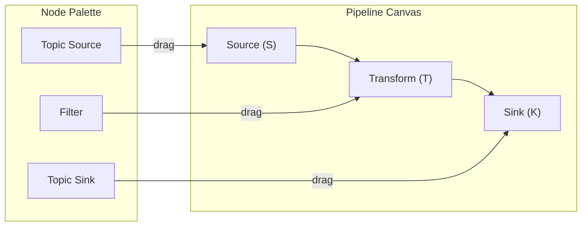

# Lesson 25.2: Creating Visual Pipelines

> **Difficulty:** Intermediate | **Duration:** 40 min | **Prerequisites:** Lesson 25.1 completion

## Overview

Learn how to create visual pipelines by dragging nodes onto the canvas, connecting them with edges, configuring properties, and validating the resulting DAG before deployment.

## Learning Objectives

- Build pipelines by adding nodes programmatically (simulating drag-drop)
- Connect nodes to create data flow paths
- Configure node properties and settings
- Validate pipeline structure and configuration
- Export and import pipeline definitions as JSON

## Drag-Drop Node Interaction

Drag nodes from the palette onto the canvas to build the pipeline graph:



## Pipeline Builder Pattern

```csharp
var pipeline = new PipelineBuilder("my-pipeline")
    .AddSource("source-1", builder => builder
        .FromTopic("input-events")
        .WithFormat("json")
        .AtPosition(100, 100))
    .AddTransform("filter-1", builder => builder
        .Filter("event.type == 'order'")
        .AtPosition(300, 100))
    .AddSink("sink-1", builder => builder
        .ToTopic("filtered-events")
        .AtPosition(500, 100))
    .Connect("source-1", "filter-1")
    .Connect("filter-1", "sink-1")
    .Build();
```

## Node Connection Rules

**Valid connections:**

| From | To | Reason |
|------|----|--------|
| Source | Transform | Data flows from source |
| Source | Sink | Direct passthrough |
| Transform | Transform | Chain transformations |
| Transform | Sink | Output processed data |
| Transform | Branch | Split to multiple paths |
| Merge | Transform | Combine then process |
| Merge | Sink | Combine then output |

**Invalid connections:**

| Connection | Reason |
|------------|--------|
| Sink → anything | Sinks are terminal nodes |
| anything → Source | Sources have no inputs |
| Node → same Node | Self-loops not allowed |
| Creates a cycle | DAG must be acyclic |

## Pipeline Export Format

```json
{
  "id": "order-pipeline-v1",
  "name": "Order Processing Pipeline",
  "version": "1.0.0",
  "metadata": {
    "author": "data-team",
    "created": "2024-01-15T10:30:00Z",
    "description": "Filters and routes order events"
  },
  "nodes": [
    {
      "id": "source-orders",
      "type": "TopicSource",
      "name": "Order Events",
      "position": { "x": 100, "y": 100 },
      "config": {
        "topic": "raw-orders",
        "format": "json",
        "startOffset": "earliest"
      }
    },
    {
      "id": "filter-valid",
      "type": "Filter",
      "name": "Filter Valid Orders",
      "position": { "x": 300, "y": 100 },
      "config": {
        "expression": "order.total > 0 && order.status != 'cancelled'"
      }
    },
    {
      "id": "sink-validated",
      "type": "TopicSink",
      "name": "Validated Orders",
      "position": { "x": 500, "y": 100 },
      "config": {
        "topic": "validated-orders",
        "format": "json"
      }
    }
  ],
  "edges": [
    { "from": "source-orders", "to": "filter-valid", "label": "" },
    { "from": "filter-valid", "to": "sink-validated", "label": "" }
  ]
}
```

## Canvas Operations

| Operation | Description |
|-----------|-------------|
| Add Node | Drag from palette or double-click palette item |
| Move Node | Click and drag on canvas |
| Delete Node | Select and press Delete or right-click menu |
| Connect | Drag from output port to input port |
| Disconnect | Click edge and press Delete |
| Select Multiple | Shift+Click or draw selection box |
| Zoom | Mouse wheel or +/- buttons |
| Pan | Middle-click drag or scroll bars |

## Exercise

In this exercise, you will:

1. Implement a PipelineBuilder with fluent API
2. Create nodes using builder methods
3. Connect nodes and validate connections
4. Export pipeline to JSON format
5. Import pipeline from JSON and execute

---

**Instructions:** [INSTRUCTIONS.md](INSTRUCTIONS.md)
