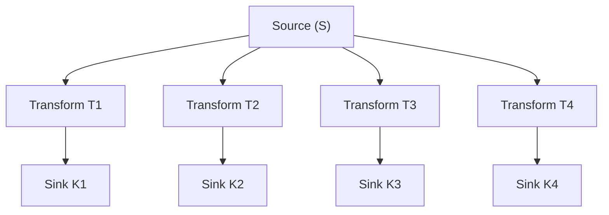
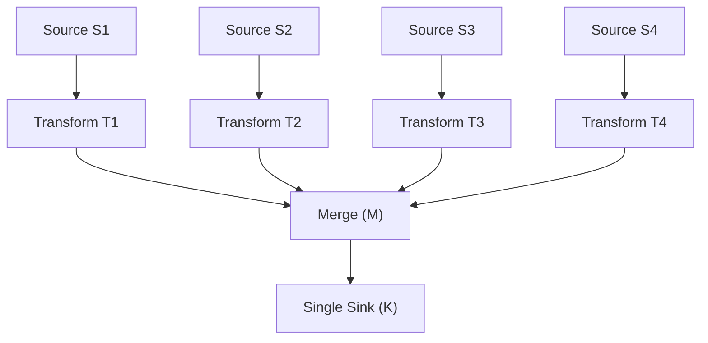
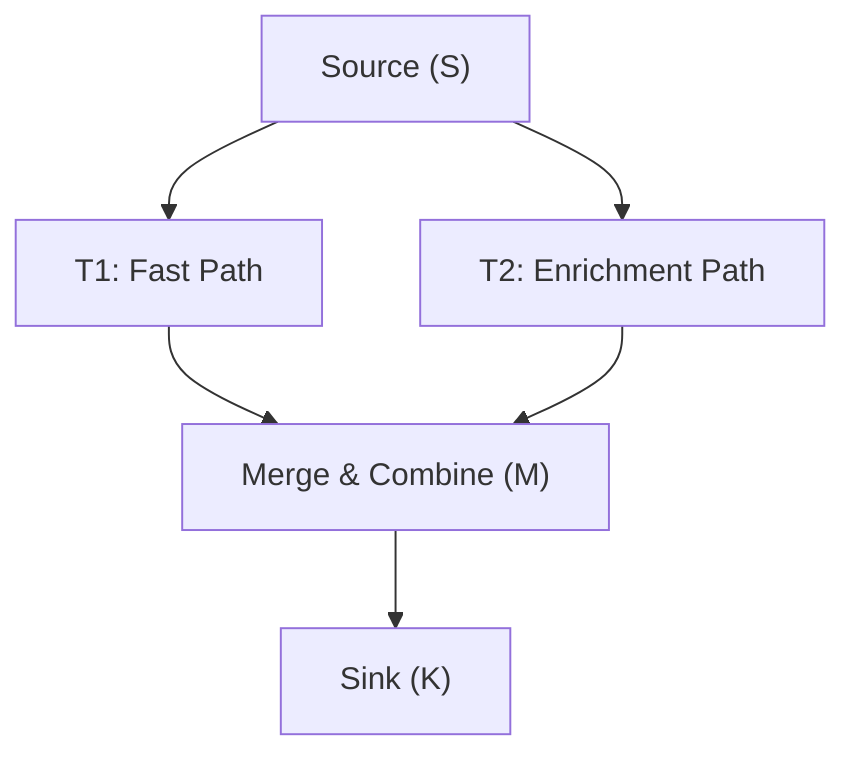
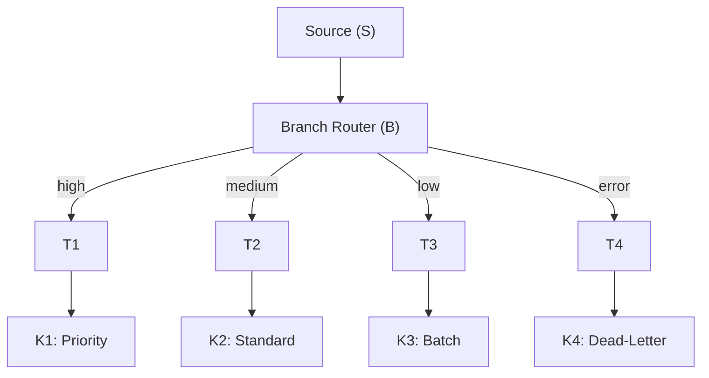
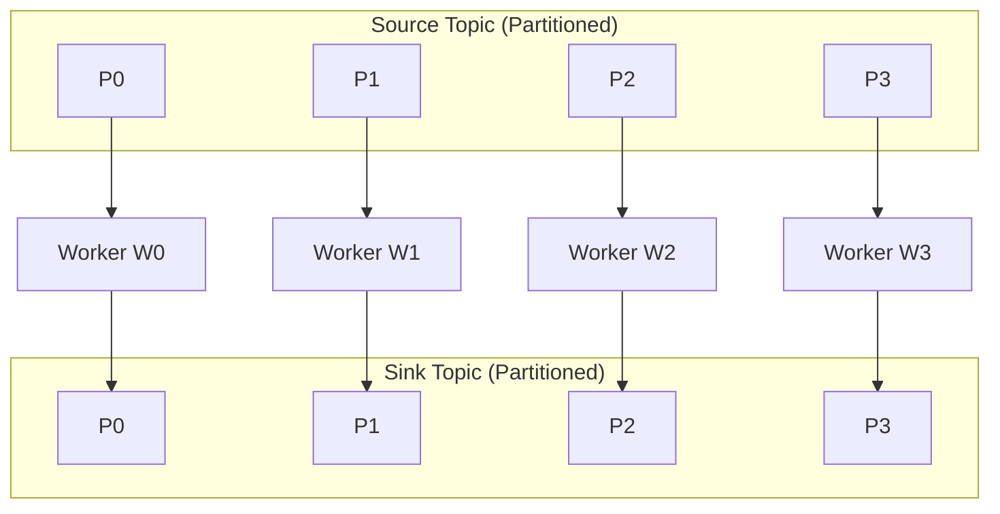

# Lesson 25.4: DAG Patterns - Fan-out, Fan-in

> **Difficulty:** Advanced | **Duration:** 50 min | **Prerequisites:** Lesson 25.3 completion

## Overview

Master advanced DAG patterns for visual pipelines including fan-out (splitting data to multiple paths), fan-in (merging multiple paths), parallel processing, and complex multi-stage topologies.

## Learning Objectives

- Implement fan-out patterns to distribute data to multiple processors
- Implement fan-in patterns to merge results from parallel paths
- Design parallel processing pipelines for performance
- Create complex multi-stage DAG topologies
- Understand pattern trade-offs and use cases

## Fan-Out Pattern

Use cases: route orders to different fulfillment centers, send events to multiple analytics systems, parallel enrichment with different data sources.

## Fan-In Pattern

Use cases: aggregate data from multiple regions, combine results from parallel processing, unified logging from multiple sources.

## Diamond Pattern (Fan-Out + Fan-In)

## Conditional Branch Pattern

## Parallel Processing Pattern

## Exercise

In this exercise, you will:

1. Build a fan-out pipeline that routes orders to different processors
2. Implement a fan-in pipeline that aggregates results
3. Create a diamond pattern for parallel enrichment
4. Implement conditional branching based on data content
5. Execute all patterns with real Surgewave data flow

---

**Instructions:** [INSTRUCTIONS.md](INSTRUCTIONS.md)
