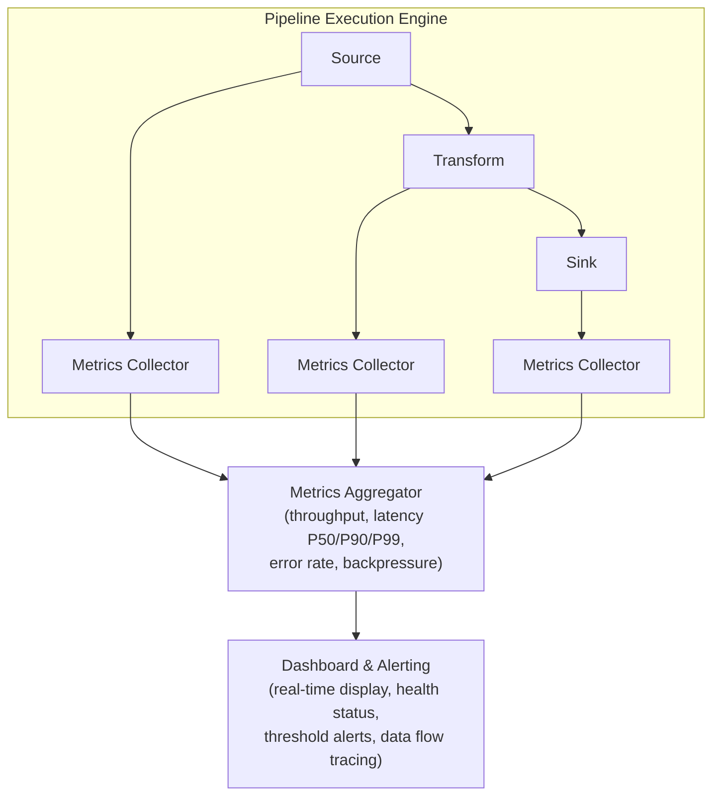

# Lesson 25.5: Pipeline Monitoring and Debugging

> **Difficulty:** Advanced | **Duration:** 45 min | **Prerequisites:** Lesson 25.4

## Overview

Learn how to monitor running pipelines, collect metrics, debug data flow issues, and visualize pipeline health. Understand throughput tracking, latency measurement, error rate monitoring, and techniques for troubleshooting pipeline problems.

## Learning Objectives

- Implement pipeline metrics collection (throughput, latency, error rate)
- Build a real-time pipeline monitoring dashboard
- Create data flow tracing for debugging
- Detect and diagnose common pipeline issues
- Visualize pipeline health with ASCII dashboards

## Pipeline Monitoring Architecture

## Key Metrics

| Category | Metrics |
|----------|---------|
| **Throughput** | Messages/sec per node and total; bytes/sec; messages filtered/dropped |
| **Latency** | Processing time per node (P50/P90/P99); end-to-end pipeline latency; queue wait time between nodes |
| **Errors** | Error count and rate per node; error types (serialization, timeout, validation); dead-letter queue depth |
| **Resources** | Memory usage per node; CPU utilization; queue/buffer utilization |

## Health Status Levels

| Status | Indicator | Description |
|--------|-----------|-------------|
| Healthy | [OK] | All metrics within normal ranges |
| Warning | [WARN] | Approaching threshold limits |
| Critical | [CRIT] | Threshold exceeded, intervention needed |
| Error | [ERR] | Node has failed, pipeline degraded |

## Debugging Techniques

| Technique | Description | Use When |
|-----------|-------------|----------|
| Message tracing | Follow a single message through all nodes | Investigating data transformation issues |
| Snapshot inspection | Capture node state at a point in time | Debugging state accumulation |
| Replay | Re-process messages from a specific offset | Reproducing bugs |
| Metric correlation | Compare metrics across nodes | Finding bottlenecks |

## Exercise

In this exercise, you will:

1. Implement pipeline metrics collection
2. Build a monitoring dashboard with health indicators
3. Create message tracing for debugging
4. Simulate pipeline issues and detect them
5. Display real-time throughput and latency stats

---

**Instructions:** [INSTRUCTIONS.md](INSTRUCTIONS.md)
