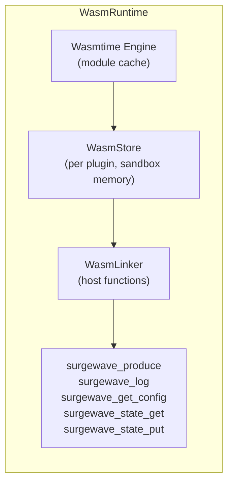
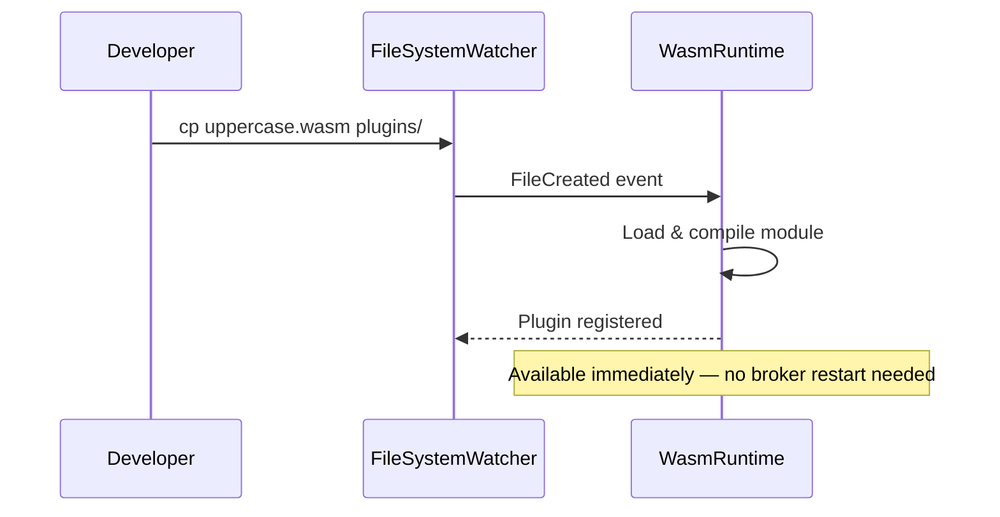

# Lesson 25.6: WebAssembly Plugins

> **Difficulty:** Advanced | **Duration:** 50 min | **Prerequisites:** Lesson 25.5

## Overview

Learn how Surgewave's WebAssembly (WASM) plugin system lets you write pipeline nodes in any language that compiles to WASM — Rust, C, Go, AssemblyScript — and hot-deploy them without restarting the broker. WASM plugins run in a sandboxed environment with explicit host function bindings, giving you the extensibility of custom code with the safety of isolation.

## Learning Objectives

- Understand why WASM is a powerful plugin model for Surgewave
- Navigate the `WasmRuntime` (Wasmtime engine) and its lifecycle
- Identify the four plugin types: Source, Sink, Transform, Function
- Read and write `WasmPluginManifest` JSON descriptors
- Use `WasmHostFunctions` to interact with Surgewave from inside WASM
- Hot-deploy a plugin via the filesystem watcher or REST API
- Write and test a simple WASM transform in AssemblyScript

## Why WebAssembly for Plugins?

| | Native .NET Plugin | WASM Plugin (Surgewave) |
|-|-------------------|---------------------|
| **Pros** | Full .NET API access; maximum performance | Sandboxed (plugin faults cannot crash the broker); language-agnostic (Rust, C, Go, AssemblyScript); hot-deploy without restart; portable (.wasm binary runs on Windows, Linux, ARM) |
| **Cons** | Crash in plugin crashes broker; must compile against exact Surgewave version; only C#/.NET supported | Slightly more overhead than native code (< 5% in practice) |

## WasmRuntime Architecture

The `WasmRuntime` wraps the [Wasmtime](https://wasmtime.dev/) engine, which is the same runtime used by the Cloud Native Computing Foundation and the Bytecode Alliance:



Each plugin gets its own `WasmStore` (isolated linear memory). The compiled module is cached so repeated loads of the same `.wasm` file incur no recompilation cost.

## Plugin Types

Surgewave WASM plugins implement one of four exported function signatures:

| Plugin Type | Exported Function | Description |
|-------------|-------------------|-------------|
| `Source` | `wasm_source_poll() -> i32` | Generates messages; called on a timer by Surgewave |
| `Sink` | `wasm_sink_write(ptr: i32, len: i32) -> i32` | Receives messages for writing to an external system |
| `Transform` | `wasm_transform(ptr: i32, len: i32) -> i32` | Reads a message, returns modified bytes |
| `Function` | `wasm_function(ptr: i32, len: i32) -> i32` | Stateless computation; no I/O side effects |

Pointers and lengths refer to offsets in the plugin's linear memory (WASM heap). Surgewave serializes message payloads as UTF-8 JSON into the plugin's shared memory buffer before calling the exported function.

## WasmPluginManifest

Every plugin ships with a `manifest.json` file that describes its metadata, type, configuration schema, and resource limits:

```json
{
  "name": "uppercase-transform",
  "version": "1.0.0",
  "description": "Uppercases the 'body' field of every JSON message",
  "type": "Transform",
  "entrypoint": "uppercase.wasm",
  "author": "Your Team",
  "config": {
    "field": {
      "type": "string",
      "default": "body",
      "description": "JSON field name to uppercase"
    }
  },
  "limits": {
    "maxMemoryMb": 16,
    "maxExecutionMs": 10,
    "maxFuelInstructions": 1000000
  }
}
```

### Manifest Fields

| Field | Description |
|-------|-------------|
| `name` | Unique plugin identifier |
| `type` | One of `Source`, `Sink`, `Transform`, `Function` |
| `entrypoint` | Relative path to the `.wasm` binary |
| `config` | JSON Schema for plugin-specific configuration |
| `limits.maxMemoryMb` | Sandbox memory cap |
| `limits.maxExecutionMs` | Wall-clock timeout per invocation |
| `limits.maxFuelInstructions` | Wasmtime fuel limit (CPU instruction budget) |

## Hot-Deploy via FileSystemWatcher

Surgewave watches the configured `WasmPluginsDirectory` for changes. When you copy or update a `.wasm` file or `manifest.json`, the broker automatically loads the new version:



You do not need to restart the broker or any running pipeline. Existing pipeline instances using an older version of the plugin continue running until the next message; new instances pick up the latest version.

## WasmHostFunctions

Plugins can call back into Surgewave via host functions exposed through the `WasmLinker`. These functions are the only way a plugin can communicate with the outside world:

| Host Function | Signature | Description |
|---------------|-----------|-------------|
| `surgewave_produce` | `(topic_ptr, topic_len, msg_ptr, msg_len) -> i32` | Produce a message to a Surgewave topic |
| `surgewave_log` | `(level: i32, ptr: i32, len: i32) -> void` | Write a log entry (0=debug, 1=info, 2=warn, 3=error) |
| `surgewave_get_config` | `(key_ptr, key_len, val_ptr, val_cap) -> i32` | Read a plugin config value into a buffer |
| `surgewave_state_get` | `(key_ptr, key_len, val_ptr, val_cap) -> i32` | Read from the plugin's persistent key-value state |
| `surgewave_state_put` | `(key_ptr, key_len, val_ptr, val_len) -> i32` | Write to the plugin's persistent key-value state |

State is scoped per plugin instance and persisted to the broker's embedded store, so values survive broker restarts.

## REST API Reference

| Method | Endpoint | Description |
|--------|----------|-------------|
| `GET` | `/api/wasm/plugins` | List all loaded WASM plugins |
| `POST` | `/api/wasm/plugins` | Upload a `.wasm` binary + manifest (multipart) |
| `DELETE` | `/api/wasm/plugins/{name}` | Unload a plugin |
| `GET` | `/api/wasm/plugins/{name}` | Get plugin metadata and manifest |
| `POST` | `/api/wasm/plugins/{name}/invoke` | Invoke a Function plugin ad-hoc |
| `GET` | `/api/wasm/plugins/{name}/stats` | Invocation count, avg latency, error count |

### Upload a Plugin

```bash
curl -X POST http://localhost:9092/api/wasm/plugins \
     -F "wasm=@uppercase.wasm" \
     -F "manifest=@manifest.json"
```

```json
{ "name": "uppercase-transform", "status": "loaded", "type": "Transform" }
```

### Invoke a Function Plugin

```bash
curl -X POST http://localhost:9092/api/wasm/plugins/uppercase-transform/invoke \
     -H "Content-Type: application/json" \
     -d '{"body": "hello world"}'
```

```json
{ "result": "{\"body\":\"HELLO WORLD\"}", "latencyMicroseconds": 82 }
```

## Writing a WASM Transform in AssemblyScript

AssemblyScript compiles TypeScript-like syntax to WASM. Here is a complete transform that uppercases the `body` field:

```typescript
// uppercase.ts (AssemblyScript)
import { JSON } from "assemblyscript-json";

// Surgewave calls this with a pointer and length into linear memory.
// We return a pointer to the modified message (also in linear memory).
export function wasm_transform(ptr: i32, len: i32): i32 {
  const input = String.UTF8.decode(memory.buffer, ptr, len);
  const obj = JSON.parse(input) as JSON.Obj;

  const field = obj.getString("body");
  if (field !== null) {
    obj.set("body", field.valueOf().toUpperCase());
  }

  const output = obj.stringify();
  const outBytes = String.UTF8.encode(output);
  const outPtr = heap.alloc(outBytes.byteLength);
  memory.copy(outPtr, changetype<usize>(outBytes), outBytes.byteLength);

  // Encode [ptr(i32), len(i32)] into a single i64 return value
  // Surgewave reads both halves to locate the output buffer.
  return encodeResult(outPtr, outBytes.byteLength);
}

function encodeResult(ptr: i32, len: i32): i32 {
  // Convention: write result header at a fixed offset, return that offset.
  store<i32>(0, ptr);
  store<i32>(4, len);
  return 0;
}
```

Compile with:

```bash
npx asc uppercase.ts --target release --outFile uppercase.wasm --optimize
```

## Configuration

```json
{
  "Surgewave": {
    "Wasm": {
      "Enabled": true,
      "PluginsDirectory": "wasm-plugins",
      "MaxConcurrentInvocations": 32,
      "DefaultTimeoutMs": 10,
      "EnableFuelMetering": true
    }
  }
}
```

| Setting | Default | Description |
|---------|---------|-------------|
| `Enabled` | `false` | Enable the WASM runtime |
| `PluginsDirectory` | `wasm-plugins/` | Directory watched for `.wasm` + `manifest.json` files |
| `MaxConcurrentInvocations` | `32` | Maximum parallel plugin invocations |
| `DefaultTimeoutMs` | `10` | Fallback timeout when not specified in the manifest |
| `EnableFuelMetering` | `true` | Enforce CPU instruction budgets (prevents infinite loops) |

## Using a WASM Plugin as a Pipeline Node

Once a plugin is loaded, you can reference it by name in a pipeline definition:

```csharp
var pipeline = new PipelineDefinition
{
    Name = "text-enrichment",
    Nodes =
    [
        new SourceNodeConfig
        {
            NodeId = "source",
            Topic  = "raw-messages"
        },
        new WasmNodeConfig
        {
            NodeId     = "uppercase",
            PluginName = "uppercase-transform",
            Inputs     = ["source"],
            Config     = new Dictionary<string, string>
            {
                ["field"] = "body"
            }
        },
        new SinkNodeConfig
        {
            NodeId = "sink",
            Topic  = "enriched-messages",
            Inputs = ["uppercase"]
        }
    ]
};
```

## Exercise

In this exercise, you will:

1. Enable WASM support in `appsettings.json`
2. Create a `manifest.json` for a simple transform plugin
3. Download or build `uppercase.wasm` from the provided AssemblyScript source in `assets/`
4. Copy both files to the `wasm-plugins/` directory and watch the broker load the plugin
5. Create a pipeline that routes messages through the WASM transform
6. Produce messages to the source topic and verify the `body` field is uppercased in the sink topic
7. Call `/api/wasm/plugins/uppercase-transform/stats` and verify invocation count and latency
8. Modify the `.wasm` file and drop it in again — verify the pipeline picks up the new version without restart

---
