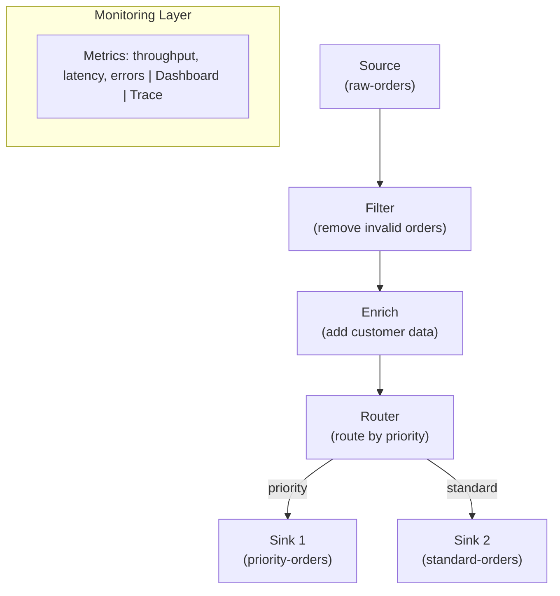

# Unit 25 Project: Visual Pipeline - Multi-Stage Data Processing

Build a multi-stage data processing pipeline demonstrating source, transform, and sink patterns with real-time monitoring, DAG execution, and metrics collection.

## Scenario

You're building a data processing pipeline for an e-commerce platform that must:

1. Ingest order events from a Surgewave topic (source)
2. Validate and filter invalid orders (transform)
3. Enrich orders with customer data (transform)
4. Route orders by priority using conditional branching (transform)
5. Write processed orders to output topics (sink)
6. Monitor the entire pipeline with metrics and health checks

## Requirements

### Functional Requirements

- [ ] Implement a source node that reads from a Surgewave topic
- [ ] Implement filter, map, and branch transform nodes
- [ ] Implement sink nodes that write to output topics
- [ ] Build a DAG executor that processes messages through the pipeline
- [ ] Collect per-node metrics (throughput, latency, errors)
- [ ] Display a monitoring dashboard after processing

### Technical Requirements

- [ ] Use Surgewave producer/consumer for real message flow
- [ ] Support at least 3 transform stages in the pipeline
- [ ] Implement conditional routing (at least 2 output paths)
- [ ] Calculate and display P50/P99 latency per node
- [ ] Detect and report pipeline bottlenecks
- [ ] Handle errors gracefully without stopping the pipeline

## Architecture



## Expected Output

```
=== Visual Pipeline Project: E-Commerce Order Processing ===

[Setup] Surgewave broker started on port 12345
[Setup] Pipeline: Source -> Filter -> Enrich -> Router -> Sinks

--- Phase 1: Producing Test Orders ---
[Producer] Sent 200 orders (mix of valid/invalid, high/standard priority)

--- Phase 2: Processing Pipeline ---
[Source] Reading from 'raw-orders' topic...
  Processing order ORD-0001... [valid] [enriched] [priority: high]
  Processing order ORD-0002... [valid] [enriched] [priority: standard]
  Processing order ORD-0003... [invalid - amount 0] [dropped]
  ...
  Processed 200 messages in 1.5 seconds

--- Phase 3: Pipeline Dashboard ---
+----------------------------------------------------------+
|              Pipeline Monitoring Dashboard                |
+----------------------------------------------------------+

  [OK]   Order Source               | Processed:    200 | Errors:   0
                                    | Throughput:    133 msg/s | P99:   3.2ms

  [OK]   Order Validator            | Processed:    185 | Dropped:  15
                                    | Throughput:    123 msg/s | P99:   1.1ms

  [WARN] Customer Enrichment        | Processed:    182 | Errors:   3
                                    | Throughput:     95 msg/s | P99:  45.0ms

  [OK]   Priority Router            | Processed:    182 | Errors:   0
                                    | Throughput:    121 msg/s | P99:   0.5ms

  [OK]   Priority Sink              | Processed:     45 | Errors:   0
  [OK]   Standard Sink              | Processed:    137 | Errors:   0

--- Phase 4: Analysis ---
  Bottleneck: Customer Enrichment (95 msg/s)
  Drop rate: 7.5% at Order Validator
  Error rate: 1.6% at Customer Enrichment
  High-priority orders: 45 (24.7%)
  Standard orders: 137 (75.3%)

=== Pipeline Complete ===
```

## Getting Started

```bash
cd bootcamp/unit-25/project/start
dotnet run
```

## Hints

1. Reuse patterns from Lessons 25.3 (connectors) and 25.4 (DAG patterns)
2. Use the metrics collector from Lesson 25.5
3. Add `Task.Delay` to simulate enrichment latency
4. Use `Random.Shared.Next` to generate varied test data
5. Track start time per message for end-to-end latency

## Evaluation Criteria

| Criteria | Points |
|----------|--------|
| Source, transform, and sink nodes working | 20 |
| DAG execution with at least 3 transforms | 20 |
| Conditional routing to multiple sinks | 15 |
| Metrics collection and dashboard | 20 |
| Bottleneck detection and analysis | 10 |
| Code quality and organization | 15 |

## Solution

Compare your implementation with [completed/](completed/README.md) when done.
