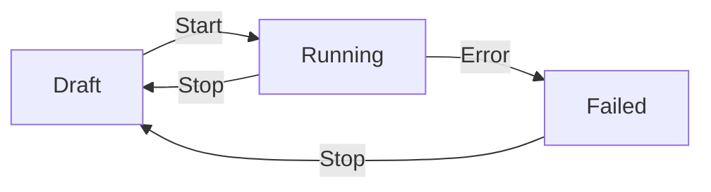
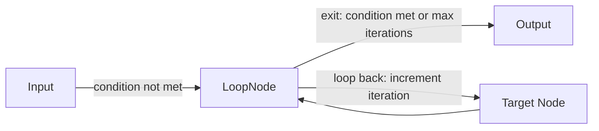
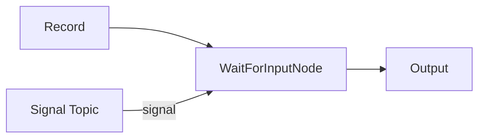
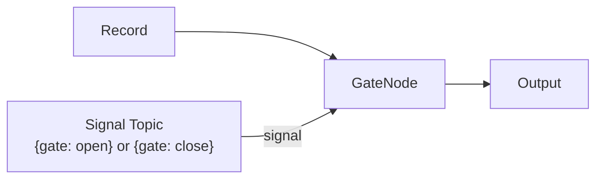
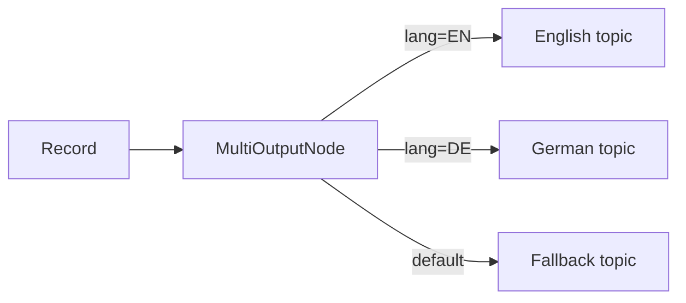
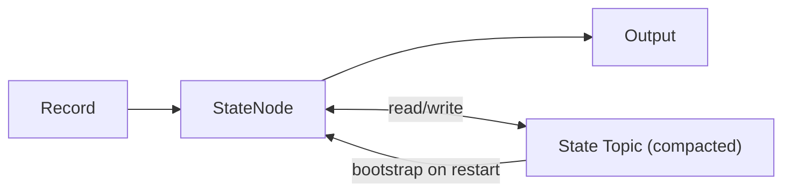
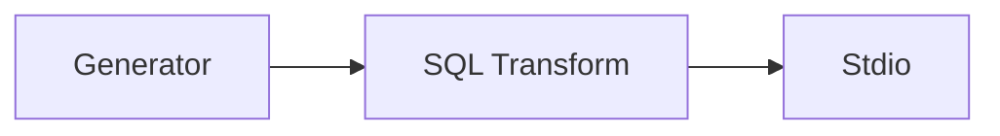
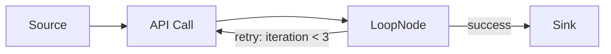

# Unit 17: Hands-On Pipeline & Workflow Building

Build production-ready data processing and AI pipelines from scratch using Surgewave's visual Pipeline Editor. This unit goes beyond the visual UI concepts covered in Unit 16, focusing on hands-on construction of real pipelines, deep configuration of every node type, workflow orchestration patterns, and interactive chat-based AI pipelines.

## Learning Objectives

By the end of this unit, you will be able to:

- Understand the internal anatomy of a pipeline: definitions, nodes, connections, and status lifecycle
- Identify and configure every node category: sources, sinks, transforms, AI/ML, and workflow nodes
- Build data processing pipelines step-by-step in the visual editor
- Construct RAG and agent pipelines from templates and from scratch
- Apply workflow patterns: human-in-the-loop, batch processing, conditional routing, retry loops, and stateful processing
- Use the Pipeline Chat API for real-time conversational AI
- Debug and monitor running pipelines with breakpoints and live data preview

## Lessons

| Lesson | Topic | Description |
|--------|-------|-------------|
| 34.1 | Pipeline Anatomy | PipelineDefinition model, nodes, connections, status lifecycle |
| 34.2 | Node Types & Categories | Source, sink, transform, AI/ML, streams, and workflow nodes |
| 34.3 | Building Your First Pipeline | Step-by-step: Generator -> SQL Transform -> Stdio |
| 34.4 | Building a RAG Pipeline | RAG chatbot from template and from scratch with 7 nodes |
| 34.5 | Building an Agent Pipeline | Agent with MCP tool access from template |
| 34.6 | Workflow Patterns | Human-in-the-loop, batching, routing, retry, stateful |
| 34.7 | Pipeline Chat & Streaming | Chat API, sessions, SSE streaming, ChatDrawer |
| 34.8 | Advanced Pipeline Features | Templates, seeder, versioning, hot-deploy, sub-pipelines |
| 34.9 | Debugging Pipelines | Live preview, breakpoints, step-through, error inspection |

## Prerequisites

- Completed Unit 1: Surgewave Fundamentals
- Completed Unit 2: Producer & Consumer Basics
- Completed Unit 16: Visual Pipeline UI
- Completed Unit 2: Surgewave Control UI Mastery (Lesson 2.4 recommended)
- Surgewave Broker running with Connect enabled and AI node plugins loaded

---

## Lesson 17.1: Pipeline Anatomy

Every pipeline in Surgewave is a directed graph of processing nodes connected by edges. Understanding the underlying data model is essential before building anything in the editor.

### PipelineDefinition

The `PipelineDefinition` record is the root object stored by the broker:

```csharp
public record PipelineDefinition
{
    public required string Id { get; init; }
    public required string Name { get; init; }
    public string? Description { get; init; }
    public required List<PipelineNode> Nodes { get; init; }
    public required List<PipelineConnection> Connections { get; init; }
    public PipelineStatus Status { get; init; }
    public DateTimeOffset CreatedAt { get; init; }
    public DateTimeOffset? UpdatedAt { get; init; }
    public string? Error { get; init; }
    public Dictionary<string, string>? Parameters { get; init; }
    public ScheduleConfig? Schedule { get; init; }
}
```

| Field | Purpose |
|-------|---------|
| `Id` | Unique pipeline identifier (e.g., `"my-etl-pipeline"`) |
| `Name` | Human-readable display name |
| `Description` | What the pipeline does |
| `Nodes` | List of processing nodes (see below) |
| `Connections` | Edges between nodes |
| `Status` | Current lifecycle state |
| `Error` | Error message if status is `Failed` |
| `Parameters` | Runtime parameter overrides |
| `Schedule` | Optional cron/interval schedule |

### PipelineNode

Each node in the graph maps to a connector class:

```csharp
public record PipelineNode
{
    public required string Id { get; init; }
    public required string ConnectorType { get; init; }
    public required Dictionary<string, string> Config { get; init; }
    public required double X { get; init; }
    public required double Y { get; init; }
    public string? Label { get; init; }
    public RetryPolicy? RetryPolicy { get; init; }
    public string? SubPipelineId { get; init; }
    public string? PortMappingsJson { get; init; }
}
```

| Field | Purpose |
|-------|---------|
| `Id` | Unique node ID within the pipeline (e.g., `"source-1"`) |
| `ConnectorType` | Fully qualified .NET type name of the connector |
| `Config` | Key-value configuration for the connector |
| `X`, `Y` | Canvas position in the visual editor |
| `Label` | Display label shown on the node |
| `RetryPolicy` | Optional retry configuration |
| `SubPipelineId` | Reference to a sub-pipeline (composite nodes) |
| `PortMappingsJson` | Port mappings for sub-pipeline nodes |

### PipelineConnection

Connections define data flow between nodes:

```csharp
public record PipelineConnection
{
    public required string Id { get; init; }
    public required string SourceNodeId { get; init; }
    public required string TargetNodeId { get; init; }
    public string? InternalTopic { get; init; }
    public PipelineConnectionType Type { get; init; } = PipelineConnectionType.Normal;
}
```

Connection types:

| Type | Description |
|------|-------------|
| `Normal` | Standard data flow connection |
| `Error` | Routes failed records to a dead-letter queue or error handler |

> **Implementation detail:** Each connection is backed by an internal Surgewave topic. The `InternalTopic` field stores the auto-generated topic name used for inter-node communication.

### Pipeline Status Lifecycle



| Status | Description |
|--------|-------------|
| `Draft` | Pipeline created but not started. Nodes can be added, removed, and configured. |
| `Running` | Pipeline is actively processing data. Connectors are started, topics are created. |
| `Stopped` | Pipeline explicitly stopped. Internal topics are preserved for restart. |
| `Failed` | A node encountered an unrecoverable error. The `Error` field contains details. |

### Creating Pipelines: Three Ways

| Method | When to Use |
|--------|-------------|
| **Visual Editor** | Interactive design, prototyping, non-developers |
| **REST API** | Automation, CI/CD, programmatic creation |
| **Templates** | Starting from proven patterns (RAG, ETL, agents) |

**REST API example** -- create a simple two-node pipeline:

```bash
curl -X POST http://localhost:5050/api/pipelines \
  -H "Content-Type: application/json" \
  -d '{
    "name": "My First Pipeline",
    "description": "Generator to console output",
    "nodes": [
      {
        "id": "gen-1",
        "connectorType": "Kuestenlogik.Surgewave.Connect.Sources.GeneratorSourceConnector",
        "config": { "interval.ms": "1000", "format": "json" },
        "x": 100, "y": 200, "label": "Generator"
      },
      {
        "id": "out-1",
        "connectorType": "Kuestenlogik.Surgewave.Connect.Sinks.StdioSinkConnector",
        "config": {},
        "x": 400, "y": 200, "label": "Console Output"
      }
    ],
    "connections": [
      { "id": "c1", "sourceNodeId": "gen-1", "targetNodeId": "out-1" }
    ]
  }'
```

---

## Lesson 17.2: Node Types & Categories

Surgewave's node palette organizes connectors into categories. This lesson covers every category and its key nodes, with emphasis on the six workflow nodes.

### Source Nodes

Source nodes ingest data into the pipeline:

| Node | ConnectorType | Purpose |
|------|---------------|---------|
| File Source | `Kuestenlogik.Surgewave.Connect.Sources.FileSourceConnector` | Read files from a directory with polling |
| Generator | `Kuestenlogik.Surgewave.Connect.Sources.GeneratorSourceConnector` | Generate synthetic data for testing |
| ChatEndpoint | `Kuestenlogik.Surgewave.AI.Nodes.ChatEndpointNode` | Accept chat messages via WebSocket/HTTP |
| HTTP Source | `Kuestenlogik.Surgewave.Connect.Sources.HttpSourceConnector` | Receive HTTP webhooks |

### Sink Nodes

Sink nodes write data out of the pipeline:

| Node | ConnectorType | Purpose |
|------|---------------|---------|
| FileStream | `Kuestenlogik.Surgewave.Connect.Sinks.FileStreamSinkConnector` | Write records to files |
| Stdio | `Kuestenlogik.Surgewave.Connect.Sinks.StdioSinkConnector` | Print records to standard output |
| ChatResponse | `Kuestenlogik.Surgewave.AI.Nodes.ChatResponseNode` | Send responses back to chat clients |

### Transform Nodes

Transform nodes modify data in-flight:

| Node | ConnectorType | Purpose |
|------|---------------|---------|
| DocumentParser | `Kuestenlogik.Surgewave.AI.Nodes.DocumentParserNode` | Parse PDF/DOCX/HTML, chunk text |
| Embedder | `Kuestenlogik.Surgewave.AI.Nodes.EmbedderNode` | Generate vector embeddings |
| PromptBuilder | `Kuestenlogik.Surgewave.AI.Nodes.PromptBuilderNode` | Assemble prompts with templates |
| Reranker | `Kuestenlogik.Surgewave.AI.Nodes.RerankerNode` | Rerank retrieved documents |

### AI/ML Nodes

AI nodes provide LLM and agent capabilities:

| Node | ConnectorType | Purpose |
|------|---------------|---------|
| LLM | `Kuestenlogik.Surgewave.AI.Nodes.LlmNode` | Call OpenAI/Anthropic models |
| Agent | `Kuestenlogik.Surgewave.AI.Nodes.AgentNode` | Autonomous agent with tool access via MCP |
| Retriever | `Kuestenlogik.Surgewave.AI.Nodes.RetrieverNode` | Retrieve from vector store by similarity |

### Workflow Nodes (Detailed)

Workflow nodes control execution flow, enable human interaction, and manage state. All six workflow nodes live in the `Kuestenlogik.Surgewave.Connect.Nodes.Workflow` namespace.

#### LoopNode -- Feedback Loop

Sends records back to an earlier node until a condition is met or max iterations reached.



| Config Key | Type | Default | Description |
|------------|------|---------|-------------|
| `max.iterations` | int | `5` | Maximum loop iterations before forcing exit |
| `condition.field` | string | | JSON field to check for loop termination |
| `condition.value` | string | | Value that means "done" (exit loop) |
| `condition.operator` | string | `equals` | Comparison: `equals`, `not_equals`, `contains`, `greater_than`, `less_than` |
| `loop.topic` | string | | Topic to send records back to (loop-back path) |
| `output.topic` | string | | Topic for records that pass the condition (exit path) |
| `iteration.header` | string | `x-loop-iteration` | Header tracking iteration count |

When max iterations are exceeded, the record exits with an `x-loop-exhausted: true` header.

#### WaitForInputNode -- Human-in-the-Loop

Pauses workflow execution and waits for an external signal before continuing. Stores waiting records by correlation key and merges them with incoming signals.



| Config Key | Type | Default | Description |
|------------|------|---------|-------------|
| `signal.topic` | string | | Topic to listen for input/signals |
| `correlation.field` | string | | Field to correlate input with waiting record (e.g., `session_id`) |
| `timeout.ms` | long | `300000` | How long to wait before timeout (default 5 minutes) |
| `timeout.action` | string | `emit_timeout` | Action on timeout: `emit_timeout`, `drop`, `emit_error` |
| `merge.strategy` | string | `combine` | How to merge original + input: `combine`, `replace`, `append` |
| `output.topic` | string | | Output topic after input received |

Merge strategies:
- **combine**: Merge JSON properties from both records (signal properties overwrite originals)
- **replace**: Discard original, use only the signal record
- **append**: Add signal under `_input` key in the original record

#### GateNode -- Flow Control

Opens or closes the data flow based on an external signal. When closed, records can be buffered or dropped.



| Config Key | Type | Default | Description |
|------------|------|---------|-------------|
| `signal.topic` | string | | Topic for open/close signals |
| `default.state` | string | `open` | Initial gate state: `open` or `closed` |
| `buffer.when.closed` | bool | `true` | Buffer records when gate is closed, or drop them |
| `max.buffer.size` | int | `1000` | Maximum buffered records when gate is closed |
| `output.topic` | string | | Output topic for records passing through the gate |

When the gate opens, all buffered records are flushed in order.

#### AccumulatorNode -- Batch Processing

Collects records into batches by count or time window, then emits them as a single batch. Supports grouping by a field value for separate accumulators per group.

Records R1, R2, R3 flow into `AccumulatorNode` and are emitted as a batch `[R1, R2, R3]` when `batch.size=3` or `window.ms` elapses.

| Config Key | Type | Default | Description |
|------------|------|---------|-------------|
| `batch.size` | int | `10` | Records per batch before emitting |
| `window.ms` | long | `5000` | Time window in ms (emit even if batch not full) |
| `output.topic` | string | | Output topic for accumulated batches |
| `output.format` | string | `array` | Output format: `array` (JSON array) or `individual` (separate records with batch headers) |
| `group.by.field` | string | | Group into separate batches by field value |

Emitted batch headers include `x-batch-size` and `x-batch-timestamp`.

#### MultiOutputNode -- Conditional Routing

Routes records to multiple named output ports based on field values, or broadcasts to all routes in fan-out mode.



| Config Key | Type | Default | Description |
|------------|------|---------|-------------|
| `route.field` | string | | JSON field to evaluate for routing |
| `route.N.value` | string | | Value for route N (1-10) |
| `route.N.topic` | string | | Output topic for route N |
| `default.topic` | string | | Default output for unmatched records |
| `broadcast` | bool | `false` | If true, send to ALL routes (fan-out) |

Supports up to 10 named routes with a default fallback.

#### StateNode -- Persistent Key-Value State

Reads and writes persistent key-value state within a workflow. Maintains an in-memory cache backed by a compacted topic for persistence. Supports TTL-based expiry.



| Config Key | Type | Default | Description |
|------------|------|---------|-------------|
| `state.topic` | string | | Compacted topic for state storage |
| `operation` | string | `read_write` | Mode: `read`, `write`, or `read_write` |
| `key.field` | string | | JSON field for state key |
| `value.field` | string | | JSON field for state value (write) |
| `output.field` | string | `state` | Field to put read state into |
| `output.topic` | string | | Output topic for processed records |
| `ttl.ms` | long | `0` | State entry TTL in ms (0 = no expiry) |

In `read_write` mode, the node reads existing state first, then writes the updated value, and emits the record with the previous state merged in.

### Extended Connector Metadata

Every connector is annotated with a `ConnectorMetadata` attribute that provides rich metadata for the UI:

```csharp
[ConnectorMetadata(
    DisplayName = "Elasticsearch Sink",
    Icon = "search",
    Category = "Search",
    Description = "Indexes documents into Elasticsearch")]
public class ElasticsearchSinkConnector : ISinkConnector { ... }
```

The `DisplayName`, `Icon`, and `Category` fields determine how the connector appears in the Node Palette. When browsing connectors, this metadata lets you quickly identify connectors by visual category rather than scanning raw type names.

### Discovering Available Nodes

In the Pipeline Editor, the left sidebar shows the **Node Palette** organized by category. The palette aggregates both local connectors (loaded from the broker's plugin directory) and remote connectors (advertised by connected worker nodes). You can also query available connector types programmatically:

```bash
# List all available connector types
curl http://localhost:5050/api/connectors

# Response includes ConnectorType, DisplayName, Description, Category, Icon for each
```

---

## Lesson 17.3: Building Your First Pipeline (Step-by-Step)

This lesson walks you through building a simple data pipeline from scratch using the Surgewave Control UI at `http://localhost:5050`.

### Step 1: Open the Pipeline Editor

1. Navigate to **Pipelines** in the left sidebar
2. Click **+ New Pipeline**
3. The visual editor canvas opens with an empty workspace

### Step 2: Add a Generator Source Node

1. In the Node Palette (left panel), expand **Sources**
2. Drag **Generator** onto the canvas
3. The node appears with a default label

### Step 3: Add a Transform Node

1. In the Node Palette, expand **Streams**
2. Drag **SQL Transform** onto the canvas to the right of the Generator

### Step 4: Add a Stdio Sink Node

1. Expand **Sinks** in the palette
2. Drag **Stdio** onto the canvas to the right of the transform

### Step 5: Connect the Nodes

1. Hover over the Generator node's **output port** (right side)
2. Click and drag to the SQL Transform node's **input port** (left side)
3. A connection line appears
4. Repeat: drag from SQL Transform output to Stdio input

Your pipeline should now look like:



### Step 6: Configure Each Node

Click on each node to open the configuration panel on the right:

**Generator node:**

| Setting | Value |
|---------|-------|
| `interval.ms` | `1000` |
| `format` | `json` |

**SQL Transform node:**

| Setting | Value |
|---------|-------|
| `query` | `SELECT * WHERE value > 50` |

**Stdio node:**

No configuration needed (defaults to standard output).

### Step 7: Set Pipeline Metadata

1. Click the **Settings** icon (gear) in the toolbar
2. Set **Name**: `My First Pipeline`
3. Set **Description**: `Generator producing JSON, filtered by SQL, output to console`
4. Click **Save**

### Step 8: Start the Pipeline

1. Click the **Play** button in the toolbar
2. The pipeline status changes from `Draft` to `Running`
3. Each node shows a green indicator when active

### Step 9: Monitor Execution

1. The status bar shows messages processed per second
2. Click any connection line to see sample messages flowing through
3. Check the Stdio output in the broker's console window

### Step 10: Stop the Pipeline

1. Click the **Stop** button
2. Status returns to `Stopped`
3. Internal topics are preserved -- you can restart without data loss

---

## Lesson 17.4: Building a RAG Pipeline

Retrieval-Augmented Generation (RAG) pipelines combine document retrieval with LLM generation. Surgewave provides a `rag-chatbot` template with 7 nodes, or you can build one from scratch.

### Option A: Start from the "rag-chatbot" Template

1. Navigate to **Pipelines** > **+ New Pipeline** > **From Template**
2. Select **RAG Chatbot** from the AI/ML category
3. The editor loads a pre-wired 7-node pipeline:

```
ChatEndpoint -> DocumentParser -> Embedder -> Retriever -> PromptBuilder -> LLM -> ChatResponse
```

### Option B: Build from Scratch

Add each node from the palette and wire them in sequence.

### Configure Each Node

Click each node and set its configuration:

**ChatEndpoint:**

| Setting | Value | Notes |
|---------|-------|-------|
| `port` | `8080` | HTTP port for chat API |
| `path` | `/chat` | Endpoint path |

No API key needed -- this node just receives user messages.

**DocumentParser:**

| Setting | Value | Notes |
|---------|-------|-------|
| `chunk.size` | `512` | Characters per chunk |
| `chunk.overlap` | `64` | Overlap between chunks for context |
| `formats` | `pdf,txt,md,html` | Supported document formats |

**Embedder:**

| Setting | Value | Notes |
|---------|-------|-------|
| `provider` | `openai` | Embedding provider |
| `model` | `text-embedding-3-small` | Embedding model |
| `api.key` | `sk-...` | Your OpenAI API key |
| `dimensions` | `1536` | Vector dimensions |

**Retriever:**

| Setting | Value | Notes |
|---------|-------|-------|
| `vector.store.url` | `http://localhost:6334` | Qdrant or compatible vector store |
| `collection` | `documents` | Collection name |
| `top.k` | `5` | Number of results to retrieve |
| `similarity.threshold` | `0.7` | Minimum similarity score |

**PromptBuilder:**

| Setting | Value |
|---------|-------|
| `template` | `Answer the question based on the following context:\n{context}\n\nQuestion: {query}` |
| `context.key` | `retrieved_docs` |
| `query.key` | `user_message` |

**LLM:**

| Setting | Value | Notes |
|---------|-------|-------|
| `provider` | `openai` | LLM provider |
| `model` | `gpt-4o` | Model name |
| `api.key` | `sk-...` | Your OpenAI API key |
| `temperature` | `0.7` | Creativity (0.0 = deterministic, 1.0 = creative) |
| `max.tokens` | `2048` | Maximum response length |

**ChatResponse:**

| Setting | Value | Notes |
|---------|-------|-------|
| `streaming` | `true` | Enable token-by-token streaming |

No API key needed -- this node sends responses back to the client.

### Test with the Chat Drawer

1. With the pipeline running, look for the **Chat FAB** (floating action button) in the bottom-right corner of the editor -- it appears when the pipeline contains a `ChatEndpoint` node
2. Click it to open the **ChatDrawer**
3. Type a message and press Enter
4. Watch the response stream in token-by-token

### Test with the Dedicated Chat Page

Navigate to `/pipelines/{id}/chat` for a full-page chat experience with conversation history.

---

## Lesson 17.5: Building an Agent Pipeline

Agent pipelines use LLMs with tool access via MCP (Model Context Protocol) servers. The `agent-with-tools` template provides a 3-node starting point.

### Start from Template

1. **Pipelines** > **+ New Pipeline** > **From Template**
2. Select **Agent with Tools** from the AI/ML category
3. The editor loads:

```
ChatEndpoint -> Agent -> ChatResponse
```

### Configure the AgentNode

Click the **Agent** node to configure:

| Setting | Value | Notes |
|---------|-------|-------|
| `provider` | `openai` | LLM provider |
| `model` | `gpt-4o` | Model for reasoning |
| `api.key` | `sk-...` | Your API key |
| `max.iterations` | `10` | Maximum tool-calling iterations |
| `mcp.servers` | `http://localhost:3000` | Comma-separated MCP server URLs |
| `system.prompt` | `You are a helpful AI assistant with access to tools.` | Agent instructions |
| `tools.enabled` | `true` | Enable tool calling |

### Add Tool Access via MCP

MCP servers provide tools that the agent can invoke. Examples:

- **Filesystem MCP server**: Read/write files
- **Database MCP server**: Query databases
- **Web search MCP server**: Search the internet
- **Custom MCP server**: Any tools you build

Configure `mcp.servers` with one or more server URLs. The agent will discover available tools automatically.

### Configure ChatResponse for Tool Calls

| Setting | Value | Notes |
|---------|-------|-------|
| `streaming` | `true` | Stream responses |
| `include.tool.calls` | `true` | Show tool invocations in the response |

### Test Interactive Agent Conversations

1. Start the pipeline
2. Open the Chat Drawer or navigate to `/pipelines/{id}/chat`
3. Ask the agent to perform a task: "List the files in the current directory"
4. Watch the agent reason, call tools, and produce a response

---

## Lesson 17.6: Workflow Patterns

Workflow nodes enable complex orchestration patterns that go beyond simple linear pipelines. This lesson demonstrates five production-ready patterns.

### Pattern 1: Human-in-the-Loop (Approval Flow)

Use `WaitForInputNode` to pause processing and wait for human review.

**Example: Content Moderation Pipeline**

```
Generator -> LLM (generate) -> WaitForInput -> LLM (publish/reject) -> Stdio
                                     ^
                                     |
                              Signal Topic (human approval)
```

**WaitForInput configuration:**

| Setting | Value |
|---------|-------|
| `signal.topic` | `moderation-approvals` |
| `correlation.field` | `content_id` |
| `timeout.ms` | `3600000` (1 hour) |
| `timeout.action` | `emit_timeout` |
| `merge.strategy` | `combine` |

**How it works:**

1. LLM generates content, each record includes a `content_id` field
2. WaitForInput stores the record and waits
3. A human reviewer sends an approval signal to the `moderation-approvals` topic:
   ```json
   { "content_id": "abc123", "decision": "approved", "reviewer": "jane" }
   ```
4. WaitForInput matches by `content_id`, merges the decision, and emits downstream
5. If no response within 1 hour, emits with `x-wait-timeout: true` header

### Pattern 2: Batch Processing (Time/Count Windows)

Use `AccumulatorNode` to collect records into batches for efficient processing.

**Example: Aggregate Sensor Readings Every 5 Minutes**

```
MQTT Source -> AccumulatorNode -> LLM (summarize) -> Database Sink
```

**Accumulator configuration:**

| Setting | Value |
|---------|-------|
| `batch.size` | `100` |
| `window.ms` | `300000` (5 minutes) |
| `output.format` | `array` |
| `group.by.field` | `sensor_id` |

**How it works:**

1. Sensor readings arrive continuously from MQTT
2. AccumulatorNode groups them by `sensor_id`
3. When 100 readings accumulate OR 5 minutes pass (whichever comes first), the batch emits as a JSON array
4. The LLM summarizes the batch, and the result is stored in the database

### Pattern 3: Conditional Routing (Multi-Language Router)

Use `MultiOutputNode` to route records to different processing paths based on content.

**Example: Route by Language (EN/DE/FR)**

```
                              +--> EN topic -> English LLM -> Response
ChatEndpoint -> MultiOutput --+--> DE topic -> German LLM  -> Response
                              +--> Default  -> Fallback    -> Response
```

**MultiOutput configuration:**

| Setting | Value |
|---------|-------|
| `route.field` | `language` |
| `route.1.value` | `en` |
| `route.1.topic` | `pipeline-lang-en` |
| `route.2.value` | `de` |
| `route.2.topic` | `pipeline-lang-de` |
| `route.3.value` | `fr` |
| `route.3.topic` | `pipeline-lang-fr` |
| `default.topic` | `pipeline-lang-fallback` |

For fan-out (broadcast to all routes), set `broadcast` to `true`.

### Pattern 4: Retry Loop (Error Recovery)

Use `LoopNode` to retry failed operations with a maximum iteration count.

**Example: Retry Failed API Calls Up to 3 Times**



**LoopNode configuration:**

| Setting | Value |
|---------|-------|
| `max.iterations` | `3` |
| `condition.field` | `status` |
| `condition.value` | `success` |
| `condition.operator` | `equals` |
| `loop.topic` | `pipeline-retry-input` |
| `output.topic` | `pipeline-retry-output` |

**How it works:**

1. API call processes the record, setting `status` to `success` or `error`
2. LoopNode checks: if `status == "success"`, emit to output (exit loop)
3. If `status != "success"` and iterations < 3, send back to `loop.topic` with incremented `x-loop-iteration` header
4. If iterations reach 3, force exit with `x-loop-exhausted: true` header

### Pattern 5: Stateful Processing (Session Tracking)

Use `StateNode` to maintain persistent state across records.

**Example: Count User Interactions Per Session**

```
ChatEndpoint -> StateNode (read_write) -> PromptBuilder -> LLM -> ChatResponse
                    |
                    v (persist)
              State Topic (compacted)
```

**StateNode configuration:**

| Setting | Value |
|---------|-------|
| `state.topic` | `session-state` |
| `operation` | `read_write` |
| `key.field` | `session_id` |
| `value.field` | `interaction_count` |
| `output.field` | `state` |
| `ttl.ms` | `86400000` (24 hours) |

**How it works:**

1. Each chat message includes a `session_id`
2. StateNode reads the existing state for that session (e.g., `{"interaction_count": 5}`)
3. Writes the updated count back to the compacted state topic
4. Merges the previous state into the record under the `state` field
5. The PromptBuilder can use `{{state.interaction_count}}` in the template
6. On broker restart, state is restored from the compacted topic
7. Entries older than 24 hours are automatically expired via TTL

---

## Lesson 17.7: Pipeline Chat & Streaming

Surgewave provides a full chat API for interacting with pipelines that contain a `ChatEndpoint` node. This enables conversational AI directly integrated with your pipeline processing.

### Chat API Endpoints

All chat endpoints are under `/api/pipelines/{pipelineId}/chat`:

| Method | Endpoint | Description |
|--------|----------|-------------|
| `POST` | `/api/pipelines/{id}/chat` | Send a message and wait for response |
| `POST` | `/api/pipelines/{id}/chat/stream` | Send a message and stream via SSE |
| `POST` | `/api/pipelines/{id}/chat/async` | Fire-and-forget message |
| `GET` | `/api/pipelines/{id}/chat/sessions` | List active sessions |
| `GET` | `/api/pipelines/{id}/chat/sessions/{sid}/history` | Get conversation history |
| `DELETE` | `/api/pipelines/{id}/chat/sessions/{sid}` | Delete a session |
| `GET` | `/api/pipelines/{id}/chat/topics` | Get signal/response topic names |

### Send a Message

```bash
curl -X POST http://localhost:5050/api/pipelines/my-chatbot/chat \
  -H "Content-Type: application/json" \
  -d '{
    "message": "What is Surgewave?",
    "sessionId": "session-001"
  }'
```

**Response:**

```json
{
  "sessionId": "session-001",
  "messageId": "msg-abc123",
  "content": "Surgewave is a high-performance message broker...",
  "role": "assistant",
  "timestamp": "2026-03-14T10:30:00Z",
  "metadata": null
}
```

If `sessionId` is omitted, a new session is created automatically.

### Streaming via Server-Sent Events (SSE)

For token-by-token streaming responses:

```bash
curl -N -X POST http://localhost:5050/api/pipelines/my-chatbot/chat/stream \
  -H "Content-Type: application/json" \
  -d '{ "message": "Explain RAG in detail" }'
```

**SSE events:**

```
event: token
data: {"type":"token","content":"Retrieval"}

event: token
data: {"type":"token","content":"-Augmented"}

event: token
data: {"type":"token","content":" Generation"}

event: done
data: {"type":"done","content":"...full response..."}
```

Event types:
- `token` -- individual token/word from the LLM
- `done` -- complete response with full content
- `error` -- error occurred during processing

### Chat Sessions

Sessions maintain conversation history across multiple messages:

```bash
# List all sessions for a pipeline
curl http://localhost:5050/api/pipelines/my-chatbot/chat/sessions

# Get history for a specific session
curl http://localhost:5050/api/pipelines/my-chatbot/chat/sessions/session-001/history

# Delete a session
curl -X DELETE http://localhost:5050/api/pipelines/my-chatbot/chat/sessions/session-001
```

### ChatDrawer in the Pipeline Editor

When editing a pipeline that contains a `ChatEndpoint` node:

1. A **floating action button** (chat icon) appears in the bottom-right corner
2. Click to open the **ChatDrawer** panel
3. Messages are sent through the running pipeline
4. Responses stream back in real-time
5. Conversation history is maintained per session

### Dedicated Chat Page

For a full-page conversational experience, navigate to:

```
http://localhost:5050/pipelines/{pipelineId}/chat
```

This page provides:
- Full-width chat interface
- Session management (create, switch, delete)
- Conversation history with scroll-back
- Streaming response display
- Message timestamps and metadata

---

## Lesson 17.8: Advanced Pipeline Features

### Pipeline Templates

Surgewave ships with 16 built-in templates across multiple categories:

| Category | Templates |
|----------|-----------|
| Data Integration | File to Kafka, Database Change Capture, PostgreSQL CDC to BigQuery |
| Event Processing | HTTP Webhook Processor |
| IoT | IoT MQTT to Kafka |
| Cloud | S3 Data Lake Ingestion, Azure Event Hub to Blob |
| Search | Elasticsearch Indexer |
| AI/ML | RAG Embedding Pipeline, RAG Chatbot, Document Indexer, Agent with Tools |
| Architecture | Event Sourcing Pattern, Saga Orchestration |
| Analytics | Real-time Analytics Dashboard |
| Observability | Log Analytics Pipeline |
| Notifications | Alert to Slack |

**Create a pipeline from a template via API:**

```bash
curl -X POST http://localhost:5050/api/pipelines/from-template/rag-chatbot \
  -H "Content-Type: application/json"
```

You can also save any existing pipeline as a custom template for reuse.

### AI Pipeline Seeder

On first startup, the `AiPipelineSeeder` creates three example AI pipelines in `Draft` status:

| Pipeline ID | Name | Description |
|-------------|------|-------------|
| `example-ai-chatbot` | Example: Simple AI Chatbot | 4 nodes: ChatInput -> PromptBuilder -> LLM -> ChatResponse |
| `example-ai-document-qa` | Example: Document Q&A with RAG | 8 nodes: ChatInput -> Router -> DocumentParser/Embedder + Retriever -> PromptBuilder -> LLM -> ChatResponse |
| `example-ai-agent` | Example: AI Agent with Tool Access | 3 nodes: ChatInput -> Agent -> ChatResponse |

These pipelines require API key configuration before starting. They serve as reference implementations you can study and modify.

### Pipeline Versioning

- Every save creates a new version in the pipeline's history
- Use the **Version History** panel to see all previous versions
- **Diff View** highlights changes between versions (added/removed nodes, config changes)
- **Restore** any previous version with a single click

### Hot-Deploy

Update running pipelines without downtime:

1. Make changes in the editor while the pipeline is running
2. Click **Deploy** (not Stop + Start)
3. Surgewave performs a rolling update: new node configurations are applied, connections are re-wired
4. In-flight messages are preserved

### Sub-Pipelines (Composite Nodes)

Encapsulate reusable pipeline fragments as composite nodes:

1. Select multiple nodes in the editor
2. Right-click > **Create Sub-Pipeline**
3. Define input and output ports via `PortMappingsJson`
4. The group collapses into a single composite node
5. Reuse across multiple pipelines by referencing the `SubPipelineId`

### Data Provenance & Lineage

- **Record Lineage Tracking**: Each record carries provenance headers showing which nodes processed it
- **Cross-Pipeline Lineage**: When pipelines publish to topics consumed by other pipelines, Surgewave discovers the inter-pipeline data flow
- **Lineage View**: Visual graph showing end-to-end data lineage across all connected pipelines

### Remote Worker Deployment

Pipelines can distribute connector execution across remote worker nodes for resource isolation and horizontal scaling:

1. Workers register with the broker and advertise their available connector types
2. In the Pipeline Editor, connectors that support remote execution show a **worker availability badge**
3. Click a node and open the **Worker Selector** dropdown in the configuration panel to choose a target worker
4. When the pipeline starts, the broker schedules the node on the selected worker instead of running it locally

This is particularly useful for resource-intensive connectors (e.g., LLM inference, large file parsing) that benefit from dedicated compute, or for geo-distributed deployments where connectors need to run close to the data source.

### Node Groups & Alignment

- **Node Groups**: Select multiple nodes, press `Ctrl+G` to group them into a named container
- **Collapse/Expand**: Click the group header to collapse or expand
- **Alignment Guides**: When moving nodes, snap-to-grid guides appear for clean layouts

---

## Lesson 17.9: Debugging Pipelines

### Pipeline Status Monitoring

The pipeline list view shows real-time status for all pipelines:

| # | Name | Status | Nodes | Msgs/s |
|---|------|--------|-------|--------|
| 1 | My ETL Pipeline | Running | 3 | 1,250 |
| 2 | RAG Chatbot | Running | 7 | 42 |
| 3 | Content Moderator | Stopped | 5 | 0 |
| 4 | Failed Import | Failed | 2 | 0 |

Click a pipeline to see per-node metrics: messages in, messages out, errors, latency.

### Live Data Preview

Inspect data flowing through a running pipeline without stopping it:

1. Click on any **connection line** between two nodes
2. The **Data Preview** panel opens at the bottom
3. See sample messages in real-time (key, value, headers)
4. Messages are sampled (not captured) to avoid performance impact

### Flow Debugger

Set breakpoints on nodes to pause and inspect data at any point:

1. Right-click a node > **Set Breakpoint**
2. A red dot appears on the node
3. When a record reaches the breakpoint, execution pauses
4. Inspect the record's key, value, headers, and metadata
5. Click **Continue** to process the current record and pause on the next
6. Click **Step** to advance one record at a time
7. Click **Remove Breakpoint** to resume normal flow

### Step-Through Execution

For detailed debugging of multi-node pipelines:

1. Set breakpoints on multiple nodes
2. Start the pipeline
3. Click **Step Through** to advance one node at a time
4. Watch how the record transforms as it passes through each node
5. Compare input vs. output at each step

### Node Error Inspection

When a node encounters an error:

1. The node displays a red error indicator
2. Click the node to see the error details
3. The **Error** tab shows:
   - Error message and stack trace
   - The record that caused the error
   - Timestamp and iteration count
4. If the connection type is `Error`, failed records route to the configured error handler

### Pipeline Execution History

View historical pipeline runs and their outcomes:

1. Open a pipeline
2. Click **History** tab
3. See all start/stop events with timestamps
4. View error logs for failed runs
5. Compare performance metrics across runs

---

## Exercises

### Exercise 1: Document Processing Pipeline

Build a document ingestion pipeline from scratch:

```
FileSource -> DocumentParser -> Embedder -> VectorStoreSink
```

**Requirements:**
- FileSource reads from `/data/documents` for `*.pdf` files
- DocumentParser chunks at 512 characters with 64-character overlap
- Embedder uses `text-embedding-3-small`
- VectorStoreSink writes to a Qdrant collection named `bootcamp-docs`
- Test by dropping a PDF file into the watched directory
- Verify embeddings appear in the vector store

### Exercise 2: Build a Chatbot from Scratch

Build a RAG chatbot pipeline **without using a template**. Wire all 7 nodes manually:

1. ChatEndpoint
2. DocumentParser
3. Embedder
4. Retriever
5. PromptBuilder
6. LLM
7. ChatResponse

**Requirements:**
- Configure each node with appropriate settings
- Use the PromptBuilder template: `"Based on the following context:\n{context}\n\nAnswer: {query}"`
- Set LLM temperature to `0.3` for factual responses
- Test by sending messages through the Chat Drawer
- Verify streaming works with token-by-token display

### Exercise 3: Human-in-the-Loop Content Moderation

Build a content moderation pipeline using `WaitForInputNode`:

```
Generator -> LLM (generate content) -> WaitForInput -> Stdio (publish)
```

**Requirements:**
- Generator produces a content request every 10 seconds
- LLM generates a short article based on the request
- WaitForInput pauses and waits for approval on a `moderation-signals` topic
- Correlation field: `content_id`
- Timeout: 2 minutes with `emit_timeout` action
- Manually send an approval signal: `{"content_id": "...", "decision": "approved"}`
- Verify approved content reaches Stdio
- Verify timed-out content emits with the `x-wait-timeout` header

### Exercise 4: Multi-Language Router

Build a pipeline that routes messages by language using `MultiOutputNode`:

```
ChatEndpoint -> MultiOutput -> EN: English LLM -> ChatResponse
                            -> DE: German LLM  -> ChatResponse
                            -> Default: Fallback LLM -> ChatResponse
```

**Requirements:**
- Route on the `language` field
- Configure at least 2 language-specific routes plus a default
- Each route uses a different system prompt (e.g., "Respond in English" vs. "Antworte auf Deutsch")
- Test by sending messages with `{"message": "Hello", "language": "en"}` and `{"message": "Hallo", "language": "de"}`

### Exercise 5: Pipeline Chat with Streaming

Test a pipeline's chat interface end-to-end:

1. Start the `example-ai-chatbot` seeded pipeline (configure the API key first)
2. Send a synchronous chat message via the REST API
3. Send a streaming chat message and observe SSE events
4. Create a new session, send multiple messages, verify history
5. List all sessions and delete one
6. Open the ChatDrawer in the Pipeline Editor and have a conversation

---

## Best Practices

| Practice | Description |
|----------|-------------|
| Start with templates | Use built-in templates as a foundation, then customize |
| Name nodes descriptively | Use labels like `"parse-invoices"` not `"node-3"` |
| Set meaningful pipeline names | Include the use case: `"invoice-processing-v2"` |
| Configure error connections | Add Error-type connections to route failures to DLQ |
| Use retry policies | Set `RetryPolicy` on nodes that call external APIs |
| Group related nodes | Use Ctrl+G to visually organize complex pipelines |
| Test in Draft first | Use dry-run mode before deploying to production |
| Monitor after deploy | Watch per-node metrics after starting a pipeline |
| Version before changes | The editor auto-versions, but use meaningful save points |
| Secure API keys | Use parameter references like `${OPENAI_API_KEY}` instead of hardcoded keys |

---

**Ready?** Start with [Lesson 17.1: Pipeline Anatomy](#lesson-171-pipeline-anatomy) and work through each lesson in order. By the end, you will be building complex AI and data processing pipelines with confidence.
