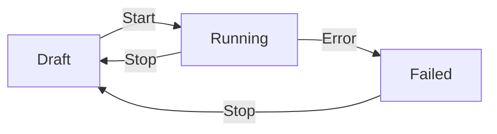

# Lesson 17.1: Pipeline Anatomy

Every pipeline in Surgewave is a directed graph of processing nodes connected by edges. Understanding the underlying data model is essential before building anything in the editor.

### PipelineDefinition

The `PipelineDefinition` record is the root object stored by the broker:

```csharp
public record PipelineDefinition
{
    public required string Id { get; init; }
    public required string Name { get; init; }
    public string? Description { get; init; }
    public required List<PipelineNode> Nodes { get; init; }
    public required List<PipelineConnection> Connections { get; init; }
    public PipelineStatus Status { get; init; }
    public DateTimeOffset CreatedAt { get; init; }
    public DateTimeOffset? UpdatedAt { get; init; }
    public string? Error { get; init; }
    public Dictionary<string, string>? Parameters { get; init; }
    public ScheduleConfig? Schedule { get; init; }
}
```

| Field | Purpose |
|-------|---------|
| `Id` | Unique pipeline identifier (e.g., `"my-etl-pipeline"`) |
| `Name` | Human-readable display name |
| `Description` | What the pipeline does |
| `Nodes` | List of processing nodes (see below) |
| `Connections` | Edges between nodes |
| `Status` | Current lifecycle state |
| `Error` | Error message if status is `Failed` |
| `Parameters` | Runtime parameter overrides |
| `Schedule` | Optional cron/interval schedule |

### PipelineNode

Each node in the graph maps to a connector class:

```csharp
public record PipelineNode
{
    public required string Id { get; init; }
    public required string ConnectorType { get; init; }
    public required Dictionary<string, string> Config { get; init; }
    public required double X { get; init; }
    public required double Y { get; init; }
    public string? Label { get; init; }
    public RetryPolicy? RetryPolicy { get; init; }
    public string? SubPipelineId { get; init; }
    public string? PortMappingsJson { get; init; }
}
```

| Field | Purpose |
|-------|---------|
| `Id` | Unique node ID within the pipeline (e.g., `"source-1"`) |
| `ConnectorType` | Fully qualified .NET type name of the connector |
| `Config` | Key-value configuration for the connector |
| `X`, `Y` | Canvas position in the visual editor |
| `Label` | Display label shown on the node |
| `RetryPolicy` | Optional retry configuration |
| `SubPipelineId` | Reference to a sub-pipeline (composite nodes) |
| `PortMappingsJson` | Port mappings for sub-pipeline nodes |

### PipelineConnection

Connections define data flow between nodes:

```csharp
public record PipelineConnection
{
    public required string Id { get; init; }
    public required string SourceNodeId { get; init; }
    public required string TargetNodeId { get; init; }
    public string? InternalTopic { get; init; }
    public PipelineConnectionType Type { get; init; } = PipelineConnectionType.Normal;
}
```

Connection types:

| Type | Description |
|------|-------------|
| `Normal` | Standard data flow connection |
| `Error` | Routes failed records to a dead-letter queue or error handler |

> **Implementation detail:** Each connection is backed by an internal Surgewave topic. The `InternalTopic` field stores the auto-generated topic name used for inter-node communication.

### Pipeline Status Lifecycle



| Status | Description |
|--------|-------------|
| `Draft` | Pipeline created but not started. Nodes can be added, removed, and configured. |
| `Running` | Pipeline is actively processing data. Connectors are started, topics are created. |
| `Stopped` | Pipeline explicitly stopped. Internal topics are preserved for restart. |
| `Failed` | A node encountered an unrecoverable error. The `Error` field contains details. |

### Creating Pipelines: Three Ways

| Method | When to Use |
|--------|-------------|
| **Visual Editor** | Interactive design, prototyping, non-developers |
| **REST API** | Automation, CI/CD, programmatic creation |
| **Templates** | Starting from proven patterns (RAG, ETL, agents) |

**REST API example** -- create a simple two-node pipeline:

```bash
curl -X POST http://localhost:5050/api/pipelines \
  -H "Content-Type: application/json" \
  -d '{
    "name": "My First Pipeline",
    "description": "Generator to console output",
    "nodes": [
      {
        "id": "gen-1",
        "connectorType": "Kuestenlogik.Surgewave.Connect.Sources.GeneratorSourceConnector",
        "config": { "interval.ms": "1000", "format": "json" },
        "x": 100, "y": 200, "label": "Generator"
      },
      {
        "id": "out-1",
        "connectorType": "Kuestenlogik.Surgewave.Connect.Sinks.StdioSinkConnector",
        "config": {},
        "x": 400, "y": 200, "label": "Console Output"
      }
    ],
    "connections": [
      { "id": "c1", "sourceNodeId": "gen-1", "targetNodeId": "out-1" }
    ]
  }'
```

---

[Back to Unit 17](../README.md)
