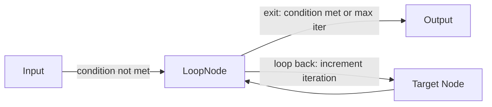
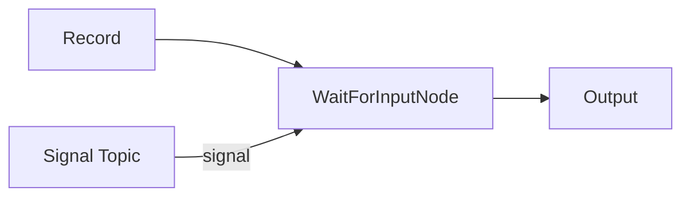
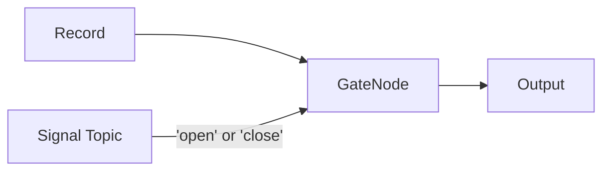
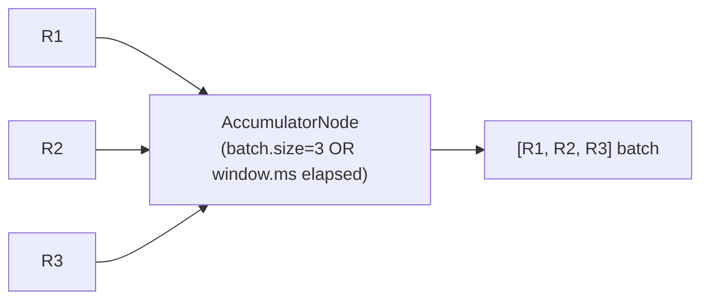
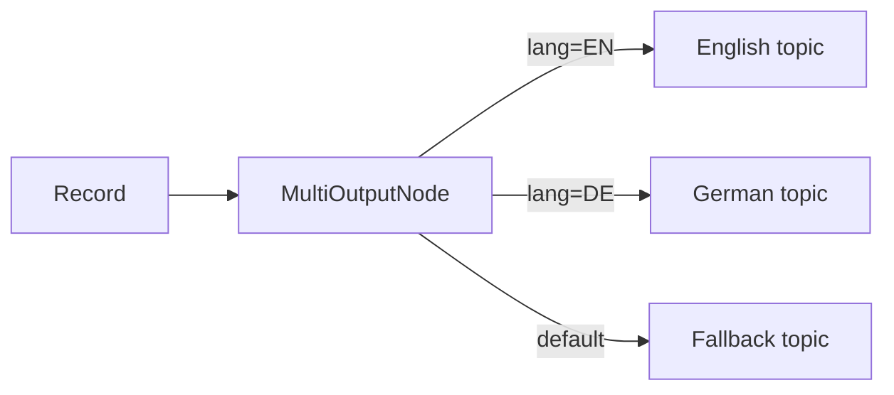

# Lesson 17.2: Node Types & Categories

Surgewave's node palette organizes connectors into categories. This lesson covers every category and its key nodes, with emphasis on the six workflow nodes.

### Source Nodes

Source nodes ingest data into the pipeline:

| Node | ConnectorType | Purpose |
|------|---------------|---------|
| File Source | `Kuestenlogik.Surgewave.Connect.Sources.FileSourceConnector` | Read files from a directory with polling |
| Generator | `Kuestenlogik.Surgewave.Connect.Sources.GeneratorSourceConnector` | Generate synthetic data for testing |
| ChatEndpoint | `Kuestenlogik.Surgewave.AI.Nodes.ChatEndpointNode` | Accept chat messages via WebSocket/HTTP |
| HTTP Source | `Kuestenlogik.Surgewave.Connect.Sources.HttpSourceConnector` | Receive HTTP webhooks |

### Sink Nodes

Sink nodes write data out of the pipeline:

| Node | ConnectorType | Purpose |
|------|---------------|---------|
| FileStream | `Kuestenlogik.Surgewave.Connect.Sinks.FileStreamSinkConnector` | Write records to files |
| Stdio | `Kuestenlogik.Surgewave.Connect.Sinks.StdioSinkConnector` | Print records to standard output |
| ChatResponse | `Kuestenlogik.Surgewave.AI.Nodes.ChatResponseNode` | Send responses back to chat clients |

### Transform Nodes

Transform nodes modify data in-flight:

| Node | ConnectorType | Purpose |
|------|---------------|---------|
| DocumentParser | `Kuestenlogik.Surgewave.AI.Nodes.DocumentParserNode` | Parse PDF/DOCX/HTML, chunk text |
| Embedder | `Kuestenlogik.Surgewave.AI.Nodes.EmbedderNode` | Generate vector embeddings |
| PromptBuilder | `Kuestenlogik.Surgewave.AI.Nodes.PromptBuilderNode` | Assemble prompts with templates |
| Reranker | `Kuestenlogik.Surgewave.AI.Nodes.RerankerNode` | Rerank retrieved documents |

### AI/ML Nodes

AI nodes provide LLM and agent capabilities:

| Node | ConnectorType | Purpose |
|------|---------------|---------|
| LLM | `Kuestenlogik.Surgewave.AI.Nodes.LlmNode` | Call OpenAI/Anthropic models |
| Agent | `Kuestenlogik.Surgewave.AI.Nodes.AgentNode` | Autonomous agent with tool access via MCP |
| Retriever | `Kuestenlogik.Surgewave.AI.Nodes.RetrieverNode` | Retrieve from vector store by similarity |

### Workflow Nodes (Detailed)

Workflow nodes control execution flow, enable human interaction, and manage state. All six workflow nodes live in the `Kuestenlogik.Surgewave.Connect.Nodes.Workflow` namespace.

#### LoopNode -- Feedback Loop

Sends records back to an earlier node until a condition is met or max iterations reached.



| Config Key | Type | Default | Description |
|------------|------|---------|-------------|
| `max.iterations` | int | `5` | Maximum loop iterations before forcing exit |
| `condition.field` | string | | JSON field to check for loop termination |
| `condition.value` | string | | Value that means "done" (exit loop) |
| `condition.operator` | string | `equals` | Comparison: `equals`, `not_equals`, `contains`, `greater_than`, `less_than` |
| `loop.topic` | string | | Topic to send records back to (loop-back path) |
| `output.topic` | string | | Topic for records that pass the condition (exit path) |
| `iteration.header` | string | `x-loop-iteration` | Header tracking iteration count |

When max iterations are exceeded, the record exits with an `x-loop-exhausted: true` header.

#### WaitForInputNode -- Human-in-the-Loop

Pauses workflow execution and waits for an external signal before continuing. Stores waiting records by correlation key and merges them with incoming signals.



| Config Key | Type | Default | Description |
|------------|------|---------|-------------|
| `signal.topic` | string | | Topic to listen for input/signals |
| `correlation.field` | string | | Field to correlate input with waiting record (e.g., `session_id`) |
| `timeout.ms` | long | `300000` | How long to wait before timeout (default 5 minutes) |
| `timeout.action` | string | `emit_timeout` | Action on timeout: `emit_timeout`, `drop`, `emit_error` |
| `merge.strategy` | string | `combine` | How to merge original + input: `combine`, `replace`, `append` |
| `output.topic` | string | | Output topic after input received |

Merge strategies:
- **combine**: Merge JSON properties from both records (signal properties overwrite originals)
- **replace**: Discard original, use only the signal record
- **append**: Add signal under `_input` key in the original record

#### GateNode -- Flow Control

Opens or closes the data flow based on an external signal. When closed, records can be buffered or dropped.



| Config Key | Type | Default | Description |
|------------|------|---------|-------------|
| `signal.topic` | string | | Topic for open/close signals |
| `default.state` | string | `open` | Initial gate state: `open` or `closed` |
| `buffer.when.closed` | bool | `true` | Buffer records when gate is closed, or drop them |
| `max.buffer.size` | int | `1000` | Maximum buffered records when gate is closed |
| `output.topic` | string | | Output topic for records passing through the gate |

When the gate opens, all buffered records are flushed in order.

#### AccumulatorNode -- Batch Processing

Collects records into batches by count or time window, then emits them as a single batch. Supports grouping by a field value for separate accumulators per group.



| Config Key | Type | Default | Description |
|------------|------|---------|-------------|
| `batch.size` | int | `10` | Records per batch before emitting |
| `window.ms` | long | `5000` | Time window in ms (emit even if batch not full) |
| `output.topic` | string | | Output topic for accumulated batches |
| `output.format` | string | `array` | Output format: `array` (JSON array) or `individual` (separate records with batch headers) |
| `group.by.field` | string | | Group into separate batches by field value |

Emitted batch headers include `x-batch-size` and `x-batch-timestamp`.

#### MultiOutputNode -- Conditional Routing

Routes records to multiple named output ports based on field values, or broadcasts to all routes in fan-out mode.



| Config Key | Type | Default | Description |
|------------|------|---------|-------------|
| `route.field` | string | | JSON field to evaluate for routing |
| `route.N.value` | string | | Value for route N (1-10) |
| `route.N.topic` | string | | Output topic for route N |
| `default.topic` | string | | Default output for unmatched records |
| `broadcast` | bool | `false` | If true, send to ALL routes (fan-out) |

Supports up to 10 named routes with a default fallback.

#### StateNode -- Persistent Key-Value State

Reads and writes persistent key-value state within a workflow. Maintains an in-memory cache backed by a compacted topic for persistence. Supports TTL-based expiry.

```mermaid
graph LR
    Record["Record"] --> SN["StateNode"]
    SN --> Output["Output"]
    SN <-->|read/write\n(bootstrap on restart)| ST["State Topic\n(compacted)"]
```

| Config Key | Type | Default | Description |
|------------|------|---------|-------------|
| `state.topic` | string | | Compacted topic for state storage |
| `operation` | string | `read_write` | Mode: `read`, `write`, or `read_write` |
| `key.field` | string | | JSON field for state key |
| `value.field` | string | | JSON field for state value (write) |
| `output.field` | string | `state` | Field to put read state into |
| `output.topic` | string | | Output topic for processed records |
| `ttl.ms` | long | `0` | State entry TTL in ms (0 = no expiry) |

In `read_write` mode, the node reads existing state first, then writes the updated value, and emits the record with the previous state merged in.

### Extended Connector Metadata

Every connector is annotated with a `ConnectorMetadata` attribute that provides rich metadata for the UI:

```csharp
[ConnectorMetadata(
    DisplayName = "Elasticsearch Sink",
    Icon = "search",
    Category = "Search",
    Description = "Indexes documents into Elasticsearch")]
public class ElasticsearchSinkConnector : ISinkConnector { ... }
```

The `DisplayName`, `Icon`, and `Category` fields determine how the connector appears in the Node Palette. When browsing connectors, this metadata lets you quickly identify connectors by visual category rather than scanning raw type names.

### Discovering Available Nodes

In the Pipeline Editor, the left sidebar shows the **Node Palette** organized by category. The palette aggregates both local connectors (loaded from the broker's plugin directory) and remote connectors (advertised by connected worker nodes). You can also query available connector types programmatically:

```bash
# List all available connector types
curl http://localhost:5050/api/connectors

# Response includes ConnectorType, DisplayName, Description, Category, Icon for each
```

---

[Back to Unit 17](../README.md)
