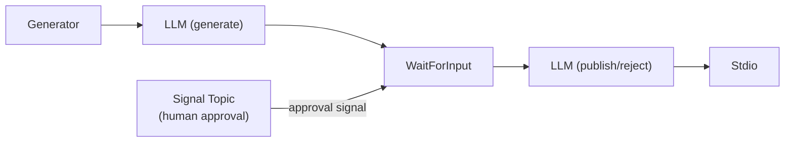
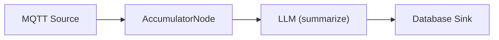
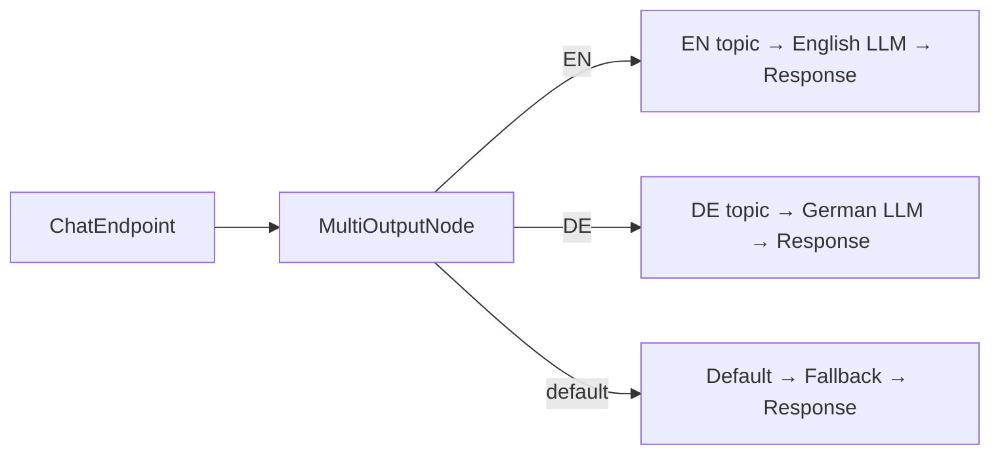
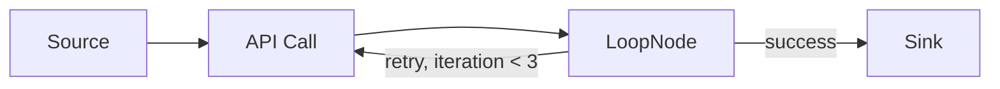
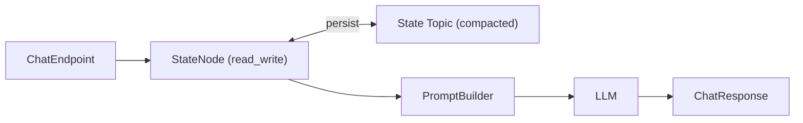

# Lesson 17.6: Workflow Patterns

Workflow nodes enable complex orchestration patterns that go beyond simple linear pipelines. This lesson demonstrates five production-ready patterns.

### Pattern 1: Human-in-the-Loop (Approval Flow)

Use `WaitForInputNode` to pause processing and wait for human review.

**Example: Content Moderation Pipeline**



**WaitForInput configuration:**

| Setting | Value |
|---------|-------|
| `signal.topic` | `moderation-approvals` |
| `correlation.field` | `content_id` |
| `timeout.ms` | `3600000` (1 hour) |
| `timeout.action` | `emit_timeout` |
| `merge.strategy` | `combine` |

**How it works:**

1. LLM generates content, each record includes a `content_id` field
2. WaitForInput stores the record and waits
3. A human reviewer sends an approval signal to the `moderation-approvals` topic:
   ```json
   { "content_id": "abc123", "decision": "approved", "reviewer": "jane" }
   ```
4. WaitForInput matches by `content_id`, merges the decision, and emits downstream
5. If no response within 1 hour, emits with `x-wait-timeout: true` header

### Pattern 2: Batch Processing (Time/Count Windows)

Use `AccumulatorNode` to collect records into batches for efficient processing.

**Example: Aggregate Sensor Readings Every 5 Minutes**



**Accumulator configuration:**

| Setting | Value |
|---------|-------|
| `batch.size` | `100` |
| `window.ms` | `300000` (5 minutes) |
| `output.format` | `array` |
| `group.by.field` | `sensor_id` |

**How it works:**

1. Sensor readings arrive continuously from MQTT
2. AccumulatorNode groups them by `sensor_id`
3. When 100 readings accumulate OR 5 minutes pass (whichever comes first), the batch emits as a JSON array
4. The LLM summarizes the batch, and the result is stored in the database

### Pattern 3: Conditional Routing (Multi-Language Router)

Use `MultiOutputNode` to route records to different processing paths based on content.

**Example: Route by Language (EN/DE/FR)**



**MultiOutput configuration:**

| Setting | Value |
|---------|-------|
| `route.field` | `language` |
| `route.1.value` | `en` |
| `route.1.topic` | `pipeline-lang-en` |
| `route.2.value` | `de` |
| `route.2.topic` | `pipeline-lang-de` |
| `route.3.value` | `fr` |
| `route.3.topic` | `pipeline-lang-fr` |
| `default.topic` | `pipeline-lang-fallback` |

For fan-out (broadcast to all routes), set `broadcast` to `true`.

### Pattern 4: Retry Loop (Error Recovery)

Use `LoopNode` to retry failed operations with a maximum iteration count.

**Example: Retry Failed API Calls Up to 3 Times**



**LoopNode configuration:**

| Setting | Value |
|---------|-------|
| `max.iterations` | `3` |
| `condition.field` | `status` |
| `condition.value` | `success` |
| `condition.operator` | `equals` |
| `loop.topic` | `pipeline-retry-input` |
| `output.topic` | `pipeline-retry-output` |

**How it works:**

1. API call processes the record, setting `status` to `success` or `error`
2. LoopNode checks: if `status == "success"`, emit to output (exit loop)
3. If `status != "success"` and iterations < 3, send back to `loop.topic` with incremented `x-loop-iteration` header
4. If iterations reach 3, force exit with `x-loop-exhausted: true` header

### Pattern 5: Stateful Processing (Session Tracking)

Use `StateNode` to maintain persistent state across records.

**Example: Count User Interactions Per Session**



**StateNode configuration:**

| Setting | Value |
|---------|-------|
| `state.topic` | `session-state` |
| `operation` | `read_write` |
| `key.field` | `session_id` |
| `value.field` | `interaction_count` |
| `output.field` | `state` |
| `ttl.ms` | `86400000` (24 hours) |

**How it works:**

1. Each chat message includes a `session_id`
2. StateNode reads the existing state for that session (e.g., `{"interaction_count": 5}`)
3. Writes the updated count back to the compacted state topic
4. Merges the previous state into the record under the `state` field
5. The PromptBuilder can use `{{state.interaction_count}}` in the template
6. On broker restart, state is restored from the compacted topic
7. Entries older than 24 hours are automatically expired via TTL

---

[Back to Unit 17](../README.md)
