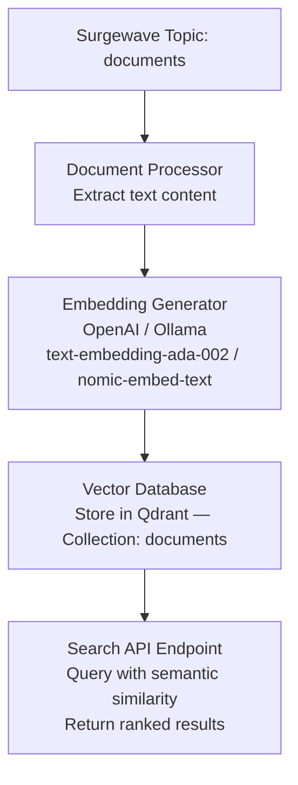
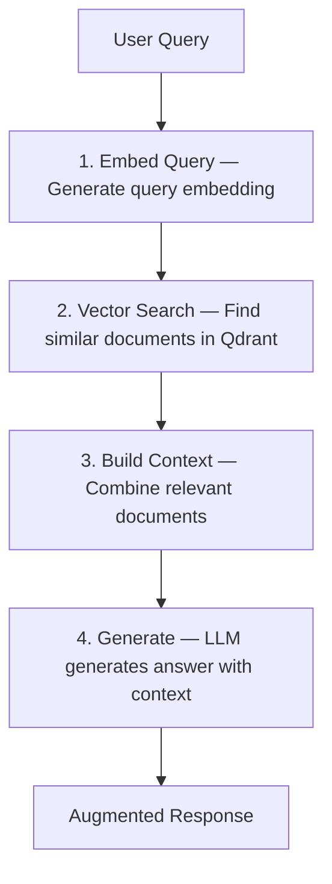

# Unit 18: AI/LLM Integration

Master the integration of AI and Large Language Models with Surgewave to build intelligent event-driven applications that leverage embeddings, vector databases, and semantic search capabilities.

## Learning Objectives

By the end of this unit, you will be able to:

- Generate embeddings using OpenAI and local Ollama models
- Store and query vectors in Qdrant vector database
- Build RAG (Retrieval-Augmented Generation) pipelines
- Implement semantic search across document streams
- Design AI-enhanced event processing architectures
- Run ONNX model inference inline in Surgewave pipelines

## Lessons

| Lesson | Topic | Description |
|--------|-------|-------------|
| [22.1](lesson-1/README.md) | OpenAI Embeddings | Generate embeddings from text using OpenAI API via Surgewave |
| [22.2](lesson-2/README.md) | Ollama Local LLM | Use local LLMs for private/offline AI inference |
| [22.3](lesson-3/README.md) | Vector Databases | Store and query embeddings with Qdrant |
| [22.4](lesson-4/README.md) | RAG Pipeline Architecture | Build retrieval-augmented generation pipelines |
| [22.5](lesson-5/README.md) | Semantic Search | Implement intelligent document search with embeddings |
| [22.6](lesson-6/README.md) | ONNX ML Scoring | Embed real-time ML inference into pipelines using ONNX models |

## Prerequisites

- Completed Unit 1: Surgewave Fundamentals
- Completed Unit 2: Producer & Consumer Basics
- Basic understanding of machine learning concepts
- OpenAI API key (for lesson 1) or Ollama installed (for lesson 2)

## Why AI Integration Matters

| | Traditional Search | Semantic Search (AI-Enhanced) |
|---|---|---|
| Query | "car problems" | "car problems" |
| Matches | Documents containing exact words "car" AND "problems" | All semantically similar documents |
| Misses | "automobile issues", "vehicle trouble", "auto defects" | Nothing — understands context and meaning |

## AI Integration Architecture Overview



## Key Concepts

### Embeddings

Embeddings are dense vector representations of text that capture semantic meaning:

```csharp
// Text -> Embedding (vector of floats)
"The quick brown fox" -> [0.023, -0.145, 0.892, ..., 0.034]  // 1536 dimensions

// Similar texts have similar embeddings
var similarity = CosineSimilarity(embedding1, embedding2);  // 0.0 to 1.0
```

### Vector Similarity

| Metric | Measures | Range | Best For |
|--------|---------|-------|----------|
| Cosine Similarity | Angle between vectors | −1 to 1 (normalized: 0 to 1) | Text similarity, semantic search |
| Euclidean Distance | Straight-line distance | 0 to ∞ (lower = more similar) | When magnitude matters |
| Dot Product | Raw multiplication of vectors | −∞ to ∞ | Pre-normalized embeddings |

### RAG (Retrieval-Augmented Generation)



## Embedding Models Comparison

| Model | Provider | Dimensions | Speed | Cost | Best For |
|-------|----------|------------|-------|------|----------|
| text-embedding-ada-002 | OpenAI | 1536 | Fast | $0.0001/1K tokens | Production, high quality |
| text-embedding-3-small | OpenAI | 1536 | Fast | $0.00002/1K tokens | Cost-effective |
| text-embedding-3-large | OpenAI | 3072 | Medium | $0.00013/1K tokens | Maximum accuracy |
| nomic-embed-text | Ollama | 768 | Medium | Free (local) | Privacy, offline |
| all-MiniLM-L6-v2 | Local | 384 | Very Fast | Free (local) | Edge deployment |

## Best Practices

| Practice | Description |
|----------|-------------|
| Batch embeddings | Generate embeddings in batches to reduce API calls |
| Cache embeddings | Store generated embeddings to avoid regeneration |
| Chunk large documents | Split documents into smaller chunks for better retrieval |
| Use metadata | Store document metadata alongside vectors for filtering |
| Monitor costs | Track embedding API usage to manage costs |
| Handle rate limits | Implement retry logic for API rate limits |

## Tools Required

| Tool | Purpose | Installation |
|------|---------|--------------|
| OpenAI API | Cloud embeddings | Get API key from platform.openai.com |
| Ollama | Local LLM inference | Download from ollama.ai |
| Qdrant | Vector database | Docker: `docker run -p 6333:6333 qdrant/qdrant` |

---

**Ready?** [Start Lesson 22.1: OpenAI Embeddings](lesson-1/README.md)
