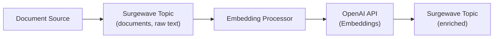
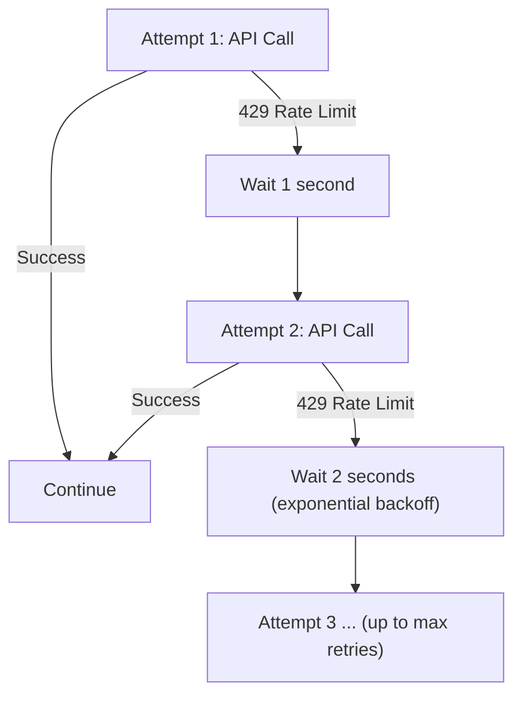

# Lesson 22.1: OpenAI Embeddings with Surgewave

## Overview

Learn how to generate text embeddings using the OpenAI API and process them through Surgewave topics. Embeddings are the foundation of modern AI-powered search and similarity applications.

## Learning Objectives

- Understand what embeddings are and why they're useful
- Generate embeddings using OpenAI's text-embedding API
- Stream documents through Surgewave and enrich with embeddings
- Calculate similarity between text embeddings
- Handle API rate limits and errors gracefully

## What Are Embeddings?

Embeddings are numerical representations of text that capture semantic meaning:

Input text is mapped to a high-dimensional vector: `"The cat sat on the mat"` → `[0.023, -0.145, 0.892, ...]` (1536 floating-point values).

Similar texts produce similar embeddings:

| Text A | Text B | Cosine Similarity |
|--------|--------|-------------------|
| "The cat sat on the mat" | "A feline rested on the rug" | 0.92 (very similar) |
| "The cat sat on the mat" | "Stock prices rose today" | 0.21 (not similar) |

## Embedding Generation Flow



## OpenAI Embedding Models

| Model | Dimensions | Max Input | Cost | Use Case |
|-------|------------|-----------|------|----------|
| text-embedding-ada-002 | 1536 | 8191 tokens | $0.0001/1K | Legacy, widely used |
| text-embedding-3-small | 1536 | 8191 tokens | $0.00002/1K | Cost-effective |
| text-embedding-3-large | 3072 | 8191 tokens | $0.00013/1K | Maximum accuracy |

## Cosine Similarity

The most common metric for comparing embeddings:

```csharp
public static double CosineSimilarity(float[] a, float[] b)
{
    double dotProduct = 0, normA = 0, normB = 0;

    for (int i = 0; i < a.Length; i++)
    {
        dotProduct += a[i] * b[i];
        normA += a[i] * a[i];
        normB += b[i] * b[i];
    }

    return dotProduct / (Math.Sqrt(normA) * Math.Sqrt(normB));
}
```

| Score Range | Interpretation |
|-------------|----------------|
| 0.90 – 1.00 | Nearly identical meaning |
| 0.75 – 0.90 | Very similar, related topics |
| 0.50 – 0.75 | Somewhat related |
| 0.25 – 0.50 | Loosely related |
| 0.00 – 0.25 | Unrelated |

## API Configuration

```csharp
// Set your OpenAI API key
Environment.SetEnvironmentVariable("OPENAI_API_KEY", "sk-...");

// Or use configuration
var embeddingClient = new OpenAIEmbeddingClient(new OpenAIEmbeddingOptions
{
    ApiKey = configuration["OpenAI:ApiKey"],
    Model = "text-embedding-3-small",
    MaxRetries = 3,
    TimeoutSeconds = 30
});
```

## Handling Rate Limits



## Best Practices

| Practice | Description |
|----------|-------------|
| Batch requests | Send multiple texts in one API call (up to 2048) |
| Cache embeddings | Store embeddings to avoid regenerating |
| Validate input | Ensure text doesn't exceed token limits |
| Handle errors | Implement retry logic with exponential backoff |
| Monitor usage | Track API calls and costs |

## Exercise

In this exercise, you will:

1. Set up an OpenAI embedding client
2. Stream documents through Surgewave
3. Generate embeddings for each document
4. Calculate similarity between documents
5. Find semantically similar content

---

**Instructions:** [INSTRUCTIONS.md](INSTRUCTIONS.md)
