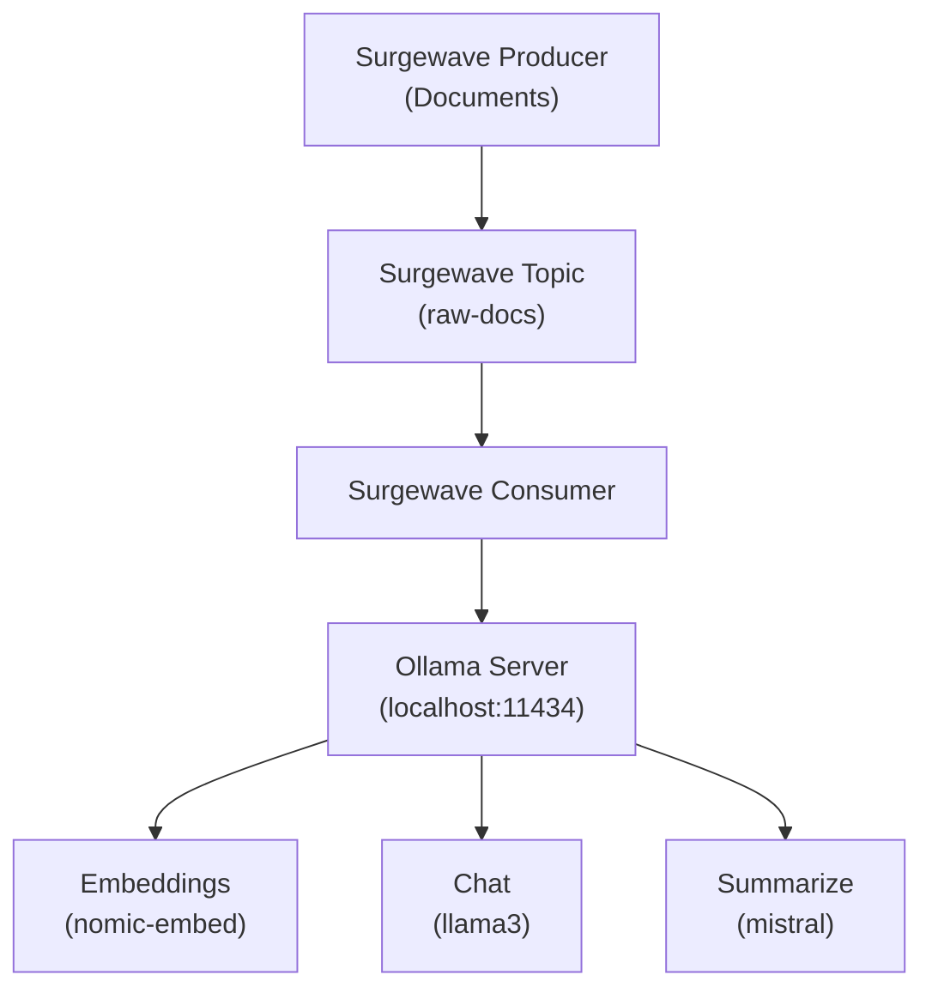

# Lesson 22.2: Ollama Local LLM Integration

## Overview

Learn how to use Ollama for local LLM inference, enabling private AI processing without sending data to external APIs. This is essential for sensitive data, offline environments, and cost-effective AI applications.

## Learning Objectives

- Set up Ollama for local LLM inference
- Generate embeddings using local models
- Process chat completions locally
- Stream LLM responses through Surgewave topics
- Compare local vs cloud AI trade-offs

## Why Local LLMs?

| | Cloud LLMs (OpenAI, Anthropic, etc.) | Local LLMs (Ollama) |
|-|--------------------------------------|---------------------|
| **Pros** | State-of-the-art performance; no infrastructure to manage; always up-to-date | Data never leaves your network; no per-request costs; works offline; no rate limits |
| **Cons** | Data leaves your network; per-token costs add up; internet dependency; rate limits | Requires local compute (GPU recommended); smaller models = less capability; you manage infrastructure |

## Ollama Architecture



## Popular Ollama Models

| Model | Type | Size | Use Case |
|-------|------|------|----------|
| nomic-embed-text | Embedding | 274M | Text embeddings (768 dims) |
| all-minilm | Embedding | 45M | Fast, small embeddings (384 dims) |
| llama3:8b | Chat | 4.7GB | General purpose, high quality |
| llama3:70b | Chat | 40GB | Maximum capability |
| mistral:7b | Chat | 4.1GB | Fast, efficient responses |
| codellama:7b | Chat | 3.8GB | Code generation |
| phi3:mini | Chat | 2.2GB | Lightweight, edge deployment |

## Ollama API Endpoints

| Endpoint | Request | Response |
|----------|---------|----------|
| `POST /api/embeddings` | `{ "model": "nomic-embed-text", "prompt": "text..." }` | `{ "embedding": [0.1, -0.2, ...] }` |
| `POST /api/generate` | `{ "model": "llama3", "prompt": "..." }` | `{ "response": "Generated text..." }` |
| `POST /api/chat` | `{ "model": "llama3", "messages": [...] }` | `{ "message": { "content": "..." } }` |

## Installing Ollama

```bash
# Windows (via installer)
# Download from https://ollama.ai

# macOS
brew install ollama

# Linux
curl -fsSL https://ollama.ai/install.sh | sh

# Pull models
ollama pull nomic-embed-text
ollama pull llama3:8b
ollama pull mistral:7b
```

## Best Practices

| Practice | Description |
|----------|-------------|
| Pre-pull models | Download models before running applications |
| Use appropriate model size | Smaller models for speed, larger for quality |
| Batch requests | Group multiple documents for efficiency |
| Monitor memory | LLMs consume significant RAM/VRAM |
| Implement timeouts | Local inference can be slow without GPU |
| Use streaming | Stream long responses for better UX |

## Exercise

In this exercise, you will:

1. Connect to a local Ollama instance
2. Generate embeddings using nomic-embed-text
3. Stream documents through Surgewave for AI enrichment
4. Use local LLM for text summarization
5. Compare performance with cloud APIs

---

**Instructions:** [INSTRUCTIONS.md](INSTRUCTIONS.md)
