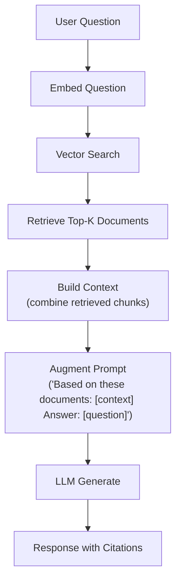

# Lesson 22.4: RAG Pipeline Architecture

## Overview

Learn how to build a Retrieval-Augmented Generation (RAG) pipeline that combines vector search with LLM generation to create intelligent, context-aware AI applications.

## Learning Objectives

- Understand RAG architecture and its benefits
- Build document chunking strategies
- Implement context retrieval from vector stores
- Augment LLM prompts with retrieved context
- Handle context window limitations

## What is RAG?

**Problems with vanilla LLMs:** knowledge cutoff date; no access to private/proprietary data; hallucinations on unknown topics; can't cite sources.

**RAG solution:**
1. Store your documents in a vector database
2. When a user asks a question, retrieve relevant documents
3. Include retrieved documents in the LLM prompt as context
4. LLM generates an answer based on your actual data

## RAG Pipeline Architecture



## Document Chunking Strategies

| Strategy | Description | Pros | Cons |
|----------|-------------|------|------|
| Fixed-Size | Split text into chunks of N tokens/characters | Simple, predictable chunk sizes | May split sentences/concepts mid-way |
| Semantic | Split at natural boundaries (paragraphs, sections) | Preserves context and meaning | Variable chunk sizes |
| Overlapping | Chunks overlap by N tokens to preserve context at boundaries | Better retrieval at chunk boundaries | Increased storage, potential duplicates |
| Hierarchical | Multiple levels: document → section → paragraph | Retrieval at appropriate granularity | More complex to implement |

## Context Window Management

| Model | Context Window | Recommended Context |
|-------|----------------|---------------------|
| GPT-3.5-turbo | 4,096 tokens | ~3,000 tokens |
| GPT-4 | 8,192 tokens | ~6,000 tokens |
| GPT-4-turbo | 128,000 tokens | ~100,000 tokens |
| Claude 3 | 200,000 tokens | ~150,000 tokens |
| Llama 3 8B | 8,192 tokens | ~6,000 tokens |

## RAG Prompt Template

**System prompt:** "You are a helpful assistant that answers questions based on the provided context. If the answer is not in the context, say 'I don't have information about that.'"

**Context section:**
```
Here are relevant documents:

[Document 1: Title]
Content of document 1...

[Document 2: Title]
Content of document 2...
```

**User question:** "Based on the above context, please answer: {user_question}"

## Best Practices

| Practice | Description |
|----------|-------------|
| Chunk size matters | 256-512 tokens works well for most use cases |
| Use overlap | 10-20% overlap prevents context loss at boundaries |
| Retrieve more, use less | Retrieve top-10, use top-3-5 for context |
| Include metadata | Add source, date, and relevance to chunks |
| Handle no-results | Have fallback when no relevant docs found |
| Cite sources | Include document references in answers |

## Exercise

In this exercise, you will:

1. Implement document chunking
2. Build a context retrieval pipeline
3. Create augmented prompts
4. Generate answers with citations
5. Handle edge cases

---

**Instructions:** [INSTRUCTIONS.md](INSTRUCTIONS.md)
