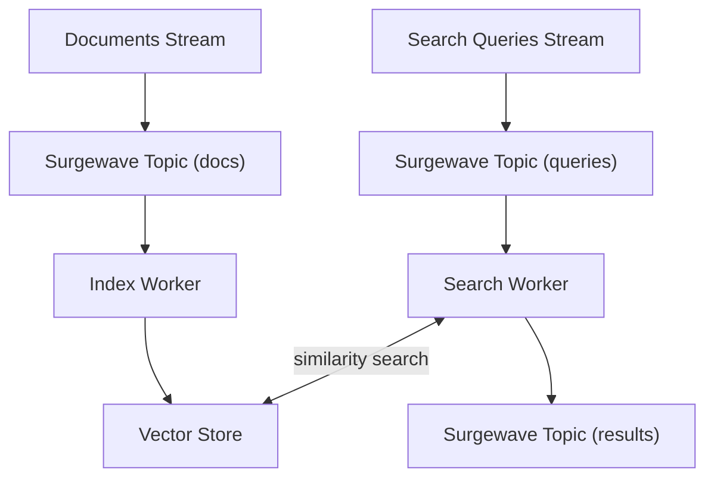
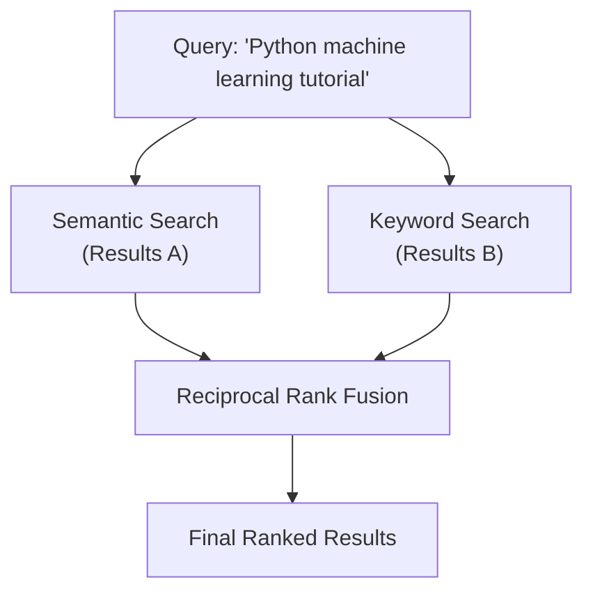

# Lesson 22.5: Semantic Search Implementation

## Overview

Build a complete semantic search system that goes beyond keyword matching to find documents based on meaning and context. This lesson brings together all the AI concepts from the unit into a production-ready search implementation.

## Learning Objectives

- Build end-to-end semantic search pipelines
- Implement hybrid search (semantic + keyword)
- Handle search ranking and relevance scoring
- Optimize search performance
- Build real-time search with Surgewave

## Semantic vs Keyword Search

Query: `"how to fix automobile problems"`

| Result | Keyword Search | Semantic Search |
|--------|---------------|-----------------|
| "Automobile repair guide" | Found (matches "automobile") | Found (semantic + keyword) |
| "Fix your plumbing problems" | Found (matches "fix", "problems") | Lower rank (different domain) |
| "Car troubleshooting tips" | Missed (no keyword match) | Found (semantic similarity) |
| "Vehicle maintenance guide" | Missed (no keyword match) | Found (semantic similarity) |

## Search Architecture

## Hybrid Search Strategy

## Relevance Scoring

| Component | Weight | Description |
|-----------|--------|-------------|
| Semantic Score | 0.7 | Cosine similarity of embeddings |
| Keyword Score | 0.2 | BM25 or TF-IDF match |
| Recency Boost | 0.1 | Newer documents ranked higher |
| Click-through | Variable | User engagement signals |

## Search Optimizations

| Optimization | Techniques |
|-------------|------------|
| **Query Caching** | Cache embeddings for frequent queries; cache search results with TTL; use LRU eviction for bounded memory |
| **Index Optimization** | Use HNSW with appropriate ef and m parameters; partition large indices by category/date; pre-filter with metadata before vector search |
| **Batch Processing** | Batch embedding generation; batch vector upserts; process multiple queries in parallel |

## Search Quality Metrics

| Metric | Description | Target |
|--------|-------------|--------|
| P@10 | Precision at 10 results | > 0.8 |
| MRR | Mean Reciprocal Rank | > 0.7 |
| NDCG | Normalized DCG | > 0.85 |
| Latency P50 | 50th percentile latency | < 100ms |
| Latency P99 | 99th percentile latency | < 500ms |

## Best Practices

| Practice | Description |
|----------|-------------|
| Use query expansion | Add synonyms to improve recall |
| Implement re-ranking | Use cross-encoder for top results |
| Handle typos | Add fuzzy matching fallback |
| Monitor search quality | Log queries and clicks for analysis |
| A/B test changes | Measure impact of algorithm changes |
| Cache strategically | Balance freshness vs performance |

## Exercise

In this exercise, you will:

1. Build a complete semantic search service
2. Implement real-time document indexing
3. Create a search API with Surgewave
4. Add hybrid search capabilities
5. Measure and optimize performance

---

**Instructions:** [INSTRUCTIONS.md](INSTRUCTIONS.md)
