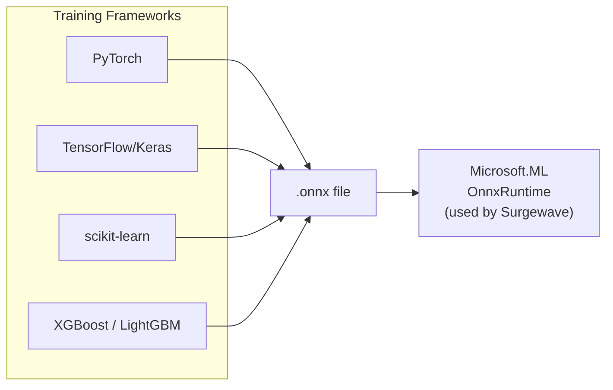
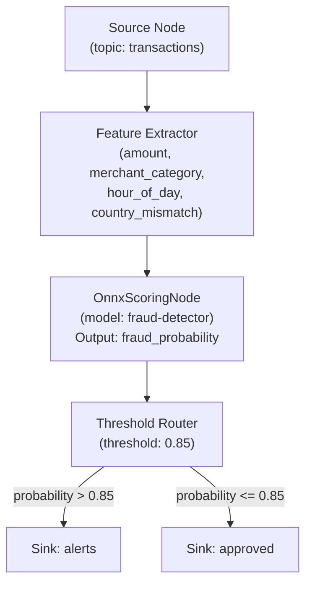

# Lesson 22.6: ONNX ML Scoring in Pipelines

> **Difficulty:** Intermediate | **Duration:** 40 min | **Prerequisites:** Lesson 22.5

## Overview

Learn how to embed real-time machine learning inference directly into Surgewave pipelines using the Open Neural Network Exchange (ONNX) format. By the end of this lesson you will load ONNX models, score incoming messages in-pipeline with sub-millisecond overhead, and expose model management through the REST API — all without leaving the Surgewave ecosystem.

## Learning Objectives

- Understand what ONNX is and why it is ideal for real-time inference
- Load and manage ONNX models with `OnnxModelManager`
- Add an `OnnxScoringNode` to a pipeline for inline scoring
- Call the ML REST API to upload, list, and remove models
- Build a fraud detection pipeline as a worked example
- Tune thread pool and batch size settings for throughput

## What Is ONNX?

ONNX (Open Neural Network Exchange) is an open standard for representing machine learning models. You train a model in any framework — PyTorch, TensorFlow, scikit-learn, XGBoost — export it to the `.onnx` file format, and then run inference in any ONNX-compatible runtime without the original framework installed.



Benefits for Surgewave: no Python dependency at inference time; consistent performance (SIMD, AVX2 optimizations); hot-swap models without restarting the broker; portable — same `.onnx` file works on Windows, Linux, ARM.

Surgewave uses `Microsoft.ML.OnnxRuntime` to run inference inside the broker process, avoiding network round-trips to a separate scoring service.

## OnnxModelManager

The `OnnxModelManager` handles the full lifecycle of ONNX models:

| Operation | Description |
|-----------|-------------|
| **Load** | `ReadAllBytes(path)` → `InferenceSession(bytes)`; registered under a name key for lookup by pipeline nodes |
| **Score** | Build `NamedOnnxValue[]` from message payload; `session.Run(inputs)` → extract output tensor, map to result object |
| **Unload** | Dispose `InferenceSession`, remove from registry; new requests immediately return `ModelNotFound` |
| **Hot-Reload** | Load new version under same name; old session disposed atomically |

### Loading a Model in Code

```csharp
// Injected via DI (registered by AddSurgewaveMl())
public class FraudDetectionService(OnnxModelManager modelManager)
{
    public async Task InitializeAsync()
    {
        // Load from file path
        await modelManager.LoadModelAsync(
            name: "fraud-detector",
            path: "/models/fraud_v2.onnx");

        // Or load from bytes (e.g., fetched from blob storage)
        byte[] modelBytes = await DownloadModelAsync();
        await modelManager.LoadModelAsync("fraud-detector", modelBytes);
    }
}
```

## OnnxScoringNode in a Pipeline

The `OnnxScoringNode` is a transform node you can drop into any pipeline. It reads a message, extracts feature values, runs the ONNX model, and emits an enriched message containing the score:



### Pipeline Definition

```csharp
var pipeline = new PipelineDefinition
{
    Name = "fraud-detection",
    Nodes =
    [
        new SourceNodeConfig
        {
            NodeId     = "tx-source",
            Topic      = "transactions",
            Deserializer = "json"
        },
        new OnnxScoringNodeConfig
        {
            NodeId    = "fraud-scorer",
            ModelName = "fraud-detector",
            Inputs    = ["tx-source"],
            // Map message fields -> ONNX input tensor names
            FeatureMap = new Dictionary<string, string>
            {
                ["amount"]              = "feature_0",
                ["merchant_category"]   = "feature_1",
                ["hour_of_day"]         = "feature_2",
                ["country_mismatch"]    = "feature_3"
            },
            OutputField = "fraud_probability"
        },
        new ThresholdRouterNodeConfig
        {
            NodeId    = "router",
            Inputs    = ["fraud-scorer"],
            Field     = "fraud_probability",
            Threshold = 0.85f,
            AboveRoute = "alerts-sink",
            BelowRoute = "approved-sink"
        },
        new SinkNodeConfig { NodeId = "alerts-sink",   Topic = "alerts",   Inputs = ["router"] },
        new SinkNodeConfig { NodeId = "approved-sink",  Topic = "approved",  Inputs = ["router"] }
    ]
};
```

### OnnxScoringNodeConfig Options

| Property | Type | Description |
|----------|------|-------------|
| `ModelName` | `string` | Name of the loaded model in `OnnxModelManager` |
| `FeatureMap` | `Dictionary<string,string>` | Maps message field names to ONNX input tensor names |
| `OutputField` | `string` | Name of the field added to the output message |
| `BatchSize` | `int` | Number of messages batched for a single inference call (default 1) |
| `TimeoutMs` | `int` | Max inference time before the message is forwarded un-scored (default 50) |

## REST API Reference

The ML REST API lives at `/api/ml`:

| Method | Endpoint | Description |
|--------|----------|-------------|
| `GET` | `/api/ml/models` | List all loaded models with metadata |
| `POST` | `/api/ml/models/{name}` | Upload and register an ONNX model by name |
| `DELETE` | `/api/ml/models/{name}` | Unload and remove a model |
| `POST` | `/api/ml/models/{name}/score` | Run a single inference (for testing) |
| `GET` | `/api/ml/models/{name}/info` | Input/output tensor shapes and types |

### Upload a Model

```bash
curl -X POST http://localhost:9092/api/ml/models/fraud-detector \
     -H "Content-Type: application/octet-stream" \
     --data-binary @fraud_v2.onnx
```

```json
{ "name": "fraud-detector", "status": "loaded", "sizeBytes": 2097152 }
```

### Test a Single Inference

```bash
curl -X POST http://localhost:9092/api/ml/models/fraud-detector/score \
     -H "Content-Type: application/json" \
     -d '{
           "feature_0": 4999.99,
           "feature_1": 7,
           "feature_2": 3,
           "feature_3": 1
         }'
```

```json
{
  "model": "fraud-detector",
  "outputs": { "fraud_probability": 0.9231 },
  "latencyMicroseconds": 380
}
```

### List Loaded Models

```bash
curl http://localhost:9092/api/ml/models
```

```json
[
  {
    "name": "fraud-detector",
    "loadedAt": "2026-03-22T08:00:00Z",
    "sizeBytes": 2097152,
    "inputTensors": ["feature_0","feature_1","feature_2","feature_3"],
    "outputTensors": ["fraud_probability"],
    "inferenceCount": 1482300,
    "avgLatencyMicroseconds": 342
  }
]
```

## Configuration

```json
{
  "Surgewave": {
    "ML": {
      "Enabled": true,
      "ModelsDirectory": "/models",
      "MaxLoadedModels": 20,
      "InferenceThreads": 4,
      "DefaultTimeoutMs": 50
    }
  }
}
```

| Setting | Default | Description |
|---------|---------|-------------|
| `Enabled` | `false` | Enable the ML subsystem |
| `ModelsDirectory` | `models/` | Directory scanned for `.onnx` files at startup |
| `MaxLoadedModels` | `20` | Hard limit on simultaneously loaded models |
| `InferenceThreads` | `Environment.ProcessorCount / 2` | Thread pool size for inference |
| `DefaultTimeoutMs` | `50` | Inference timeout after which the message passes through un-scored |

## Exporting a scikit-learn Model to ONNX

```python
from sklearn.ensemble import GradientBoostingClassifier
from skl2onnx import convert_sklearn
from skl2onnx.common.data_types import FloatTensorType
import numpy as np

# Train your model (abbreviated)
clf = GradientBoostingClassifier()
clf.fit(X_train, y_train)

# Export to ONNX (4 float32 input features)
initial_type = [("float_input", FloatTensorType([None, 4]))]
onnx_model = convert_sklearn(clf, initial_types=initial_type)

with open("fraud_v2.onnx", "wb") as f:
    f.write(onnx_model.SerializeToString())
```

## Performance Characteristics

| Scenario | Throughput | Latency P50 | Notes |
|----------|-----------|-------------|-------|
| Gradient boosting (4 features) | 500k msg/s | 340 µs | Single thread |
| Neural net (128 hidden units) | 120k msg/s | 1.2 ms | SIMD accelerated |
| BatchSize=32 (boosting) | 8M msg/s | 4 ms total | 125 µs per message |

## Exercise

In this exercise, you will:

1. Download or train a simple ONNX model (a pre-trained fraud model is provided in `assets/fraud_v2.onnx`)
2. Upload the model via the REST API
3. Define a pipeline that scores transactions from the `transactions` topic
4. Produce 1,000 synthetic transactions with varying fraud signals
5. Observe routed messages in the `alerts` and `approved` topics
6. Call the `/api/ml/models/fraud-detector` info endpoint to inspect tensor shapes

---
